::: {.callout-note}
This document is best viewed in a web browser.
:::

# Overview

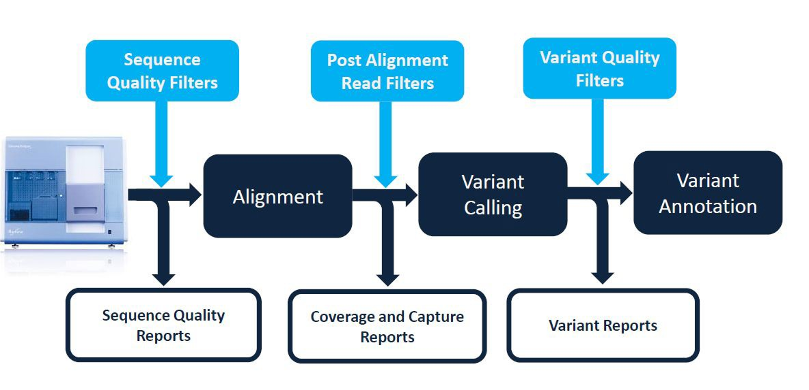{#fig-1}

**The basic analysis of NGS data for clinical genetics involves the following steps:**

- quality control
- alignment (read mapping)
- variant calling
- variant annotation
- variant prioritisation
- reporting

It is essential to assess data quality and performance at each step.

**At the end of this workshop you will be able to:**

1. Use the Galaxy suite of bioinformatic tools
2. Assess the quality of raw NGS data in FASTQ format prior to alignment
3. Align NGS data to the reference human genome using BWA-MEM
4. Describe the contents of FASTQ, SAM and BAM files
5. Make an assessment of the alignment process
6. Conduct quality control filtering of reads
7. Visualise aligned data
8. Call variants and conduct quality control filtering and annotation of variants
9. Prioritise variants for follow-up/clinical reporting

At the beginning of relevant sections the main software used and its basic input and output formats will be listed.

::: {.callout-tip}
Work through this workshop at your own pace. Read all sections carefully and if you're unsure about anything, don't be afraid to ask questions. Have fun!
:::

::: {.callout-warning}
Galaxy is an ongoing project, and bioinformatics tools and software are frequently updated. As a result, some screenshots in this document may not exactly match what you see on the live Galaxy site. Software versions may also differ. Don't panic. Keep calm. The workflows, pipelines, and tools we use remain the same; there may only be minor differences. Use Galaxy's search bar to find the tools you need, ask questions, search on Google, and report any bugs or typos.
:::

## Software used in this workshop

- [Galaxy Europe](https://usegalaxy.eu/)
- [falco](https://github.com/smithlabcode/falco)
- [fastp](https://github.com/OpenGene/fastp)
- [BWA-MEM](https://bio-bwa.sourceforge.net/)
- [samtools](https://www.htslib.org/doc/samtools.html)
- [picard](https://broadinstitute.github.io/picard/)
- [bedtools](https://bedtools.readthedocs.io/en/latest/)
- [mosdepth](https://github.com/brentp/mosdepth)
- [freebayes](https://github.com/freebayes/freebayes)
- [IGV](https://igv.org/)
- [bcftools](https://www.htslib.org/doc/bcftools.html)
- [Ensembl Variant Effect Predictor](https://www.ensembl.org/vep)

## Illumina Sequencing Technology
A short overview of how the Illumina sequencing-by-synthesis (SBS) technology works.

- [Screencast](https://vimeo.com/121178846)
- [Slides](https://depot.galaxyproject.org/hub/attachments/documents/presentations/NGS101-Illumina.pdf)

### Publications

- [Bentley, D. et al., 2008 Accurate whole human genome sequencing using reversible terminator chemistry.](https://doi.org/10.1038/nature07517)
  - The seminal paper describing the Illumina sequencing technology (originally developed by Solexa).
- [Kircher, M. et al., 2011. Addressing challenges in the production and analysis of illumina sequencing data.](https://doi.org/10.1186/1471-2164-12-382)
  - A practical guide for identifying and mitigating systematic errors and artifacts in Illumina sequencing.
- [Nakamura, K. et al., 2011. Sequence-specific error profile of Illumina sequencers.](https://doi.org/10.1093/nar/gkr344)
  - This paper shows that specific motifs, particularly inverted repeats and GGC triplets, can alter polymerase activity or cause single-stranded DNA to fold, resulting in reproducible false SNV calls and coverage bias.
- [Stoler, N. and Nekrutenko, A., 2021. Sequencing error profiles of Illumina sequencing instruments](https://doi.org/10.1093/nargab/lqab019)
  - This paper shows the differences between the newer 2-color sequencing systems (MiniSeq, NextSeq, and NovaSeq) and the older 4-color systems (MiSeq and HiSeq), leading to different error patterns.

---

# The Workshop Case Study

The sequence data that you will be analysing is from a 3-year-old male who presented with difficulty walking after the first year of life, followed by muscle wasting and weakness, muscle rigidity, developmental delay, progressive vision loss leading to blindness, seizures, impaired swallowing, paralysis, and cognitive decline.

A brain MRI scan showed a "tigroid" (leopard‑skin) pattern within the deep white matter. Further clinical testing suggested a diagnosis of [Metachromatic leukodystrophy](https://medlineplus.gov/genetics/condition/metachromatic-leukodystrophy/) (MLD, also called Arylsulfatase A deficiency), which is a lysosomal storage disease commonly listed in the family of leukodystrophies as well as among the sphingolipidoses as it affects the metabolism of sphingolipids.

The patient's exome was sequenced using the paired-end method on an [Illumina HiSeq 2500](https://support.illumina.com/sequencing/sequencing_instruments/hiseq_2500.html) following target enrichment using the [Nextera Rapid Capture Exome and Expanded Exome Enrichment Kits](https://support.illumina.com/sequencing/sequencing_kits/nextera-rapid-capture-exome-kit/documentation.html).

*This dataset is simulated but represents a realistic clinical scenario.*

## Getting the Data
Download the test data from the links provided below.

| File | Description |
|------|-------------|
| [WES01_chr22m_R1.fastq.gz](data/WES01_chr22m_R1.fastq.gz){download="WES01_chr22m_R1.fastq.gz"} | Illumina FASTQ read 1 |
| [WES01_chr22m_R2.fastq.gz](data/WES01_chr22m_R2.fastq.gz){download="WES01_chr22m_R2.fastq.gz"} | Illumina FASTQ read 2 |
| [chr22.genes.hg38.bed](data/chr22.genes.hg38.bed){download="chr22.genes.hg38.bed"} | Annotation BED file |
<br>
You should now have the files downloaded into a folder that looks something like @fig-2.

{#fig-2}

---

# Introduction to Galaxy

You will be using Galaxy to build and run your NGS pipeline. Galaxy is an open source, web-based platform and public servers hosted around the world, allowing scientists to analyse large datasets in a reproducible and collaborative way.

::: {.callout-tip}
If you are new to Galaxy start here and consult the help resources.
:::

**Learning Resources**

- [Galaxy NGS 101](https://galaxyproject.org/learn/galaxy-ngs101/)
  This page is designed to serve as a comprehensive resource describing
  manipulation and analysis of NGS data. While it is designed to
  highlight the utility of Galaxy it will also provide information that
  is broadly applicable and can be used for teaching of big data
  biology. It is accompanied by a collection of screencasts.
- [Galaxy Training](https://training.galaxyproject.org/)

**Getting more help on Galaxy**

- [FAQs and Guides](https://galaxyproject.org/support/)
- [GalaxyHelp Community Forum](https://help.galaxyproject.org/)

## Sign in to Galaxy

::: {.callout-important}
If you don't have a Galaxy account, please register at <https://usegalaxy.eu/register/start>.
:::

::: {.callout-note appearance="simple"}
Go to <https://usegalaxy.eu/login> and sign in.
:::

### The Galaxy Interface

- The available software can be found in the **Tools** menu in the left panel.
- The central panel is your working area where you can visualise your data, select tool options and execute jobs.
- Your **History** is shown in the right hand panel. Here you will see your data, results, and a history of all the software that you have used.

{#fig-3}

### The Galaxy Tools Interface

When a tool is selected, the central panel shows important information related to that tool.

An example is shown in @fig-4. This is for the software Freebayes: a Bayesian genetic variant detector designed to find small polymorphisms,
specifically SNPs (single-nucleotide polymorphisms), indels (insertions and deletions), MNPs (multi-nucleotide polymorphisms), and complex
events (composite insertion and substitution events) smaller than the length of a short-read sequencing alignment.

In this page, if you scroll down you will be able to find the following:

- **Tool name, Galaxy Version, and tool version selector and other Galaxy options**
- **Tool parameters** e.g. set input files, reference genome version, tool specific parameters.
- **What it does**
- **Description**
- **Galaxy-specific options**
- **Command-line parameters**
- **Acknowledgments**
- **References**

::: {.callout-tip}
Don't worry about memorising everything on this interface right now, you will become familiar with it as you work through the workshop.
:::

::: figure
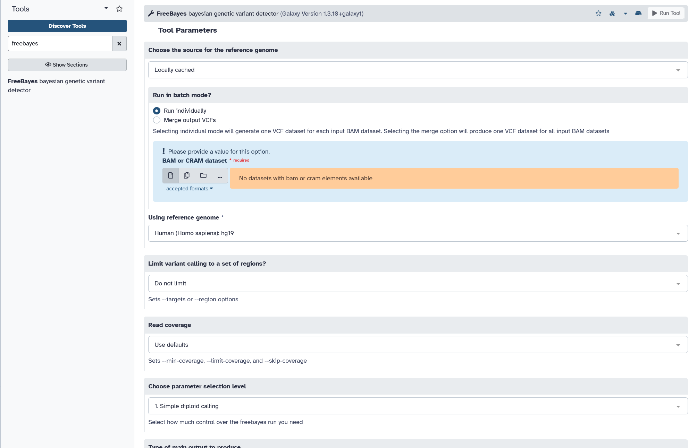{#fig-4}
:::

## Start a new Galaxy History

::: {.callout-note appearance="simple"}
1. Ensure you are starting with a new empty history.
1. If your history is not empty, click the `+` button to create a new history.
:::

{#fig-5}

::: {.callout-note appearance="simple"}
3. Click on the `Edit ✎` button to rename this history.
3. Change the name to **WES01 NGS Workshop**.
3. Click the `Save` button.
:::

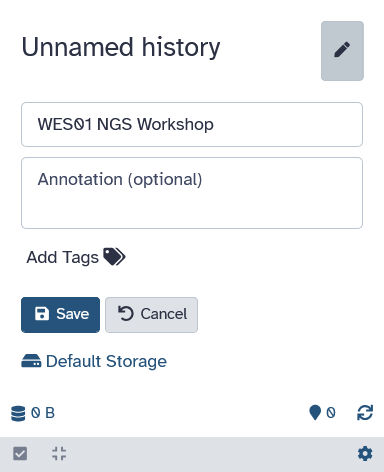{#fig-6}

---

# Data Upload

::: {.callout-note appearance="simple"}
1. Click on `Upload`.
:::

{#fig-7}

::: {.callout-note appearance="simple"}
2. On the top bar, above the box to drop files, click on `Collection`.
2. Change the **Collection:** type setting to `List of Pairs`.
2. Change the **Type (set all)** to `fastqsanger.gz`.
2. Click `Choose local file`.
:::

{#fig-8}

::: {.callout-note appearance="simple"}
6. Navigate to the `Downloads` folder on your local computer and select the two `.fastq.gz` files and click `Open`.
:::

{#fig-9}

The files will appear in the **Upload from Disk or Web** window.

::: {.callout-note appearance="simple"}
7. Click `Start` to begin the upload of the files.
7. Wait until the files are successfully uploaded and the `Build` button becomes enabled (it will turn blue). This may take some time, depending on server load.
7. Click on the `Build` button to create a list of paired `fastq` files.
:::

{#fig-10}

::: {.callout-note appearance="simple"}
10. Name the collection **WES01 fastq**.
10. Click on `Create collection`.
:::

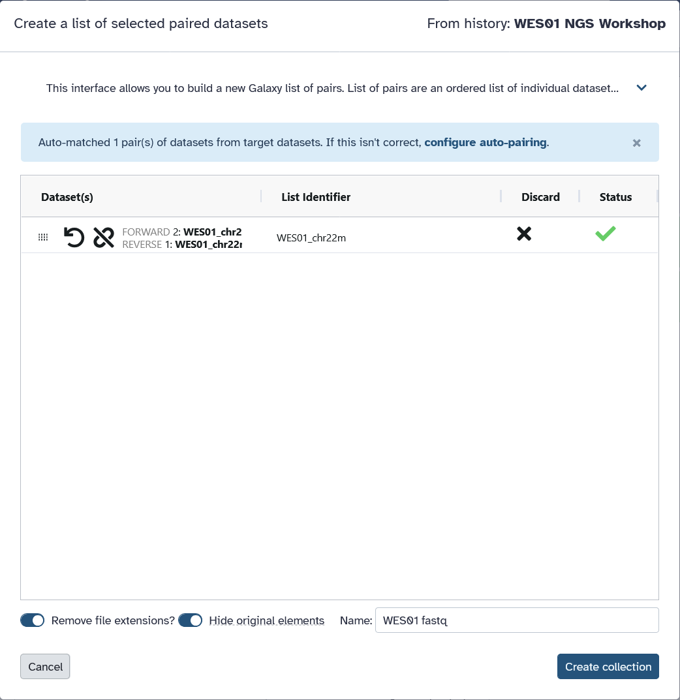{#fig-11}

A confirmation window will appear if the files were successfully paired.

::: {.callout-note appearance="simple"}
12. Click `Exit` on the confirmation window.
:::

{#fig-12}


::: {.callout-note appearance="simple"}
13. Open the `Upload from Disk or Web` window again.
13. On the top bar, above the box to drop files, click on `Regular`.
13. Click `Choose local file` again and upload the `chr22.genes.hg38.bed` file.
13. Change the file type to `bed`.
13. Change the genome reference to `Human Dec. 2013 (GRCh38/hg38)`.
13. Click `Start` to begin the upload of the `bed` file.
13. When the file has finished uploading, click `Close`.
:::

{#fig-13}

The uploaded data will appear in the History panel on the right.

{#fig-14}

::: {.callout-tip}
You can inspect and view the contents of the data uploaded by clicking on the `View 👁` button next to the name of each file.
:::

## NGS Data Files and Formats

### FASTQ Files
#### Data Format

One lane of paired end sequencing was performed so you have two files of raw sequence data (`WES01_chr22m_R1.fastq.gz` and `WES01_chr22m_R2.fastq.gz`) which contain all the sequence data for read 1 (R1) and read 2 (R2) respectively (@fig-15). To save on computing time and disk space, the NGS data for WES01 has been filtered to contain reads mapping to chromosome 22 only and the files have been compressed with `gzip` (hence the `.gz` extension).

{#fig-15}


The raw NGS data is held in [FASTQ format](https://en.wikipedia.org/wiki/FASTQ_format).
`fastq` files are the simplest and most generic way of storing biological sequences and their corresponding quality scores.

A `fastq` file has four line-separated fields per sequence:

  - Line 1 begins with an `@` character and is followed by a sequence identifier and an optional description (like a FASTA title line).
  - Line 2 is the raw sequence letters.
  - Line 3 begins with a `+` character and is optionally followed by the same sequence identifier (and any description) again.
  - Line 4 encodes the quality values for the sequence in Line 2, and must contain the same number of symbols as letters in the sequence.

A `fastq` file containing a single sequence might look like this:

```
@HWI-D00119:50:H7AP8ADXX:1:1212:10369:36657/1
GCACGTGGGTTCCCAGTAGCAAGAAACTAAAGGGTCGCAGGCCGGTTTCTGCTAATTTCTTTAATTCCAAGACAGTCTCAAATATTTTCTTATTAACTTCC
+
CCCFFFFFHHHHHJJJHIJJJJJJJJJJJJJJJJHFGIIIGJJJJIIHHHHHHFFFFFFFEEEEEEEEEDDDDDDDDDDEDDDDFFEEEDDDDEEEDDEDD
```

#### Illumina sequence identifiers

Sequences from the [Illumina instruments](https://help.basespace.illumina.com/files-used-by-basespace/fastq-files#format) use systematic identifiers.

```
@EAS139:136:FC706VJ:2:2104:15343:197393 1:Y:18:ATCACG
```

  Value         Description
  ------------- ------------------------------------------------------------------------
  **EAS139**    the unique instrument name
  **136**       the run id
  **FC706VJ**   the flowcell id
  **2**         flowcell lane
  **2104**      tile number within the flowcell lane
  **15343**     'x'-coordinate of the cluster within the tile
  **197393**    'y'-coordinate of the cluster within the tile
  **1**         the member of a pair, 1 or 2 (paired-end or mate-pair reads only)
  **Y**         Y if the read is filtered, N otherwise
  **18**        0 when none of the control bits are on, otherwise it is an even number
  **ATCACG**    index sequence

::: {.callout-note}
More recent versions of Illumina software output a sample number (as taken from the sample sheet) in place of an index sequence.

For example, the following header might appear in the `fastq` belonging to the first sample of a batch of samples:
`@EAS139:136:FC706VJ:2:2104:15343:197393 1:N:18:1`
:::

#### Phred Quality Scores

A [Phred quality score](https://en.wikipedia.org/wiki/Phred_quality_score) is a measure of the quality of the identification of the sequence of bases generated
by automated DNA sequencing.

A phred score or quality value Q is an integer mapping of p (i.e., the probability that the corresponding base call is incorrect).

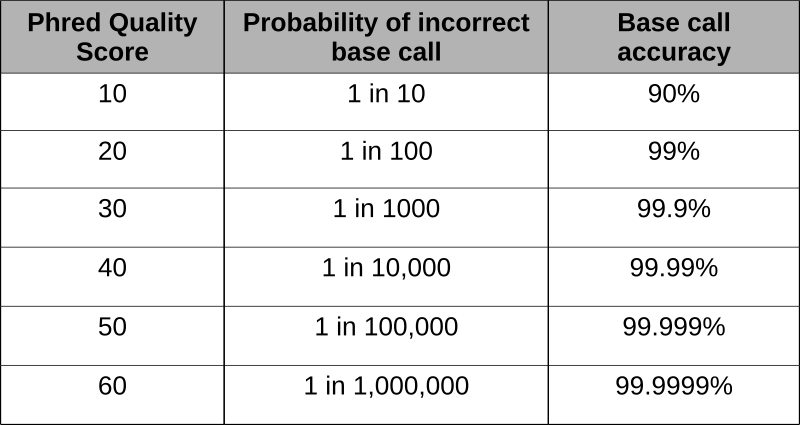{#fig-16}

- <https://en.Wikipedia.org/wiki/FASTQ_format#Quality>
- <https://en.Wikipedia.org/wiki/FASTQ_format#Encoding>

It is more efficient to store the sequence quality scores as characters because they require less disk space than numbers (i.e. 1 character
versus multiple digits). Characters are also more reliable and portable than numbers. Sequence quality scores on the phred scale are determined
by mapping the ASCII character to its associated number.

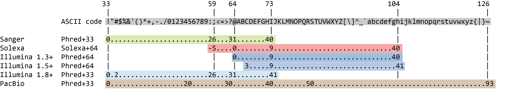{#fig-17}

### BED Files

The uploaded file `chr22.genes.hg38.bed` describes the exome sequences and genes that have been targeted in your trial data, stored in `.bed`
format. A **BED** file is a tab-delimited text file that defines genomic features.

Briefly, the [BED format](https://en.wikipedia.org/wiki/BED_(file_format)) consists of one line per feature, each containing 3-12 columns of data, plus optional feature definition lines.
A minimal `.bed` file uses 3-4 tab delimited columns of data to describe the target:

The first three fields in each feature line are required:

1.  **chrom** - Chromosome (e.g. chr3, chrY, chr2_random) or [scaffold](https://en.wikipedia.org/wiki/Scaffolding_(bioinformatics)) (e.g. scaffold10671) name
2.  **chromStart** - Start coordinate on the chromosome for the sequence considered (this position is zero-based, i.e. the first base on a chromosome is 0).
3.  **chromEnd** - End coordinate on the chromosome for the sequence considered; this position is non-inclusive, unlike chromStart (this position is one-based, i.e. the first base on a chromosome is 1)
4.  **name** - Name of the feature in that line.

Let's have a quick look at `chr22.genes.hg38.bed`

```
chr22	15721285	15721631	POTEH-chr22-16256332-16256677
chr22	15719659	15719778	POTEH-chr22-16258185-16258303
chr22	15710867	15711034	POTEH-chr22-16266929-16267095
chr22	15708019	15708090	POTEH-chr22-16269873-16269943
chr22	15702685	15702756	POTEH-chr22-16275207-16275277
chr22	15700077	15700215	POTEH-chr22-16277748-16277885
chr22	15698661	15698768	POTEH-chr22-16279195-16279301
chr22	15690025	15690709	POTEH-chr22-16287254-16287937
chr22	15528158	15529137	OR11H1-chr22-16448826-16449804
chr22	16590757	16592810	CCT8L2-chr22-17071648-17073700
```
---

# Pre-alignment QC

::: {.callout-note}
- **Software**
  - falco
  - fastp

- **Input/Output**
  - falco input (collection of raw fastq files):
    - `WES01_chr22m_R1.fastq.gz`
    - `WES01_chr22m_R2.fastq.gz`
  - falco output:
      - `html` report
        - forward
        - reverse
      - stats text file
        - forward
        - reverse
  - fastp input (collection of raw fastq files):
    - `WES01_chr22m_R1.fastq.gz`
    - `WES01_chr22m_R2.fastq.gz`
  - fastp output (collection of quality filtered fastq files):
    - `WES01_chr22m_R1.fastp.fastq.gz`
    - `WES01_chr22m_R2.fastp.fastq.gz`
    - `html` report
    - stats `JSON` file

:::

## Extract Read Group Information

::: {.callout-note appearance="simple"}
1. View the `fastq` files and note the following information:
    - The unique instrument name
    - The run id
    - The flowcell id
    - The flowcell lane
:::

This information can be obtained from the sequence identifier i.e. line 1 of the first fastq entry.


    Header: @HWI-D00119:50:H7AP8ADXX:1:1212:10369:36657/1
                |       |     |      |
    mapping:    1       2     3      4

1.  The unique instrument name:**HWI-D00119**
2.  The run id: **50**
3.  The flowcell id: **H7AP8ADXX**
4.  The flowcell lane: **1**

::: {.callout-tip}
For more information on `fastq` headers please see the [Illumina sequence identifiers](#illumina-sequence-identifiers) section.
:::

::: {.callout-important}
We will use this information later, during the alignment process, to add metadata, such as read group and run information, to the sample we are analysing.
:::

## Quality assessment of raw sequence data

To assess the quality of the raw sequence data and to guide quality control we will use a program called `falco`, short for *FastQC Alternative Code*. The program outputs
summary plots and text files that show if there are any problems with the data, which could influence alignment or variant calling if not addressed.

You can learn more about `falco` [here](https://github.com/smithlabcode/falco), and the older (and slower) program on which it is based, `FastQC` [here](https://www.bioinformatics.babraham.ac.uk/projects/fastqc/).

::: {.callout-note appearance="simple"}
1. In the Tool Panel select the `Falco` tool.
1. For the `Raw read data from your current history` choose `Dataset collection` (the third button) and then ensure the `WES01 fastq` collection is selected.
1. Click on the `Run Tool` button to execute the analysis.
:::

{#fig-18}

The FastQC reports will be shown in the History Pane. Queued jobs are shown in grey with a clock symbol, running jobs in yellow with a buffering symbol, and finished jobs in green, failed jobs in red with a cross.

Depending on server load, it may take a little while for the jobs to start running.

{#fig-19}


::: {.callout-note appearance="simple"}
4. Click on `Falco on collection 5: Webpage`, then on `WES01_chr22`, and then the view button for the `forward` and `reverse` files to view the respective QC reports.
:::

#### Questions
::: {.callout-important}
Use the html `falco` reports from the `forward` and `reverse` sequencing data to answer the following questions.
:::

For questions 1 and 2, type your answer in the box and press `Check`. For the multiple choice questions (3--6), click on an option to check your answer.

1.  How many reads does each file contain?

    ::: {.saq answer="505987"}
    Both files contain 505,987 reads. The forward and reverse files of a paired-end run should contain the same number of reads, as each read in one file is paired with a read in the other.
    :::

2.  How long are the reads (bp)?

    ::: {.saq answer="101"}
    All reads are 101 bp long, in both files.
    :::

3.  Which of the following quality checks has **failed** in **both** the `forward` and `reverse` files?

    :::: {.mcq}
    - Per base sequence quality and Adapter Content
    - Overrepresented sequences and Sequence Length Distribution
    - [Per base sequence content and Per sequence GC content]{.correct}
    - None of the above

    ::: {.mcq-explain}
    Both files fail *Per base sequence content* and *Per sequence GC content*, and give a warning for *Adapter Content*. A failed module does not necessarily mean the data is unusable: `falco` (like `FastQC`) assumes a random, whole-genome library, and some modules routinely fail for targeted sequencing data such as exomes.
    :::
    ::::

4.  Look at the *Per base sequence content* plots of the `forward` and `reverse` reads. What do they show, and what is the most likely reason this check has failed?

    :::: {.mcq}
    - The four lines overlap at 25% each along the whole read, so the check has failed in error
    - The four lines drift apart towards the end of the reads, because base quality falls there
    - The four lines are far apart along the whole length of the reads, because the sample is contaminated
    - [The four lines are uneven over the first ~15 bases and then flat and parallel, because library preparation introduces a sequence bias at the start]{.correct}

    ::: {.mcq-explain}
    In a random library, the proportions of A and T, and of G and C, should be nearly equal at every position, giving flat, parallel lines. `falco` fails this module if A and T, or G and C, differ by more than 20% at any position. Here G and C differ by almost 30% at base 4, but from about base 16 onwards the lines settle at G ≈ C ≈ 28% and A ≈ T ≈ 22%, consistent with the high GC content of this sample.

    The bias appears at the same positions in both files, so it was introduced when the library was made, not by the sequencer. The Nextera transposase enzymes used to fragment and tag the DNA prefer certain sequences, so the first bases of each read are not random.
    :::
    ::::

5.  Compare the *Per base sequence quality* plots of the `forward` and `reverse` reads. Which statement best describes them?

    :::: {.mcq}
    - [Quality declines towards the end of the reads]{.correct}
    - Quality is constant along the full length of the reads
    - Quality is lowest at the start of the reads and improves towards the end
    - The `forward` reads have lower quality than the `reverse` reads at every position

    ::: {.mcq-explain}
    Median quality peaks mid-read (~Q40) and falls towards the 3' end in both files, reaching ~Q31 in the `forward` reads and ~Q34 in the `reverse` reads. The reverse read is sequenced last, after the clusters have gone through many more chemistry cycles, so it is usually of lower quality.
    :::
    ::::

6.  The *Per sequence GC content* module fails, with a mean GC content of ~56% (the human genome average is ~41%). What is the most likely explanation?

    :::: {.mcq}
    - The sample is contaminated with bacterial DNA
    - [The reads come from captured exons]{.correct}
    - The reads are too short for GC content to be measured reliably
    - The library is dominated by adapter dimers

    ::: {.mcq-explain}
    Coding exons are GC-rich, and chromosome 22 is one of the most GC-rich human chromosomes. Exome capture also enriches some regions more than others, so the GC distribution departs from the smooth normal curve `falco` models for a random genomic library. *Overrepresented sequences* passes, which argues against contamination or adapter dimers.
    :::
    ::::


### Per base sequence quality
{#fig-20}

Looking at the per base sequence quality for the forward reads you will notice that the average base quality drops towards the end of the reads (@fig-20).

This drop in quality is typical for ensemble-based sequencing by synthesis (SBS) methods, such as Illumina, which add complementary bases one at a time in a cluster of identical sequences to determine a consensus sequence from the 'average' sequence signal over all copies in the cluster.

As nucleotides are added some of the sequences in a cluster grow at a different rate and become desynchronized which reduces the accuracy of the 'average' sequence signal (@fig-21).

{#fig-21}

Another particularly important plot is that of 'Overrepresented sequences', which lists sequences that account for more than 0.1% of the total. The presence of an overrepresented sequence suggests that the sequence is biologically significant, or that the library is contaminated or has low diversity.

To check for contamination, each overrepresented sequence is compared to a database of common contaminants such as sequencing adapters, which can then be removed from
the raw `fastq` data.

## Read filtering

In a typical analysis you may want to raise technical issues identified by `falco`, such as low read count, poor quality, and overrepresented sequences with the data provider. To ensure that only data of a certain quality is used for further analysis we will exclude low quality reads.

In paired-end data there are two `fastq` files per lane of sequencing which are synchronised so that matching pairs are stored in the same line of each file (e.g. the read in line 1, file 1 is paired with the read in line 1, file 2 and so on).

The fastq files need to be joined and the reads have to be analysed and trimmed or removed as a pair. To maintain this order when filtering, we will filter the `fastq` files using [`fastp`](https://github.com/OpenGene/fastp).


::: {.callout-note appearance="simple"}
1. In the Tool Panel select the `fastp` tool.
1. For the `Single-end or paired reads` section choose `Paired collection` and then ensure the `WES01 fastq` collection is selected.
1. Open the `Adapter Trimming Options` section and enable `Adapter sequence auto-detection for paired-end`.
:::

{#fig-22}

::: {.callout-note appearance="simple"}
4. Open the `Quality filtering options`. Note that, by default, `fastp` will discard reads where more than 40% of bases have Phred quality of 15 or lower, and reads with more than 5 unknown nucleotides (*N*). Leave the defaults as is, do not add any values to the boxes.
:::

{#fig-23}

::: {.callout-note appearance="simple"}
5. Open the `Length filtering options`. Note that, by default, `fastp` will discard reads shorter than 15 base pairs. Set the `Length required` parameter to `40`. This will discard reads shorter than 40 base pairs.
5. Open the `Read modification options`, and then `Per read cutting by quality options`. Set the lower `Cut by quality in tail (3') (Move a sliding window from front to tail)` to `Yes` and ensure the `Cutting window size for cut right` is set to `4` and `Cutting mean quality for cut right` is set to `20`.
5. Click on the `Run Tool` button to execute quality filtering.
:::

{#fig-24}

{#fig-25}

You should now have set up 3 `fastp` operations:

1.  Enabled `Adapter sequence auto-detection for paired-end`
1.  Discard reads below a specified length (40bp)
1.  Per read cutting by quality: trim the 3' end of each read using a sliding window (`Cut by quality in tail (3')`), moving from front to tail with a window size of 4 and cutting when the mean quality in the window drops below Q20

We are also using the default `fastp` quality filtering options, which include discarding reads with more than 40% of bases with less than Q15, and reads with more than 5 *N* nucleotides.

For paired-end data a particular strength of `fastp` is that it retains the pairing of reads (from R1 and R2) in the filtered output files.

The two `fastq` files (R1-paired and R2-paired) contain one read from each pair where both have survived filtering. Additionally, `fastp` can also output two `fastq` files (R1-unpaired and R2-unpaired) which contain reads where one of the pair failed the filtering steps, although this is currently not supported by the `fastp` version on Galaxy.

## Quality assessment of read filtering

::: {.callout-note appearance="simple"}
1. When the `fastp on collection 5: HTML report` has finished, click on the collection to open it, and then click on the `View 👁` button to view the report.
:::

{#fig-26}

::: {.callout-note appearance="simple"}
2. Check whether `fastp` detected the adapter sequences automatically, and whether they correspond to the sequences below, which were used in the [Nextera Rapid Capture Exome and Expanded Exome Enrichment Kits](https://support.illumina.com/sequencing/sequencing_kits/nextera-rapid-capture-exome-kit/documentation.html).
:::

The Nextera adapters used are:
```
Read1  I7_Nextera_Transposase_1  CTGTCTCTTATACACATCTCCGAGCCCACGAGAC
Read2  I5_Nextera_Transposase_1  CTGTCTCTTATACACATCTGACGCTGCCGACGA
```

[Further Reading](https://knowledge.illumina.com/library-preparation/general/library-preparation-general-reference_material-list/000001314): what sequences do we use for adapter trimming?

::: {.callout-tip}
If the adapter sequences were not correctly detected by `fastp`, it means that it could not correctly attempt to overlap the forward and reverse reads. Check that you correctly uploaded both the `R1` and `R2` `fastq.gz` files.
:::

::: {.callout-note}
`fastp` includes many adapter sequences in its database, but it is not exhaustive. If `fastp` does not detect your adapters in a future experiment, you would need to provide the adapter sequencers to the tool so it can trim them correctly.

However, please note that many modern sequencers and basecalling pipelines now perform adapter trimming automatically, so adapters may not always be detected at this stage and may not need to be trimmed.
:::

::: {.callout-note appearance="simple"}
3. Check the quality control results, before and after filtering.
:::

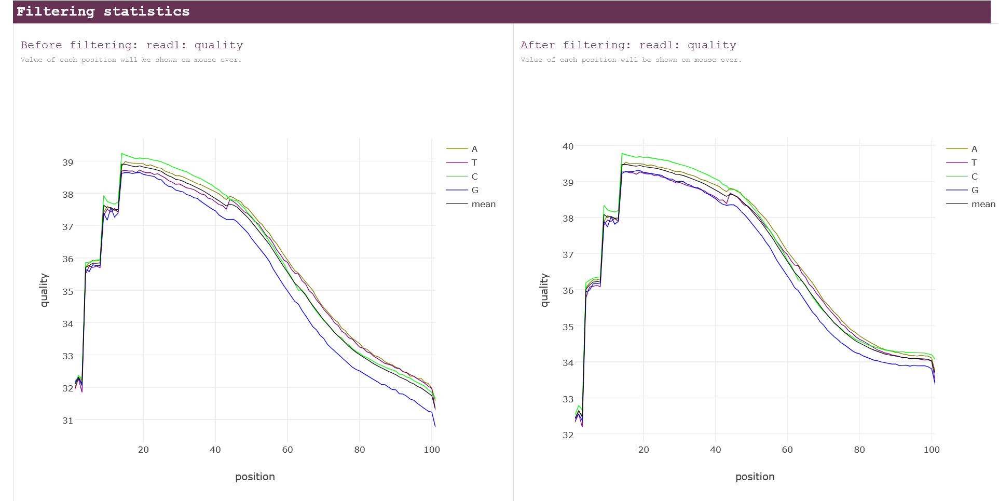{#fig-27}

There are other ways to clean up reads more agressively, such as applying stricter filtering criteria, which may be appropriate depending on data quality and analysis requirements. However, these approaches can reduce usable data and should be used with caution.

#### Questions
::: {.callout-important}
Use the `fastp` report to answer the following questions.
:::

For questions 1 and 2, type your answer in the box and press `Check`. For the multiple choice questions (3--9), click on an option to check your answer.

1.  How many reads does **each** file contain after quality filtering? (Hint: `fastp` reports the total for the `forward` and `reverse` files combined.)

    ::: {.saq answer="452030"}
    Each file contains 452,030 reads. The `fastp` summary reports 904,060 reads after filtering, which is the total for both files, just as the 1,011,974 reads before filtering are 2 × 505,987, the number `falco` reported for each file. Because `fastp` removes reads as pairs, both files keep the same number of reads.
    :::

2.  What is the mean length (bp) of the `forward` reads after quality filtering?

    ::: {.saq answer="96"}
    The mean length is 96 bp for the `forward` reads and 94 bp for the `reverse` reads, down from 101 bp. Trimming adapters and low-quality 3' ends shortens some of the reads, so they are no longer all the same length. The `reverse` reads are shorter on average because their quality is lower, so more of their 3' ends are trimmed.
    :::

3.  Have the correct adapter sequences been detected?

    :::: {.mcq}
    - Yes, they are TruSeq adapters
    - [Yes, they are Nextera adapters]{.correct}
    - No, no adapters were detected
    - Only the read 1 adapter was detected

    ::: {.mcq-explain}
    Both detected sequences match the Nextera adapters listed above, which were used to prepare this library. They share the same first 19 bases (`CTGTCTCTTATACACATCT`), which is the reverse complement of the mosaic end (ME) sequence that the Nextera transposase binds to.
    :::
    ::::

4.  The *Insert size peak* is 101 bp, and the reads are 101 bp long. Which reads will contain adapter sequence?

    :::: {.mcq}
    - All reads, because adapters are always sequenced at the start of each read
    - Reads from DNA fragments (inserts) longer than 101 bp
    - [Reads from fragments shorter than 101 bp]{.correct}
    - None, because the insert size peak is not longer than the reads

    ::: {.mcq-explain}
    The sequencer reads from the start of the insert. If the insert is shorter than the read length, the sequencer reads through the end of the insert and into the adapter on the other side.

    Fragments longer than 101 bp give reads with no adapter, but fragments shorter than 101 bp do, so with a peak at 101 bp a substantial proportion of the reads will contain adapter. With paired-end data, `fastp` finds these reads by overlapping the `forward` and `reverse` reads, which is why both files are needed for adapter auto-detection.

    Note that 48% of the read pairs could not be overlapped, so their insert size is unknown: it is either shorter than 30 bp or longer than 172 bp (or the reads contain too many sequencing errors).
    :::
    ::::

5.  Compare the read 1 quality plots before and after filtering (@fig-27). Has the read quality improved?

    :::: {.mcq}
    - [Yes, mean quality is higher, but it still declines towards the 3' end of the reads]{.correct}
    - Yes, but only improved at the start of the reads
    - Yes, quality is now constant along the whole read
    - No, the plots are identical

    ::: {.mcq-explain}
    The mean quality is higher at every position after filtering, and the proportion of bases with Q30 or higher is now 96.2%. Filtering removes the worst reads and trims their poor-quality ends, but it cannot change how the sequencer works, so quality still falls along the read and the dip in the first few bases remains.
    :::
    ::::

6.  Which filter removed the most reads?

    :::: {.mcq}
    - Low quality (more than 40% of bases below Q15)
    - Too many *N* bases
    - [Too short (below 40 bp)]{.correct}
    - Adapter dimers

    ::: {.mcq-explain}
    The *Filtering result* section shows that 107,506 reads (10.6%) were removed for being too short, compared with only 18 for low quality, 0 for too many *N* bases and 390 (0.04%) for being adapter dimers. Trimming adapters and low-quality 3' ends shortens reads, and any read left shorter than 40 bp is discarded. Overall, 89.3% of reads passed the filters.
    :::
    ::::

7.  The *GC content* is ~56% before filtering and ~55.7% after filtering. Why has it barely changed?

    :::: {.mcq}
    - `fastp` does not measure GC content after filtering
    - [The high GC content comes from the captured exons, not from low-quality reads or adapters, so filtering does not change it]{.correct}
    - Filtering should have lowered it to the genome average of ~41%, so filtering has failed
    - The adapter sequences have the same GC content as the reads

    ::: {.mcq-explain}
    As we saw in the `falco` reports, the high GC content is a property of the sample: coding exons and chromosome 22 are GC-rich. Filtering removes poor-quality reads and adapter sequence, which make up a small fraction of the data, so it does not change the GC content of the library.
    :::
    ::::

8.  For Illumina HiSeq systems, the typical minimum specification for data quality is that >85% to 90% of bases are expected to have a Q30 score or higher. Does this sample pass QC after quality filtering?

    :::: {.mcq}
    - [Yes, 96.2% of bases are Q30 or higher after filtering]{.correct}
    - It passed before filtering, but fails after filtering because bases were removed
    - No, it failed before filtering and still fails after filtering
    - No, only 29.8% of bases are Q40 or higher

    ::: {.mcq-explain}
    Before filtering, ~90% of bases were Q30 or higher, which already met the 85% specification. After filtering, 96.2% of bases are Q30 or higher, comfortably passing. The specification refers to Q30, not Q40: a Q30 base has a 1 in 1,000 chance of being incorrectly called.
    :::
    ::::

9.  The number of bases fell from 102.2 M to 86.6 M (~15%), and 10.7% of the reads were discarded. Considering this, which statement is most reasonable?

    :::: {.mcq}
    - Trimming was essential, because without it most reads would have failed the Q30 specification
    - Trimming should never be used for Illumina data
    - Trimming removed all of the reads with low-quality bases
    - [Trimming improved the data quality, but at a noticeable cost in reads and bases]{.correct}

    ::: {.mcq-explain}
    The proportion of bases with Q30 or higher rose to 96.2% after filtering, and the reads are cleaner, but about 15% of the bases were lost, mostly because 107,506 reads were left shorter than 40 bp.

    The data was already close to specification before filtering (~90% of bases at Q30 or higher), so trimming was not essential for it to pass QC.

    Modern aligners such as BWA-MEM can soft-clip poor-quality read ends, and variant callers generally take base quality into account, so stricter trimming is rarely needed for data of this quality. In your own experiments, weigh the loss of data against the gain in quality.
    :::
    ::::

---

# Alignment

::: {.callout-note}
- **Software**
  - `BWA-MEM`

- **Input/Output**
  - `BWA-MEM` input: Reference Genome and indexes for use with bwa
    - hg38 reference genome (`fasta` file)
    - `BWA-MEM` indexes (provided by Galaxy):
      - `.amb` is text file, to record appearance of N (or other non-ATGC)
        in the ref `fasta`.
      - `.ann` is text file, to record ref sequences, name, length, etc.
      - `.bwt` is binary, the Burrows-Wheeler transformed sequence.
      - `.pac` is binary, packaged sequence (four base pairs encode one
        byte).
      - `.sa` is binary, suffix array index.
    - `BWA-MEM` input (paired `fastq` files):
      - `WES01_chr22m_R1.fastp.fastq.gz`
      - `WES01_chr22m_R2.fastp.fastq.gz`
  - `BWA-MEM` output (aligned sequences file):
    - `.bam` file
    - `.bai` (`bam` index: automatically produced by Galaxy)
:::

## Align sequence data to the reference human genome

We will use a program called `BWA-MEM` (Burrows-Wheeler Aligner) to align the sequence data to the human genome. You can learn more about the `BWA` program [here](http://bio-bwa.sourceforge.net/).

::: {.callout-note appearance="simple"}
1. In the Tool Panel select the `Map with BWA-MEM` tool.
1. For the `Will you select a reference genome from your history or use a built-in index?`, ensure `Use a built-in genome index is selected`, then choose `Human Dec. 2013 (GRch38/hg38)` as the reference genome.
1. In the section `Single or Paired-end reads`, select `Paired Collection` as your data type, then select `fastp on collection 5: Paired-end output` as your data collection.
:::

{#fig-28}

## Set read groups per the SAM/BAM specification

::: {.callout-warning}
This next step is very important! Please do not skip it.
:::

::: {.callout-tip}
Please see the [Extract Read Group Information](#extract-read-group-information) section to remember how this information was obtained.
:::


::: {.callout-note appearance="simple"}
4. In the section `Set read groups information?`, select the option `Set read groups (SAM/BAM specification)`.
4. Enter the following for the options:
    - Read group identifier (ID): `HWI-D00119.50.H7AP8ADXX.1.WES01`
    - Read group sample name (SM): `WES01`
    - Platform/technology used to produce the reads (PL): `ILLUMINA`
    - Library name (LB): `nextera-wes01-blood`
:::

{#fig-29}

::: {.callout-note appearance="simple"}
6. Continue entering the following options
    - Date that run was produced (DT): `2017-02-23`
    - Platform unit (PU): `H7AP8ADXX.1`
6. Click on the `Run Tool` button to execute the analysis.
:::
{#fig-30}

[Additional Reference](https://gatk.broadinstitute.org/hc/en-us/articles/360035890671-Read-groups): what are read groups?

## A new NGS Data Format
### The Binary Alignment/Map file (BAM)

The alignment process maps the read data to the reference human genome creating a **Binary Alignment/Map file (BAM)**. The `bam` file is not in text format, so it is not directly viewable. Clicking the view button will open the alignment on IGV (Integrative Genomics Viewer).

[Additional Reference](https://galaxyproject.org/learn/galaxy-ngs101/#understanding-and-manipulating-sambam-datasets): understanding and manipulating SAM/BAM datasets

---

# Post Alignment QC and Filtering

::: {.callout-note}
- **Software**
  - `Picard MarkDuplicates`
  - `samtools`
  - `bedtools`
  - `mosdepth`

- **Input/Output**
  - `Picard MarkDuplicates` input: `BWA-MEM` aligned BAM file
  - `Picard MarkDuplicates` output: BAM file with duplicate reads flagged
  - `samtools view` input: duplicate read marked BAM file
  - `samtools `view` output: Filtered duplicate read marked BAM file and related bai index
  - `samtools flagstat` input: Filtered duplicate read marked BAM file
  - `samtools flagstat` output: text file
  - `samtools idxStats` input: Filtered duplicate read marked BAM file
  - `samtools idxStats` output: text file
  - `bedtools coverageBed` input:
    - Filtered duplicate read marked BAM file
    - Target intervals file `.bed` file
      - chr22.genes.hg19.bed
  - `bedtools coverageBed` output: text file
  - `mosdepth` input: Filtered duplicate read marked BAM file
  - `mosdepth` output: text file
:::

For variant calling, reads with low mapping quality (phred <20), unmapped reads, secondary alignments, reads failing platform/vendor quality checks, and duplicate reads that have the same start and stop position are typically removed or ignored because they can influence genotyping accuracy.

Duplicates originate mostly from DNA library preparation methods that rely on PCR amplification, which can create multiple sequencing reads from the same original DNA molecule (PCR duplicates) and thus artificially inflate read depth and bias allele fractions. Other sources include optical duplicates (sequencing clusters imaged more than once) and platform-specific artefacts.

For example, at heterozygous sites the two alleles should be evenly distributed (50% of reads have the A allele and 50% have the B allele) but if reads with the A allele are duplicated the A allele will become overrepresented and the site might be misinterpreted as homozygous for the A allele.

We will use `Picard MarkDuplicates` and then `samtools view` to make a new BAM file which flags duplicate molecules and excludes poor quality reads.

[Additional Reference](https://www.cureffi.org/2012/12/11/how-pcr-duplicates-arise-in-next-generation-sequencing/): How PCR duplicates arise in next-generation sequencing

## MarkDuplicates

::: {.callout-note appearance="simple"}
1. In the Tool Panel select the `MarkDuplicates` tool.
1. Select `Dataset collection` (the third button) as your data type, then select `Map with BWA-MEM on collection 13 (mapped reads in BAM format)` as your data collection.
1. Leave all other settings on their default options.
1. Click on the `Run Tool` button to execute the analysis.
:::

{#fig-31}


This tool examines aligned records in the supplied SAM or BAM dataset to locate duplicate molecules. All records are then written to the output file with the duplicate records flagged. Two files are produced, 1) the new BAM file with duplicate reads marked and 2) a metrics file summarising the number of duplicate reads found.

## Filter BAM based on mapping quality and bitwise flags

::: {.callout-note appearance="simple"}
1. In the Tool Panel select the `Filter SAM or BAM, output SAM or BAM files on FLAG MAPQ RG LN or by region` tool.
1. Select `Dataset collection` as your data type, then select `MarkDuplicates on collection 20: BAM` as your data collection.
1. For `Minimum MAPQ quality score` type `30`.
1. On the section `Filter on bitwise flag` select `yes`.
1. Select the following options on `Skip alignments with any of these flag bits set`:
    - `The read is unmapped`
    - `The alignment or this read is not primary`
    - `The read fails platform/vendor quality checks`
    - `The read is a PCR or optical duplicate`
1. Leave all other settings on their default options.
1. Click on the `Run Tool` button to execute the analysis.
:::

{#fig-32}

This tool uses the `samtools view` command in the `samtools` toolkit to filter a `sam` or `bam` file on the MAPQ (mapping quality), FLAG bits, Read Group, Library, or region.

The input is a `bam` file, and the output file will also be `bam`.

## Generating Alignment Statistics

When aligning reads to the reference genome anywhere between 0 to 20% of reads are not aligned due to sequencing errors, sample contamination (e.g. bacterial or viral DNA), gaps in the reference genome and genome variation. Use `samtools flagstat` to determine how many reads have been aligned. We will compare the duplicate-marked `bam` file with the final filtered `bam` file.

::: {.callout-note appearance="simple"}
1. In the Tool Panel select the `Samtools flagstat tabulate descriptive stats for BAM datset` tool.
1. Select `Dataset collection` as your data type, then select `MarkDuplicates on collection 20: BAM` as your data collection.
1. Click on the `Run Tool` button to execute the analysis.
1. Run the `Samtools flagstat` tool again for the `Filter SAM or BAM, output SAM or BAM on collection 23: bam` dataset.
:::

{#fig-33}

{#fig-34}

::: {.callout-important}
Click the view data icon for both and use the Flagstat output to determine the percentage of mapped reads, and calculate the number of reads that were filtered out (difference in total read count between the raw and filtered BAM files).
:::

**Before Filtering**

{#fig-35}

**After Filtering**

{#fig-36}

#### Questions
::: {.callout-important}
Use the `samtools flagstat` outputs for the duplicate-marked (before filtering) and filtered (after filtering) `bam` files to answer the following questions.
:::

For questions 1--5, type your answer in the box and press `Check`. For the multiple choice questions (6--9), click on an option to check your answer.

1.  How many reads (in total) does the `bam` file contain before filtering?

    ::: {.saq answer="904162"}
    The duplicate-marked `bam` file contains 904,162 reads. Of these, 904,060 are *primary* alignments, exactly the number of reads `fastp` kept after filtering: every read in the `fastq` files gets one primary alignment. The other 102 are *supplementary* alignments, extra records for reads whose parts align to different places in the genome.
    :::

2.  What percentage of reads were mapped to the reference genome before filtering? (Round to the nearest whole number.)

    ::: {.saq answer="100|100%|100.00|100.00%"}
    904,161 of the 904,162 reads (100.00%) were mapped, so only a single read was left unmapped. This is higher than you would usually expect, and this is because the workshop dataset was made by extracting reads that had already aligned to chromosome 22.
    :::

3.  How many reads were filtered out?

    ::: {.saq answer="243693"}
    904,162 − 660,469 = 243,693 reads were filtered out.
    :::

4.  What percentage of the reads were filtered out? (Round to the nearest whole number.)

    ::: {.saq answer="27|27%|26.95|26.95%|26.9|26.9%"}
    243,693 / 904,162 × 100 ≈ 27% of the reads were filtered out, leaving 73% of the reads for variant calling.
    :::

5.  What percentage of the primary reads were flagged as duplicates by `MarkDuplicates`? (Round to one decimal place.)

    ::: {.saq answer="5.8|5.8%"}
    52,510 / 904,060 × 100 ≈ 5.8% of the primary reads were flagged as duplicates. After filtering there are 0 duplicates, because we discarded reads with the `The read is a PCR or optical duplicate` flag set.
    :::

6.  Duplicates account for most of the reads that were filtered out. Which filter removed most of the remaining reads?

    :::: {.mcq}
    - The read is unmapped
    - The alignment or this read is not primary
    - The read fails platform/vendor quality checks
    - [Minimum MAPQ quality score of 30]{.correct}

    ::: {.mcq-explain}
    Before filtering there was only 1 unmapped read, 0 secondary alignments and 0 reads failing quality checks (the second number on each line, after the `+`).

    The rest of the reads, about 191,000 (~21% of the total), were removed because their mapping quality (MAPQ) was below 30.

    MAPQ is a Phred-scaled estimate of the probability that a read has been aligned to the wrong place: MAPQ 30 means a 1 in 1,000 chance. Reads that align equally well to several places in the genome, such as repeats, segmental duplications and closely related genes (paralogues) get a low MAPQ, as the aligner cannot tell where they really come from.
    :::
    ::::

7.  Before filtering, there are the same number of `read1` and `read2` reads (452,030), but after filtering there are 330,241 `read1` and 330,168 `read2` reads. Why?

    :::: {.mcq}
    - `fastp` discarded some unpaired reads
    - `BWA-MEM` failed to align some of the `read2` reads
    - [The filters are applied to each read individually, so one read of a pair can be removed while its mate is kept]{.correct}
    - `samtools flagstat` counts `read2` incorrectly

    ::: {.mcq-explain}
    `samtools` checks the MAPQ and flags of each read on its own. If one read of a pair aligns to a repetitive region and gets a low MAPQ, it is removed, but its mate is kept if it passes the filters. The line `with itself and mate mapped` still reports 660,409 reads, because it is based on each read's flags, which record that its mate was mapped, even if the mate is no longer in the file.
    :::
    ::::

8.  Why are there still 60 *supplementary* alignments after filtering, even though we skipped alignments that are `not primary`?

    :::: {.mcq}
    - [The `not primary` flag marks *secondary* alignments; supplementary alignments have their own flag, which we did not select]{.correct}
    - They are duplicates that `MarkDuplicates` did not detect
    - They are unmapped reads
    - `samtools` cannot remove supplementary alignments

    ::: {.mcq-explain}
    A *secondary* alignment is an alternative position for a read that aligns to more than one place. A *supplementary* alignment is a part of a read (a split or chimeric read) that aligns to a different place from the rest of it, for example across a deletion or structural variant.

    They are marked by different flags, so skipping `The alignment or this read is not primary` does not remove supplementary alignments. To remove them, you would also need to select `The alignment is supplementary`.
    :::
    ::::

9.  After filtering, the percentage of properly paired reads rises slightly (99.56% to 99.60%), and the number of reads `with mate mapped to a different chr` falls from 466 to 10. What does this suggest?

    :::: {.mcq}
    - Filtering has introduced alignment errors
    - [Many of the reads with unexpectedly placed mates were ambiguous alignments, which were removed by the MAPQ filter]{.correct}
    - The sample carries hundreds of translocations between chromosomes
    - Duplicate reads always have mates on a different chromosome

    ::: {.mcq-explain}
    A read pair is *properly paired* when both reads align facing each other, on the same chromosome, at about the expected distance apart. Pairs whose mates align to different chromosomes are sometimes caused by real structural variants, but are more often caused by reads from repetitive regions that have been aligned to the wrong place. Of the 466 such reads, only 74 had a MAPQ of 5 or higher, and only 10 passed our MAPQ 30 filter, so most were low-confidence alignments.
    :::
    ::::

## Viewing the BAM File

As mentioned above, the `bam` file is held in binary format and so it can not be viewed directly.

However, the `bam` file can be converted to a viewable text format known as a SequenceAlignment/Map file or `sam` file. The `sam` file format is described in
detail [here](https://samtools.github.io/hts-specs/SAMv1.pdf).

Let's use `samtools view` to convert the filtered `bam` file to a `sam` file so we can view its contents.

::: {.callout-note appearance="simple"}
1. In the Tool Panel select the `Samtools view` tool.
1. Select `Dataset collection` as your data type, then select `Filter SAM or BAM, output SAM or BAM on collection 23: bam` as your data collection.
1. In the `Output format` select the option`SAM`.
1. Click on the `Run Tool` button to execute the conversion.
1. Click view data to view the SAM file.
:::

{#fig-37}

::: {.callout-note appearance="simple"}
8. Spend some time inspecting this file and its contents and format.
8. **Optional.** Repeat the conversion step but exclude the SAM header by disabling `Include SAM header in the output?`. This will make it easier to view the aligned reads.
:::

### The SAM/BAM Format

In the SAM file, lines starting with "@" are headers, and those without "@" are read sequences aligned to the reference.

  **SAM_Column**   Description
  ---------------- ------------------------------------------------
  **QNAME**        Query name of the read or the read pair
  **FLAG**         Bitwise flag (pairing)
  **RNAME**        Reference sequence name
  **POS**          1-Based leftmost position of clipped alignment
  **MAPQ**         Mapping quality (Phred-scaled)
  **CIGAR**        Extended CIGAR string (operations MIDNSHP)
  **MRNM**         Mate reference name ('=' if same as RNAME)
  **MPOS**         1-based leftmost mate position
  **ISIZE**        Inferred insert size
  **SEQQuery**     Sequence on the same strand as the reference
  **QUAL**         Query quality (ASCII-33=Phred base quality)

<br>

Please see the following two reads. Note that they both have the same read id. `HWI-D00119:50:H7AP8ADXX:1:1107:11894:71970`
```
HWI-D00119:50:H7AP8ADXX:1:1107:11894:71970	99	chr1	143252916	60	64M	=	143252916	64	GATTCCATTCCATACCATTTGAAGATGATTACATTCGAGACCATTAGATGATTGCATTCAATTC	@CCFFFDDFHHGHIIIEEHIIIIEDDEEEHGIGEDHIAEFHHGIGHG>GDBDFHIGGCHHGGEH	MC:Z:64M MD:Z:30C14C18 PG:Z:MarkDuplicates RG:Z:HWI-D00119.50.H7AP8ADXX.1.WES01 NM:i:2 MQ:i:60 AS:i:54 XS:i:31

HWI-D00119:50:H7AP8ADXX:1:1107:11894:71970	147	chr1	143252916	60	64M	=	143252916	-64	GATTCCATTCCATACCATTTGAAGATGATTACATTCGAGACCATTAGATGATTGCATTCAATTC	IGIGGHFDGGGDDBHGGBIGHFAEEDEDGFBIGIHCGDECGIIHGIHBIIHDHDHFDDFFD@@C	MC:Z:64M MD:Z:30C14C18 PG:Z:MarkDuplicates RG:Z:HWI-D00119.50.H7AP8ADXX.1.WES01 NM:i:2 MQ:i:60 AS:i:54 XS:i:31
```

**SAM/BAM Format mapping:**

**QNAME**: HWI-D00119:50:H7AP8ADXX:1:1107:11894:71970\
**FLAG**: 99\
**RNAME**: chr1\
**POS**: 143252916\
**MAPQ**: 60\
**CIGAR**: 64M\
**MRNM**: =\
**MPOS**: 143252916\
**ISIZE**: 64\
**SEQQuery**: GATTCCATTCCATACCATTTGAAGATGATTACATTCGAGACCATTAGATGATTGCATTCAATTC\
**QUAL**: @CCFFFDDFHHGHIIIEEHIIIIEDDEEEHGIGEDHIAEFHHGIGHG>GDBDFHIGGCHHGGEH

::: {.callout-important}
Use [this website](https://broadinstitute.github.io/picard/explain-flags.html) to decode the flags (99 and 147) of the reads and determine which strand of the
reference genome they are aligned with.
:::

## Compressing the BAM File
While `bam` files are already compressed, further compression is possible using the `cram` format. `cram` (Compressed Read Alignment Map) is a more efficient file format that compresses alignment data by storing only the differences between the reads and the reference genome, rather than storing the full sequence data.

CRAM files typically achieve 4-10x better compression than BAM files, making them ideal for long-term storage and data transfer. However, CRAM files require the reference genome to be accessible for reading, so the reference sequence must be provided.

::: {.callout-note appearance="simple"}
1. In the Tool Panel select the `samtools view` tool.
1. Select `Dataset collection` as your data type, then select `Filter SAM or BAM, output SAM or BAM on collection 23: bam` as your data collection.
1. In the `Output format` select the option `CRAM (-C)`.
1. In the section `Use a reference sequence?`, select `Use a built-in genome` and then for the reference genome, select `Human Dec. 2013 (GRch38/hg38)`.
1. Click on the `Run Tool` button to execute the conversion.
:::

{#fig-38}


#### Questions
::: {.callout-important}
Once the `cram` file has been generated, compare the file sizes of the `bam` and `cram` files to answer the following questions.

  1. In your History panel, click on the `bam` file dataset from `Filter SAM or BAM, output SAM or BAM on collection 23: bam` and note the file size displayed.
  2. Click on the `cram` file dataset from `Samtools view on dataset 27: filtered alignments` and note the file size displayed.
:::

For questions 1 and 2, type your answer in the box and press `Check`. For the multiple choice questions (3--5), click on an option to check your answer.

1.  How much space (in MB) has been saved by converting the `bam` file to `cram` format?

    ::: {.saq answer="21.2|21.2mb"}
    The filtered `bam` file is 47.3 MB and the `cram` file is 26.1 MB, so 47.3 − 26.1 = 21.2 MB has been saved.
    :::

2.  What percentage of space has been saved by converting to `cram` format? Use the formula (`bam` size − `cram` size) / `bam` size × 100%. (Round to the nearest whole number.)

    ::: {.saq answer="45|45%|44.8|44.8%"}
    (47.3 − 26.1) / 47.3 × 100 ≈ 45%. The `cram` file is a little over half the size of the `bam` file, about 1.8 times smaller.
    :::

3.  How does the `cram` format make the file smaller than the `bam` format?

    :::: {.mcq}
    - It removes the unmapped and duplicate reads
    - It discards the base quality scores
    - [It stores only the differences between each read and the reference genome, instead of the full read sequence]{.correct}
    - It keeps only the reads that align to chromosome 22

    ::: {.mcq-explain}
    Most bases in a read match the reference genome, so `cram` only needs to record where each read aligns and the few bases that differ from the reference. By default, `cram` compression is *lossless*: the `cram` file contains the same reads, quality scores and alignment information as the `bam` file, and the `bam` file can be recreated from it exactly.
    :::
    ::::

4.  A colleague wants to open your `cram` file on their own computer. Apart from the `cram` file, what do they need?

    :::: {.mcq}
    - The original `fastq` files
    - The `bam` file it was made from
    - [The same reference genome (hg38) that was used to create the `cram` file]{.correct}
    - Nothing else, the `cram` file is self-contained

    ::: {.mcq-explain}
    As the `cram` file stores the reads as differences from the reference genome, the read sequences cannot be rebuilt without the exact same reference sequence.

    If a different reference (for example hg19, or a version of hg38 with different chromosome names) is used, the file cannot be decoded correctly.

    This is why it is important to keep a record of which reference genome was used for alignment.
    :::
    ::::

5.  Even though the read sequences are stored very efficiently, the `cram` file is still more than half the size of the `bam` file. Which part of the data takes up most of the space in the `cram` file?

    :::: {.mcq}
    - The read sequences
    - [The base quality scores]{.correct}
    - The `bam` header
    - The read group information

    ::: {.mcq-explain}
    Comparing reads to the reference genome greatly reduces the space needed for the read sequences, but each base still has its own quality score, and these are much harder to compress. Quality scores can take many different values and vary a lot between neighbouring bases, so they make up most of a lossless `cram` file.

    Nowadays newer sequencer models *bin* quality scores into a few values (for example, 2, 12, 23 and 37), which compress much better.

    `cram` files can also use *lossy* compression, binning or discarding quality scores to save more space, at the cost of losing some information.
    :::
    ::::

::: {.callout-note}
`cram` files are particularly useful for large-scale sequencing projects where storage and transfer costs can become significant.
:::

## Generate alignment statistics per chromosome

When viewing the SAM file you may have noticed that not all the reads are mapped to chromosome 22 which is surprising as the sequence was initially filtered for reads mapping to chromosome 22 only. Use the IdxStats to generate a breakdown of the number of reads that map to each chromosome or contig.

::: {.callout-note appearance="simple"}
1. In the Tool Panel select the `Samtools idxstats` tool.
1. Select `Dataset collection` as your data type, then select `Filter SAM or BAM, output SAM or BAM on collection 23: bam`, or the `cram` file we just generated in `Samtools view on collection 26: filtered alignments`, as your data collection.
1. Click on the `Run Tool` button to execute the analysis.
1. Click on `View` when the job has finished running.
:::

{#fig-39}

This will produce a file with 4 columns:

  1. Reference sequence identifier
  2. Reference sequence length
  3. Number of mapped reads.
  4. Number of placed but unmapped reads (typically unmapped partners of mapped reads)

{#fig-40}

#### Questions
::: {.callout-important}
Use the `idxstats` output to answer the following questions. The total number of mapped reads can be found in the `samtools flagstat` output for the filtered `bam` file.
:::

For question 1, type your answer in the box and press `Check`. For the multiple choice question (2), click on an option to check your answer.

1.  What percentage of the mapped reads in the filtered `bam` file map to chromosome 22? (Round to one decimal place.)

    ::: {.saq answer="98.6|98.6%"}
    651,474 of the 660,469 mapped reads map to chromosome 22: 651,474 / 660,469 × 100 ≈ 98.6%. The remaining 8,995 reads (1.4%) map to other chromosomes and contigs.
    :::

2.  The workshop dataset was made by extracting reads that aligned to chromosome 22. Why do some of these reads now map to other chromosomes and contigs?

    :::: {.mcq}
    - [The reads were originally extracted using a different reference genome]{.correct}
    - The reads were contaminated with DNA from another sample
    - `MarkDuplicates` moved some reads to other chromosomes
    - `samtools idxstats` counts the reads incorrectly

    ::: {.mcq-explain}
    In this case, the reads were originally extracted from an alignment to the hg19/GRCh37 reference genome, and in this workshop we aligned them to hg38/GRCh38. A read mapping to chromosome 22 in hg19 is not guaranteed to be on chromosome 22 in hg38.

    Where a read aligns depends on the reference genome version and the aligner used. Many regions of chromosome 22 have similar sequences elsewhere in the genome, such as paralogous genes, segmental duplications and the unplaced (`_random`) and unlocalised (`chrUn_`) contigs of hg38. When the reads are aligned again to the whole hg38 genome, some of them find a better match outside chromosome 22.

    As we kept only reads with a MAPQ of at least 30, these reads were placed there with high confidence.
    :::
    ::::

## Determine the distribution of insert sizes

Insert sizes, the region between the 5' ends of the paired reads (see @fig-41), are important for correct alignment and variant calling. For variant calling, reads are assumed to be independent.

However, if an insert is smaller than the sum of the read pairs the reads will overlap and not be independent in the overlapping region (shown in yellow).

If a PCR error occurs in this overlapping region it will be present in both reads which may result in there being enough evidence to call a variant at this site that is not real.

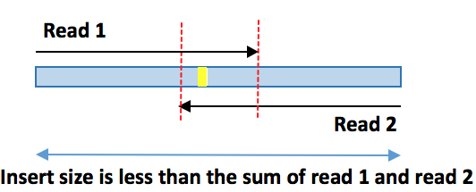{#fig-41}

Picard  `CollectInsertSizeMetrics` provides data on the Insert Size, including the parts covered by the reads and the unsequenced gap in the middle.

::: {.callout-warning}
Due to a bug with the built-in Galaxy references, we will first need to upload a separate reference genome to our history.


1. Click on `Upload` in the Tool Panel.
1. Select `Regular`.
1. Click on `Paste/Fetch data`.
1. Paste the link in the file name: `https://hgdownload.gi.ucsc.edu/goldenPath/hg38/bigZips/hg38.fa.gz`.
1. Set the file type to `fasta.gz`.
1. Set the reference type to `Human Dec. 2013 (GRCh38/hg38)`.
1. Click on the `Start` button.
:::

Once the upload has finished, we can run the tool.

::: {.callout-note appearance="simple"}
1. In the Tool Panel select the `CollectInsertSizeMetrics` tool.
1. Select `Dataset collection` as your data type, then select `Filter SAM or BAM, output SAM or BAM on collection 23: bam` as your data collection.
1. On `Load reference genome from` select `History`.
1. Select `hg38.fa.gz (as fasta)` as the reference.
1. Click on the `Run Tool` button to execute the analysis.
:::

{#fig-42}

This tool will produce two output files. The first is a tabular output with some metrics and a list of insert sizes and counts. The second output is a .pdf with an insert size histogram, that should look like @fig-43.

{#fig-43}

The ideal insert size depends on the experiment, but some things apply to any library:

  - You want a single, tight peak. Insert size distributions usually have a tail towards longer inserts (right-skewed), which is normal.
  - A very wide histogram suggests that size selection during library preparation was poor.
  - Bimodality (two distinct peaks in the histogram) usually means two different library preps were mixed, or there was a problem with fragment selection during library preparation.

In **WES**, the goal is to capture coding regions efficiently, so the ideal insert size is around **150–250 bp**. Most exons are short (often 100–200 bp), so shorter fragments keep more of each read on target. Longer fragments extend further into the flanking introns, lowering the proportion of sequenced bases that fall on the exome.

What to watch out for:

  - With 2×101 bp reads, the two reads of a pair overlap whenever the insert is shorter than ~202 bp. In WES some overlap is normal and an accepted trade-off. The problem is heavy overlap, when the median insert is very short (e.g., below ~120 bp):
      - The overlapping bases are not independent evidence. Overlap does let the two reads cross-check sequencing errors, but an error introduced during PCR is copied into both reads, so it is counted twice and can look like a real variant (as explained above, @fig-41).
      - Sequencing capacity is wasted. For example, a 110 bp insert gives only 110 bp of unique sequence out of the 202 bp sequenced.
      - Inserts shorter than the read length (101 bp) make the sequencer read through into the adapter on the other side, as we saw in the `fastp` section.
  - Adapter dimers (two adapters joined together with no fragment between them) will not appear in this histogram, because they contain no genomic sequence and cannot be aligned. Look for them in the `fastp` report instead.

For comparison, in **WGS** the goal is uniform coverage across the whole genome, so inserts are usually longer, around **350–500 bp**. With 2×101 bp reads, a 350 bp insert leaves a ~150 bp unsequenced gap between the reads, which helps span repetitive regions. A tight distribution matters even more in WGS, as structural variant callers detect deletions and other rearrangements as deviations from the expected insert size.

In our data (@fig-43), the histogram has a single peak at around 150 bp with a tail towards longer inserts, which is typical for an exome library. This is at the lower end of the ideal range, so a good proportion of read pairs overlap, but there is no sign of mixed libraries or of a large population of very short fragments.

#### Questions
::: {.callout-important}
View the tabular output from `CollectInsertSizeMetrics` and use it, together with the histogram (@fig-43) and the `fastp` report, to answer the following questions.
:::

For questions 1 and 2, type your answer in the box and press `Check`. For the multiple choice questions (3--6), click on an option to check your answer.

1.  What is the mean insert size (bp)? (Round to the nearest whole number.)

    ::: {.saq answer="168|167.6|167.65|167.645|167.645042"}
    The mean insert size (`MEAN_INSERT_SIZE`) is 167.6 bp, so about 168 bp. This is within the ideal range of 150–250 bp for WES.
    :::

2.  What is the standard deviation (bp) of the insert size? (Round to the nearest whole number.)

    ::: {.saq answer="69|68.6|68.64|68.639|68.639459"}
    The standard deviation (`STANDARD_DEVIATION`) is 68.6 bp, so about 69 bp. Most inserts are therefore between about 100 and 235 bp (mean ± 1 standard deviation).
    :::

3.  The mean insert size (168 bp) is higher than the median (155 bp), which is higher than the mode (134 bp). What does this tell you about the distribution?

    :::: {.mcq}
    - The distribution is symmetrical
    - [The distribution has a tail towards longer inserts (right-skewed)]{.correct}
    - The distribution has a tail towards shorter inserts (left-skewed)
    - The library contains two mixed populations of fragments

    ::: {.mcq-explain}
    In a symmetrical distribution, the mean, median and mode are about the same. Here, a smaller number of long inserts pull the mean up above the median, and the median above the most common insert size (the mode). The longest insert (`MAX_INSERT_SIZE`) is 15,364 bp, far beyond the peak.

    A right-skewed distribution is normal for insert sizes, as explained above. Two mixed populations would show up as two separate peaks in the histogram, which we do not see in @fig-43.
    :::
    ::::

4.  The reads are 2×101 bp and the median insert size is 155 bp. What does this mean for the two reads of a typical pair?

    :::: {.mcq}
    - There is an unsequenced gap of about 54 bp between the two reads
    - [The two reads overlap by about 47 bp]{.correct}
    - The two reads cover exactly the same bases
    - Both reads contain adapter sequence

    ::: {.mcq-explain}
    The two reads cover 2 × 101 = 202 bp, which is more than the 155 bp insert, so they overlap by 202 − 155 = 47 bp in the middle of the fragment. Only inserts longer than 202 bp leave an unsequenced gap between the reads.

    The reads only contain adapter sequence when the insert is shorter than the read length (101 bp), which is the case for only a small proportion of the pairs.
    :::
    ::::

5.  The `PAIR_ORIENTATION` column reports `FR`. What does this mean?

    :::: {.mcq}
    - [The two reads of each pair face towards each other]{.correct}
    - The two reads of each pair face away from each other
    - Both reads of each pair align to the same strand
    - The forward reads failed and only the reverse reads were used

    ::: {.mcq-explain}
    `FR` (forward–reverse) means that one read aligns to the forward strand and its mate to the reverse strand, pointing towards each other, which is the expected orientation for Illumina paired-end libraries.

    Other orientations (`RF`, facing away from each other, or `TANDEM`, both on the same strand) are expected for other library types, such as mate-pair libraries, but in a standard library they can indicate structural variants or alignment errors.
    :::
    ::::

6.  The `fastp` report showed an insert size peak at 101 bp, but the `CollectInsertSizeMetrics` histogram peaks at around 134 bp. Why are there differences between the two plots?

    :::: {.mcq}
    - The inserts became longer during alignment
    - `fastp` was run on a different sample
    - [`fastp` can only estimate the insert size of read pairs that overlap, so it misses longer inserts]{.correct}
    - `CollectInsertSizeMetrics` includes the adapter sequences in the insert size

    ::: {.mcq-explain}
    `fastp` works on the raw reads, without a reference genome, so it can only work out the insert size by overlapping the `forward` and `reverse` reads. Pairs from long inserts do not overlap enough (or at all), so they cannot be measured: 48% of the read pairs could not be overlapped. As a result, the `fastp` histogram is biased towards short inserts.

    `CollectInsertSizeMetrics` uses the positions where both reads of a pair align to the reference genome, so it can measure inserts of any length, whether the reads overlap or not. It is also run on the filtered `bam` file, after duplicates and low-quality alignments were removed, so it is the more accurate description of the library.
    :::
    ::::

## Depth of Coverage

Identification and accuracy of variant calling relies on the depth and breadth of sequence coverage. To calculate coverage, a file in bed format describing the target region is required. Bed files use tab delimited columns of data to describe the target: chromosome, left location (bp), right location (bp).

### Calculate depth per base
We will use the uploaded bed file which describes the exome sequence that has been targeted in your trial data `chr22.genes.hg38.bed`.

The options we selected will report the per-base of coverage for each feature in the `bed` file.

::: {.callout-note appearance="simple"}
1. In the Tool Panel select the `bedtools Compute both the depth and breadth of coverage` tool.
1. Switch the tool software version to `2.22.1`.
1. For the `Count how many intervals in this BED/VCF/GFF/BAM file (source)` section select `Dataset collection` as your data type, then select `Filter SAM or BAM, output SAM or BAM on collection 23: bam` as your data collection.
1. For the `overlap the intervals in this BED file (target)` select the `chr22.genes.hg38.bed` file.
1. Enable the option `Report the depth at each position in each B feature`.
1. Click on the `Run Tool` button to execute the analysis.
:::

{#fig-44}

The output will consist of a line for each one-based position in each
feature, followed by the coverage detected at that position.

The 6th (last) column is the **Depth** at position X (Column 5) for the genomic feature (exon) A (columns 1-4).

Note that the order in column 5 is not numerical or in order. This is a quirk of `bed` files' sorting.

```
chr22	15528158	15529137	OR11H1-chr22-16448826-16449804	1	23
chr22	15528158	15529137	OR11H1-chr22-16448826-16449804	10	33
chr22	15528158	15529137	OR11H1-chr22-16448826-16449804	100	65
```
For line 1: the depth at the first base (indicated by col 5) of the feature/exon OR11H1-chr22-16448826-16449804 is 23.

For line 2: the depth at the 10th base (indicated by col 5) of the feature/exon OR11H1-chr22-16448826-16449804 is 33.

For line 3: the depth at the 100th base (indicated by col 5) of the feature/exon OR11H1-chr22-16448826-16449804 is 65.

### Correct the sort order

::: {.callout-note appearance="simple"}
7. In the Tool Panel select the `Sort data in ascending or descending order` tool.
7. For the `Sort Query` section select `Dataset collection` as your data type, then select `Compute both the depth and breadth of coverage across collection 26` as your data collection.
7. In `Column selections`, Click `+ Insert Column Selections` twice.
7. Add `Sort on Column 2` Leave all the other options as they are.
7. Add `Sort on Column 5` Leave all the other options as they are.
7. Click on the `Run Tool` button to execute the analysis.
:::

{#fig-45}

::: {.callout-note appearance="simple"}
13. View the new sorted data. It should look like @fig-46.
:::

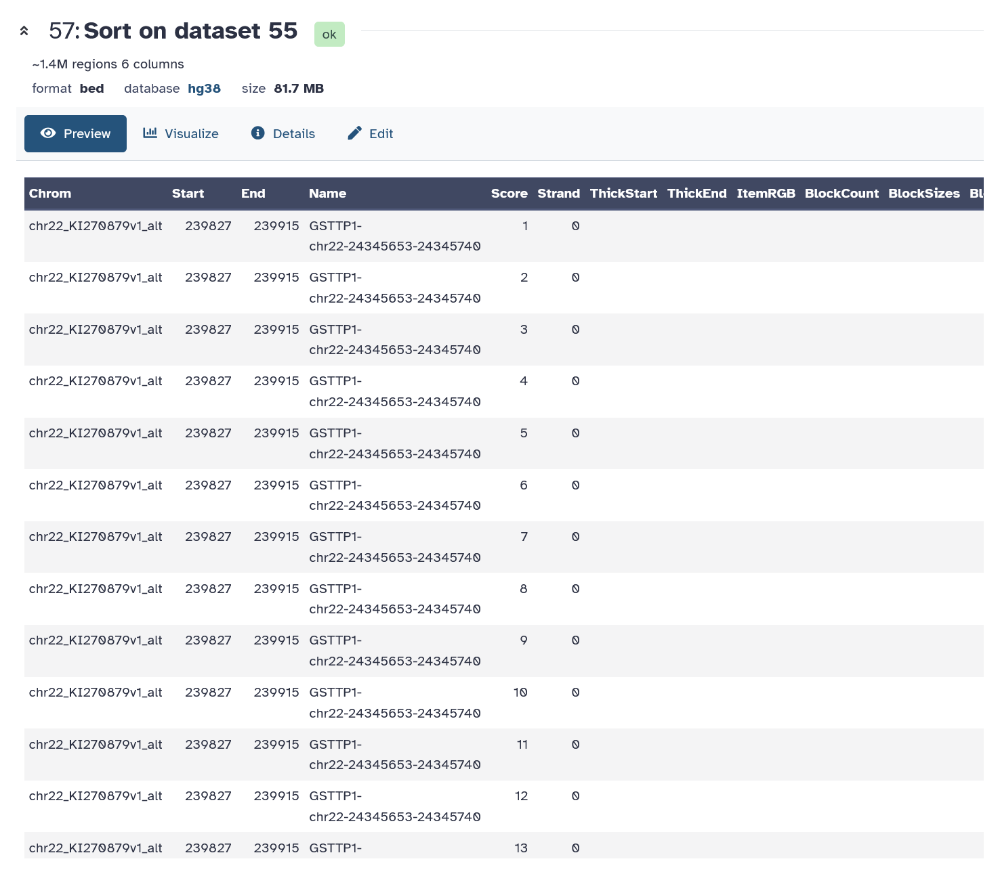{#fig-46}

### Targeted Regions Mean Coverage

We can calculate the mean coverage of the targeted regions by averaging over the values in column 6.

::: {.callout-note appearance="simple"}
14. In the Tool Panel select the `Summary Statistics` tool.
14. For the `Summary statistics on` section select `Dataset collection` as your data type, then select `Sort on collection 54` as your data collection.
14. Set `Column or expression` to `c6`.
14. Click on the `Run Tool` button to execute the analysis.
:::

{#fig-47}

::: {.callout-note appearance="simple"}
18. View the data. It should look like @fig-48.
:::

{#fig-48}

#### Questions
::: {.callout-important}
Use the `Summary Statistics` output (@fig-48) to answer the following questions. The columns `0%`, `25%`, `50%`, `75%` and `100%` are percentiles of the depth: the minimum, lower quartile, median, upper quartile and maximum, respectively.
:::

For questions 1--3, type your answer in the box and press `Check`. For the multiple choice questions (4--6), click on an option to check your answer.

1.  What is the mean depth of coverage of the targeted regions? (Round to one decimal place.)

    ::: {.saq answer="29.5|29.5x|29.5×|29.50|29.504|29.5043"}
    The `mean` column reports a depth of 29.5043, so about 29.5×. On average, each targeted position is covered by about 29.5 reads.
    :::

2.  What is the median depth of coverage of the targeted regions?

    ::: {.saq answer="23|23x|23×"}
    The median is reported in the `50%` column: half of the targeted positions have a depth of 23× or lower, and half have a depth of 23× or higher.
    :::

3.  The `sum` column adds up the depth of every targeted position. Using the `sum` and `mean` columns, how many millions of positions were included in the calculation? (Round to two decimal places.)

    ::: {.saq answer="1.39|1.39million|1.39M"}
    The `sum` is reported in scientific notation: 4.10214e+07 is 41,021,400. Dividing the sum by the mean gives the number of positions: 41,021,400 / 29.5043 ≈ 1,390,000, or about 1.39 million.
    :::

4.  The mean depth (29.5×) is higher than the median depth (23×), and the highest depth is 262×. What does this tell you about the depth across the targeted positions?

    :::: {.mcq}
    - Most positions have a depth very close to the mean
    - [A small number of positions with very high depth pull the mean up]{.correct}
    - At least half of the positions have a depth of 29.5× or higher
    - The depth is evenly distributed across the positions

    ::: {.mcq-explain}
    As half of the positions have a depth of 23× or lower, more than half of them must be below the mean of 29.5×. The distribution has a tail towards high depths (right-skewed), and these positions raise the mean more than they raise the median.

    The depth is also far from uniform: the standard deviation (27.8×) is almost as large as the mean, and the middle half of the positions range from 9× to 42×. This is why the mean depth alone is not enough to describe the coverage of an experiment.
    :::
    ::::

5.  The `0%` column reports a depth of 0. What does this mean for variant calling at these positions?

    :::: {.mcq}
    - [Any variants at these positions cannot be detected, as there are no reads to support them]{.correct}
    - These positions match the reference genome
    - These positions are not in the `bed` file
    - These positions were not used to calculate the mean depth

    ::: {.mcq-explain}
    A depth of 0 means that no reads in the filtered `bam` file cover the position, so there is no evidence either for or against a variant. The absence of a variant call at such a position does not mean that the sample matches the reference genome.

    These positions are in the `bed` file and are included in the mean, as `bedtools` reports the depth at every position of every feature. Positions may have no coverage if they were poorly captured, or if the reads aligning there were removed by the MAPQ filter because they could not be placed with confidence.
    :::
    ::::

6.  The `25%` column reports a depth of 9. What does this mean?

    :::: {.mcq}
    - 25% of the reads have a depth of 9×
    - A quarter of the targeted positions have a depth of 9× or higher
    - [A quarter of the targeted positions have a depth of 9× or lower]{.correct}
    - The depth of the targeted regions increases by 9× in every quartile

    ::: {.mcq-explain}
    The 25th percentile is the value below which a quarter of the positions fall, so about 25% of the targeted positions have a depth of 9× or lower, and about 75% have a depth of 9× or higher.

    This matters because low depth makes variants harder to call. At 9×, only 4 or 5 reads would be expected to carry a heterozygous variant, which makes it more difficult to distinguish from sequencing errors. So, despite a mean depth of 29.5×, variants may be missed or called with low confidence in a substantial proportion of the targeted positions.
    :::
    ::::

### Depth of coverage by chromosome

What is the average depth of coverage across the entirety of chromosome 22?

To quickly and efficiently calculate this value, we will be using the [mosdepth](https://github.com/brentp/mosdepth) tool.

::: {.callout-note appearance="simple"}
19. In the Tool Panel select the `mosdepth` tool.
19. Select `Dataset collection` as your data type, then select `Filter SAM or BAM, output SAM or BAM on collection 23: bam` as your data collection.
19. Click on the `Run Tool` button to execute the analysis.
:::

{#fig-49}

::: {.callout-note appearance="simple"}
18. View the `mosdepth summary` file to see the coverage of depth calculated by chromosome. It should look like @fig-50.
:::

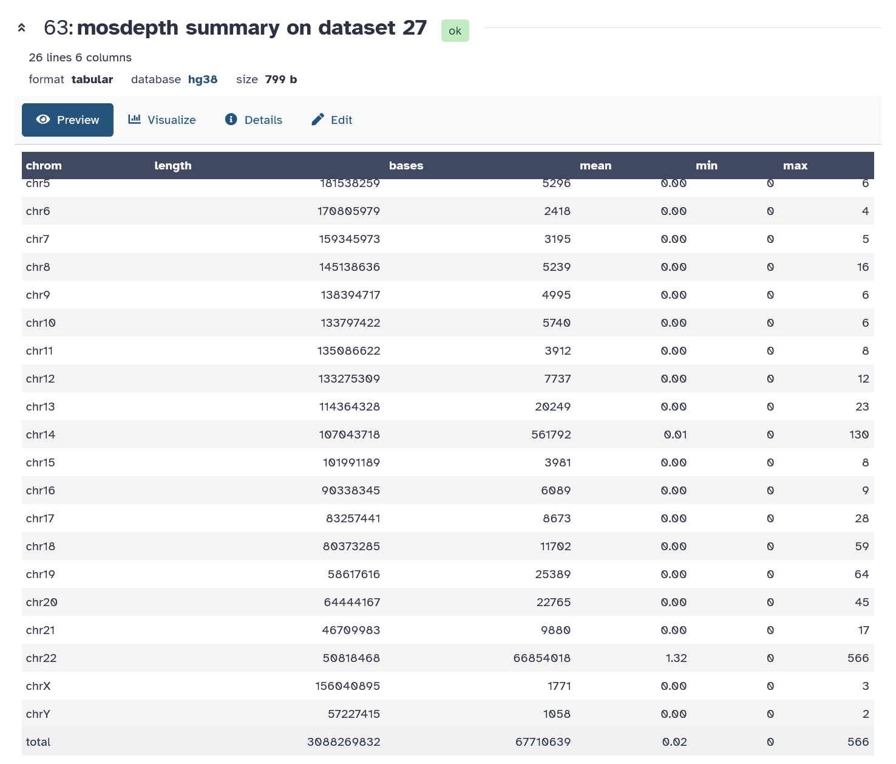{#fig-50}

#### Questions
::: {.callout-important}
Use your `mosdepth summary` file to answer the following questions. For each chromosome or contig, the `bases` column adds up the depth of every position, and the `mean` column is `bases` divided by `length`. The last row (`total`) combines all of the rows above it.
:::

For questions 1--3, type your answer in the box and press `Check`. For the multiple choice questions (4--5), click on an option to check your answer.

1.  What is the mean depth of coverage across the entire chromosome 22? (Round to two decimal places.)

    ::: {.saq answer="0.97|0.97x|0.97×"}
    The `mean` column of the `chr22` row reports 0.97×: 49,126,388 / 50,818,468 ≈ 0.97. On average, each position of chromosome 22 is covered by slightly less than one read.
    :::

2.  What is the mean depth of coverage across the entire genome? (Round to two decimal places.)

    ::: {.saq answer="0.02|0.02x|0.02×"}
    The `mean` column of the `total` row reports 0.02×: 49,820,267 / 2,374,460,364 ≈ 0.02.

    The `total` length of about 2.37 billion positions is shorter than the hg38 genome (about 3.1 billion), as only the chromosomes and contigs with aligned reads are listed. For example, there is no row for chr5 or chrX. Dividing by the length of the whole genome gives about 0.016×, which still rounds to 0.02×.
    :::

3.  What percentage of the bases in the `total` row are on chromosome 22? (Round to one decimal place.)

    ::: {.saq answer="98.6|98.6%"}
    49,126,388 / 49,820,267 × 100 ≈ 98.6%, which agrees with the percentage of mapped reads on chromosome 22 in the `idxstats` output.

    A mean of 0.00 does not mean that a chromosome has no aligned reads. For example, `chr1` has 1,363 bases, but this is such a small value compared to its 248,956,422 positions that the mean rounds to 0.00.
    :::

4.  The mean depth across chromosome 22 is 0.97×, but the mean depth of the targeted regions was 29.5×. Why are they so different?

    :::: {.mcq}
    - [The targeted regions make up only a small part of chromosome 22]{.correct}
    - `mosdepth` and `bedtools` were run on different `bam` files
    - Most of the reads aligned outside chromosome 22
    - `mosdepth` only includes positions covered by at least one read

    ::: {.mcq-explain}
    The targeted regions cover about 1.39 million of the 50.8 million positions of chromosome 22, or about 2.7%. As this is exome data, the reads are concentrated in these regions, and the rest of the chromosome has little or no coverage. These positions are all included in the `mosdepth` mean, which pulls it far below the depth of the targeted regions.

    Both tools were run on the same filtered `bam` file, and 98.6% of the bases are on chromosome 22. For targeted sequencing, the depth of the targeted regions is the more useful measure of coverage, as it describes the positions where we expect to call variants.
    :::
    ::::

5.  `chr22_KI270734v1_random` is an unlocalised contig: a short sequence in the reference genome that is known to belong to chromosome 22, but whose exact position on the chromosome is unknown. Its mean depth of 2.24× is higher than the 0.97× of chromosome 22. Why is this?

    :::: {.mcq}
    - [The contig is very short, so a relatively small number of bases gives a higher mean]{.correct}
    - The contig has more aligned bases than chromosome 22
    - The contig was targeted more deeply than the rest of chromosome 22
    - Reads on the contig are of higher quality than reads on chromosome 22

    ::: {.mcq-explain}
    The contig is only 165,050 positions long, so its 369,998 bases give a mean of 369,998 / 165,050 ≈ 2.24×. These bases are less than 1% of the `total`, whereas chromosome 22 has about 49 million bases spread over about 51 million positions.

    The mean depends on both the number of bases and the length of the sequence, so it should not be used alone to compare chromosomes and contigs of very different lengths. The `max` column of 231 also shows that the reads on this contig pile up at some positions, rather than being spread evenly.
    :::
    ::::

---

# Visualising Alignments

::: {.callout-note}
- **Software**
  - `IGV`

- **Input/Output**
  - `IGV` input:
    - `bam` and `bai` file
    - reference genome (IGV provided)
    - optional additional files
      - vcf from variant calling
      - bed files (gene annotations)
  - `IGV` output:
    - Interactive visual display of data
:::

## Integrative Genomics Viewer (IGV)
It is useful to look at the aligned data as this is one way to identify variants, assess their quality, and determine their genomic context with respect to other annotated features of the human genome such as genes, repeat sequences, transcription factor binding sites etc. We therefore recommend alignment visualisation before validation of in-silico variants by independent sequencing methods.

The Integrative Genome Viewer (IGV) is a popular tool for interrogating aligned NGS data (look here for more details on IGV: www.ncbi.nlm.nih.gov/pubmed/22517427).

You can run IGV on its [Web App](https://igv.org/app/). Don't worry if you accidentally close Galaxy. Your files will remain saved as long as you don't delete them.

[About IGV](hhttps://igv.org/doc/)

## Viewing the BAM File

::: {.callout-note appearance="simple"}
1. Navigate to your filtered `bam` data set `Filter SAM or BAM, output SAM or BAM on collection 23: bam` and open the panel.
1. Download the `Dataset` and the `bam_index`.
1. Rename the `bam` file to `filtered.bam`, and the `bai` index to `filtered.bam.bai`.
:::

::: {.callout-warning}
The `bam` and `bai` file names should not have special characters for the files to be read successfully by IGV.
:::

{#fig-51}

::: {.callout-note appearance="simple"}
4. Open the [IGV Web App](https://igv.org/app/), and ensure the reference genome is set to `hg38`, on the top left corner. You can change it in the `Genome` drop-down menu if you are currently on a different build.
4. Click on the `Tracks` drop-down menu, and click on `Local File...`.
4. Select the `filtered.bam` and `filtered.bam.bai` files to import the alignment track to IGV.
:::

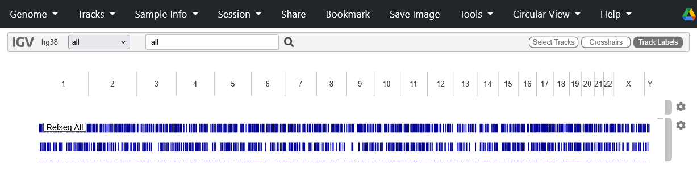{#fig-52}

## Viewing the Gene NF2

::: {.callout-note appearance="simple"}
7. Enter `NF2` in the search box and click enter to go to this gene. We can now see data for the whole gene as a coverage profile in the upper track and individual reads below.
:::

`NF2` is a tumour suppressor gene that regulates cell cycle, growth and differentiation. An inactivating germline mutation in exon 1 of SMARCB1 has been reported in patients with [NF2-related Schwannomatosis](https://doi.org/10.1016/j.spen.2024.101171). Schwannomas are mostly benign tumours involving schwann cells that myelinate the axons of nerve cells but can cause problems if the tumour compresses a nerve. There are several cases where people with schwannomatosis have developed hearing loss due to an acoustic neuroma, which is a schwannoma on the vestibular nerve in the brain that is involved in hearing.

{#fig-53}

#### Questions
::: {.callout-important}
Use IGV to answer the following questions. To go to a region, enter its coordinates in the search box. The number at the top left of the coverage track is the top of its scale, which IGV sets according to the highest depth in the view.

As you go, zoom in on an exon and get familiar with IGV and viewing the `bam` file. You can mouse over the coverage track to see the depth at a position.
:::

For questions 1 and 2, type your answer in the box and press `Check`. For the multiple choice questions (3--7), click on an option to check your answer.

1.  Go to `chr22:29,601,408-29,613,528`, which contains the first exon of `NF2`. What is the top of the scale of the coverage track?

    ::: {.saq answer="34|34x|34×"}
    The scale of the coverage track goes from 0 to 34, so the highest depth in this view is about 34×.
    :::

2.  Go to `chr22:29,672,445-29,684,565`. What is the top of the scale of the coverage track now?

    ::: {.saq answer="99|99x|99×"}
    The scale of the coverage track now goes from 0 to 99, so the highest depth in this view is about 99×.
    :::

3.  The tallest peaks in the two views above both reach the top of the coverage track. What can you conclude about their depth?

    :::: {.mcq}
    - They have about the same depth, as they have the same height
    - [The tallest peak in the second view is about three times as deep as the one in the first view]{.correct}
    - The tallest peak in the first view is about three times as deep as the one in the second view
    - Nothing, as the height of the coverage track is not related to depth

    ::: {.mcq-explain}
    The height of a peak is only meaningful relative to the scale of the current view. Here, the same height corresponds to about 34× in the first view and about 99× in the second. Always check the scale before comparing the coverage track between different regions.
    :::
    ::::

4.  Go to `chr22:29,633,978-29,646,099`. The rightmost exon in this view has a target of 84 bp in the `bed` file (`chr22:29,642,202-29,642,285`), but its peak of coverage is several hundred bases wide and tapers off on both sides. Why does the coverage extend into the introns?

    :::: {.mcq}
    - The `bed` file was used to trim the reads to the target
    - The introns were targeted as deeply as the exons
    - The reads in the introns are sequencing errors
    - [Captured DNA fragments can extend beyond the target into the flanking sequence]{.correct}

    ::: {.mcq-explain}
    Capture enriches for fragments that overlap a target, wherever they start and end. Positions in the target are covered by most of these fragments, whereas positions further away are covered by fewer and fewer of them, which gives the peak its tapered shape. This is why we see peaks at the exons, with little or no coverage in the rest of the introns.
    :::
    ::::

5.  Go back to `chr22:29,672,445-29,684,565`. Are all of the exons in this view equally captured?

    :::: {.mcq}
    - Yes, all of the peaks have about the same height
    - [No, the depth differs between exons]{.correct}
    - No, and only the longest exons have any coverage
    - It is not possible to tell by comparing peaks in the same view

    ::: {.mcq-explain}
    All of the peaks in this view share a scale, so their heights can be compared directly. The tallest peaks reach about 99×.

    Capture efficiency varies with properties of each region, such as its GC content, and how well the capture probes bind to it. This is part of why the depth of the targeted regions is so far from uniform, as we saw in the `Summary Statistics` output (@fig-48).
    :::
    ::::

6.  Go back to `chr22:29,601,408-29,613,528` and zoom in on the first exon. Its target in the `bed` file is `chr22:29,603,556-29,604,112`. Is the depth uniform across this target?

    :::: {.mcq}
    - [No, the depth is highest in one part of the target]{.correct}
    - Yes, the depth is about 34× at every position of the target
    - Yes, but only over the coding part of the exon
    - It is not possible to see the depth within a single target

    ::: {.mcq-explain}
    The peak of about 34× covers only a part of this target of 557 bp. Towards both of its ends, the depth falls to about 10× or less, so a variant at these positions would be harder to call than one at the peak, despite being in the same target.

    A good depth at the highest point of an exon therefore does not mean that the entire exon is well covered. This is another reason to check the depth at a position of interest before interpreting the presence or absence of a variant.
    :::
    ::::

7.  In the same view (`chr22:29,601,408-29,613,528`), there are two peaks of coverage at about 29,609 kb and 29,610 kb. They do not line up with an exon in the `Refseq All` track, and the `bed` file has no targets between the first exon and `chr22:29,636,751`. What does this tell you?

    :::: {.mcq}
    - These reads are adapter sequences that were not removed by `fastp`
    - These positions are included in the mean depth of the targeted regions
    - [Not all of the reads fall within the targeted regions]{.correct}
    - The `bed` file is wrong, as every peak of coverage must be an exon

    ::: {.mcq-explain}
    Capture is not perfectly specific, so some reads come from outside the regions listed in the `bed` file. We cannot tell why these two regions were enriched from this view alone, but a peak of coverage is not evidence of an exon, and variants called here need to be interpreted with this in mind.

    As these positions are not in the `bed` file, they were not included in the mean depth of the targeted regions (29.5×). They are included in the mean depth of chromosome 22 reported by `mosdepth`, which covers every position of the chromosome.
    :::
    ::::

## A Variant in NF2

::: {.callout-note appearance="simple"}
8. Enter the location `chr22:29,642,163` in the search box to focus on the data for a particular variant. You can now see the coloured bar consists of two colours representing the two alleles and their height corresponds with the allele frequency.
8. Right click and select sort alignments by base.
8. Mouse over the coverage track for the SNV at `chr22:29,642,163` and look at the information IGV displays.
:::

{#fig-54}

#### Questions
::: {.callout-important}
Use the information IGV displays for `chr22:29,642,163`, together with the reads sorted by base (@fig-54), to answer the following questions.
:::

For the multiple choice questions (1 and 2), click on an option to check your answer.

1.  The sequence track above the coverage track shows the base in the reference genome at this position. What does this tell you about the variant in this patient?

    :::: {.mcq}
    - The patient is homozygous for the base `C`
    - The patient is heterozygous, and the reference genome has a `C` at this position
    - [The patient is heterozygous, and the reference genome has an `A` at this position]{.correct}
    - The patient has two copies of the reference base, and the `C` is a sequencing error

    ::: {.mcq-explain}
    The reference genome has an `A` at this position, so this is an `A` to `C` substitution (`A>C`). IGV only colours the bases that differ from the reference, so the reads that carry the `A` remain grey.

    About half of the reads are expected to carry each allele at a heterozygous position, as each read comes from one of the two copies of the chromosome. If the patient was homozygous for the variant, nearly all of the reads would carry the `C`.
    :::
    ::::

2.  Which observation best supports this being a true variant, rather than an artefact from sequencing or library preparation?

    :::: {.mcq}
    - All of the reads that carry the `C` start at the same position
    - [The `C` is seen at the same position in reads starting at different positions and aligning in both orientations]{.correct}
    - The position is inside one of the targets in the `bed` file
    - Only the reads that carry the `C` are shown in colour

    ::: {.mcq-explain}
    Sequencing errors are rarely seen at the same position in many reads, and mostly appear as isolated mismatches. Reads that start at different positions come from different DNA fragments, so they are independent evidence rather than PCR duplicates of one fragment. Support from both orientations also argues against an error specific to one strand.

    The position is about 40 bp outside the nearest target in the `bed` file, which tells us nothing about whether the variant is real. IGV colours every mismatch, including errors. This evidence is supportive but not definitive, and we will use `freebayes` to assess it statistically in the next section.
    :::
    ::::

---

# Variant Calling

::: {.callout-note}
- **Software**
  - `freebayes`
  - `bcftools`

- **Input/Output**
  - `freebayes` input:
    - Filtered duplicate read marked BAM file
    - Reference Genome hg19 (fasta file, provided by galaxy)
  - `freebayes` output:
    - vcf file
  - `bcftools view` input: vcf file
  - `bcftools view` output: filtered vcf file
  - `bcftools stats` input: `freebayes` vcf file and filtered vcf file
  - `bcftools stats` output: text file with variant statistics
:::

Accurate and consistent variant calling requires statistical modelling and is essential for the clinical implementation of NGS. Many programs are available for calling variants and their concordance varies. Furthermore, variants have different levels of confidence due to differences in data quality.

For variants with intermediate confidence levels, it is difficult to separate true variation from artefacts that arise from many factors such as sequencing error, misalignment and inaccurate base quality scores. As a result, the evidence for variant calls requires scrutiny and caution should be used when interpreting positive and negative findings especially for indels which are more error prone.

At the end of this exercise you will be able to:

1.  Use a state of the art software (`freebayes`) to call small variants
    (SNVs and indels)
2.  Describe the contents of variant call files
3.  Generate and interpret basic variant quality control parameters
4.  Use quality control filters to exclude or flag variants with low
    confidence

[Additional Reference](https://galaxyproject.org/learn/galaxy-ngs101/#finding-variants): Finding variants

## Freebayes

[Freebayes](https://github.com/freebayes/freebayes) is a Bayesian variant caller that detects polymorphisms shorter than a short-read alignment: SNPs (single-nucleotide polymorphisms), indels (insertions and deletions), MNPs (multi-nucleotide polymorphisms), and complex events (combined insertions and substitutions).

::: {.callout-note appearance="simple"}
1. In the Tool Panel select the `freebayes` tool.
1. Select `Dataset collection` as your data type, then select `Filter SAM or BAM, output SAM or BAM on collection 23: bam` as your data collection.
1. On the section `Using reference genome`, select `Human Dec. 2013 (GRch38/hg38)`.
1. Click on the `Run Tool` button to execute the analysis.
:::

{#fig-55}

`Freebayes` uses short-read alignments ([BAM](http://samtools.sourceforge.net/SAMv1.pdf) files with [Phred+33](http://en.wikipedia.org/wiki/Phred_quality_score) encoded quality scores, now standard) for any number of individuals from a population and a [reference genome](http://en.wikipedia.org/wiki/Reference_genome) (in [FASTA](http://en.wikipedia.org/wiki/FASTA_format) format) to determine the most-likely combination of genotypes for the population at each position in the reference. It reports positions which it finds putatively polymorphic in variant call file ([VCF](http://www.1000genomes.org/node/101)) format. It can also use an input set of variants (VCF) as a source of prior information, and a copy number variant map (BED) to define non-uniform ploidy variation across the samples under analysis.


## Viewing the VCF
::: {.callout-important}
View the VCF file created by freebayes and familiarise yourself with the variables by reading the comments in the header section.

This history panel shows: 7,044 variants and 516 comments (@fig-56).

The comments appear at the top of the VCF file (lines begin with a '#' character) and explain the format of the info and sample columns.
:::

{#fig-56}

`Freebayes` writes its results in the standard Variant Call Format (VCF), version 4.2. VCF was designed to describe allelic variants probabilistically across a population of samples, but it works equally well for describing the probability of variation in a single sample.

The most useful field for most analyses is `QUAL`, which reflects how confident `freebayes` is that a site is polymorphic (i.e. carries an alternate allele). It is a Phred-scaled estimate of the probability that the site is actually homozygous for the reference allele, given the data: `QUAL` 20 means a 1 in 100 chance that the site is not a true variant, and `QUAL` 30 means a 1 in 1,000 chance. Use `QUAL` to filter your results, rather than treating everything `freebayes` outputs as ground truth.

{#fig-57}

## Filtering the VCF

By default, VCF records are output even if they have very low probability of variation, in expectation that the VCF will be filtered.

::: {.callout-note appearance="simple"}
1. In the Tool Panel select the `bcftools view VCF/BCF conversion` tool.
1. Select `Dataset collection` as your data type, then select `FreeBayes on collection 26 (variants)` as your data collection.
1. On the section `Restrict to`, add the following filtering expression to `Include`:
    `QUAL > 1 && QUAL/INFO/AO > 10 && SAF > 0 && SAR > 0 && RPR > 1 && RPL > 1`
1. Set the `output_type` to `uncompressed VCF`.
1. Click on the `Run Tool` button to execute the analysis.
:::

{#fig-58}

**The `freebayes` fields used for filtering**

- `QUAL`: Phred-scaled probability that the site is homozygous for the reference allele, given the data. Higher values mean greater confidence in the variant.
- `AO`: number of alternate allele observations, with partial observations recorded as fractions.
- `SAF`: number of alternate allele observations on the forward strand.
- `SAR`: number of alternate allele observations on the reverse strand.
- `RPL`: Reads Placed Left, the number of reads supporting the alternate allele that are balanced to its left (5') side.
- `RPR`: Reads Placed Right, the number of reads supporting the alternate allele that are balanced to its right (3') side.

**Which calls are likely to be poor, based on the `freebayes` VCF annotations?**

N is a threshold chosen for the analysis.

1. Low-quality calls (`QUAL` < N)
    - Variants with low overall quality scores
    - Variants with a high `QUAL` but a low `QUAL/AO` (quality per observation)
2. Low read depth (`DP` < N)
    - Sites with insufficient sequencing coverage
3. Strand bias
    - `SAF > 0 & SAR > 0` requires the alternate allele to be seen on both the forward and reverse strands
    - This removes variants seen on only one strand, which are likely to be artefacts
4. Read placement bias
    - `RPL > 1 & RPR > 1` requires the reads supporting the variant to be balanced on both sides

**Suggested `freebayes` hard filters for diploid humans**

`QUAL > 1 && QUAL/INFO/AO > 10 && SAF > 0 && SAR > 0 && RPR > 1 && RPL > 1`

- `QUAL > 1`: removes only the very poorest sites. This is a permissive threshold that relies on the other filters.
- `QUAL/AO > 10`: each alternate allele observation should contribute at least 10 to `QUAL` on average (roughly Q10 per read).
- `SAF > 0 & SAR > 0`: at least one read on each strand.
- `RPR > 1 & RPL > 1`: at least two reads balanced to each side of the site.

[Additional Reference](https://www.scribd.com/document/415209482/Erik-Garrison-Iowa-Talk-2): freebayes in depth: model, filtering, and walkthrough

  Before                                                                After
  --------------------------------------------------------------------- ----------------------------------------------------------------
  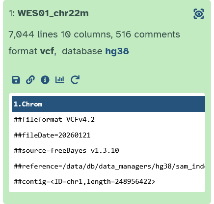{#fig-56}     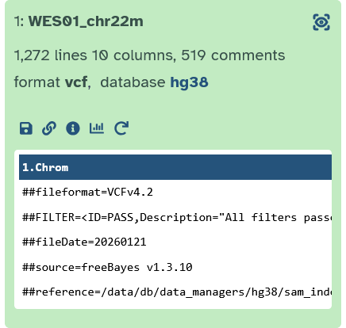{#fig-59}

#### Questions
::: {.callout-important}
Look at the filtered `vcf` file and compare it with the `freebayes` output to answer the following questions. The History panel entries for both files are shown above, and a section of the `freebayes` output is shown in @fig-57.
:::

For questions 1--3, type your answer in the box and press `Check`. For the multiple choice questions (4--9), click on an option to check your answer.

1.  How many variants are there after filtering?

    ::: {.saq answer="1272|1272variants"}
    The History panel shows 1,272 lines and 519 comments for the filtered `vcf` file. Galaxy counts the comments separately, so the 1,272 lines are the variant records.
    :::

2.  What percentage of the variants called by `freebayes` were removed by filtering? (Round to the nearest whole number.)

    ::: {.saq answer="82|82%|81.9|81.9%"}
    7,044 − 1,272 = 5,772 variants were removed, and 5,772 / 7,044 × 100 ≈ 82%. This is expected, as `freebayes` outputs records even if they have a very low probability of variation.
    :::

3.  Using the Phred scale, a site with a `QUAL` of 40 has a 1 in how many chance of not being a true variant?

    ::: {.saq answer="10000|1in10000"}
    A `QUAL` of 40 corresponds to a probability of 10^−40/10^ = 0.0001, or a 1 in 10,000 chance. Each increase of 10 in `QUAL` makes this probability 10 times smaller.
    :::

4.  A site has `QUAL` = 150, `AO` = 30, `SAF` = 15, `SAR` = 15, `RPL` = 14 and `RPR` = 16. Would it pass the filter that we used?

    :::: {.mcq}
    - Yes, it passes all parts of the filter
    - [No, because `QUAL/AO` is too low]{.correct}
    - No, because `QUAL` is too low
    - No, because the alternate allele is not seen on both strands

    ::: {.mcq-explain}
    `QUAL/AO` = 150 / 30 = 5, which is below the threshold of 10. The site passes every other part of the filter: `QUAL` is above 1, the alternate allele is seen on both strands, and at least two reads are balanced to each side of the site.

    `QUAL` tends to increase with the number of observations, so many weak observations can add up to a high `QUAL`. Dividing by `AO` checks how much each observation contributes on average.
    :::
    ::::

5.  A site has `QUAL` = 900, `AO` = 30, `SAF` = 30, `SAR` = 0, `RPL` = 15 and `RPR` = 15. Which part of the filter removes it?

    :::: {.mcq}
    - `QUAL > 1`
    - `QUAL/INFO/AO > 10`
    - [`SAR > 0`]{.correct}
    - `RPL > 1`

    ::: {.mcq-explain}
    All 30 observations of the alternate allele are on the forward strand, and none are on the reverse strand. Reads from a true variant are normally seen in both orientations, as we saw in IGV, so this strand bias suggests an artefact.

    The site has a high `QUAL` and `QUAL/AO` = 900 / 30 = 30, which shows why a high `QUAL` alone is not enough to trust a variant.
    :::
    ::::

6.  Look at the record at `chr2:94255725` in @fig-57. What type of variant is this?

    :::: {.mcq}
    - A single nucleotide variant
    - [An insertion of `A` bases in a run of `A` bases]{.correct}
    - A deletion of `A` bases in a run of `A` bases
    - A substitution of several bases with no change in length

    ::: {.mcq-explain}
    The `ALT` allele is longer than the `REF` allele, and the only difference between them is the length of the run of `A` bases. `Freebayes` reports the bases around the change as well, which is why both alleles are longer than the change itself.

    The number of bases in a run of the same base (a homopolymer) is difficult to sequence and align accurately, which is one reason that indels are more error prone than SNVs and should be interpreted with caution.
    :::
    ::::

7.  The `FORMAT` column of the `vcf` file lists the fields stored in the sample column, starting with `GT` (genotype). What does a `GT` of `0/1` mean?

    :::: {.mcq}
    - The patient has two copies of the reference allele
    - [The patient is heterozygous, with one copy of the reference allele and one copy of the alternate allele]{.correct}
    - The patient has two copies of the alternate allele
    - The genotype could not be determined

    ::: {.mcq-explain}
    In the `GT` field, `0` is the `REF` allele and `1` is the first allele in the `ALT` column, with one value for each copy of the chromosome. A `GT` of `0/0` is homozygous for the reference allele, and `1/1` is homozygous for the alternate allele. A genotype that could not be determined is written as `./.`.
    :::
    ::::

8.  The filtered `vcf` file has 519 comments, 3 more than the `freebayes` output. Where do the extra comments come from?

    :::: {.mcq}
    - The variants that were removed are kept as comments
    - `Freebayes` adds them when its output is opened
    - [`bcftools view` adds them to the header of the file it writes]{.correct}
    - Galaxy adds a comment for each filter that was applied

    ::: {.mcq-explain}
    `bcftools` adds a definition of the `PASS` filter (visible in the History panel entry for the filtered file), and records its version and the command that was run. The removed variants are not kept in the file: 5,772 comments would have been added if they were.

    Keeping this information in the header means that anyone who receives the file can see how it was produced, which is important for reproducibility.
    :::
    ::::

9.  Which statement best describes the filtered `vcf` file?

    :::: {.mcq}
    - All of the remaining variants are true variants
    - All of the variants that were removed were false positives
    - [The file is enriched for true variants, but it may still contain artefacts, and some true variants may have been removed]{.correct}
    - The remaining variants are the ones that cause the patient's disease

    ::: {.mcq-explain}
    Hard filters are a trade-off. Stricter thresholds remove more artefacts but also more true variants (false negatives), and more permissive thresholds do the opposite. Important variants are therefore usually confirmed by inspecting them in IGV or with another sequencing method, such as Sanger sequencing.

    These filters only assess the evidence that a variant is present, not its effect on the patient. We will use annotation and prioritisation in the next section to find out which variants are likely to be relevant to the disease.
    :::
    ::::

## Generating Variant Statistics

The History panel tells us how many records a `vcf` file contains, but not what they are. Use `bcftools stats` to compare the `freebayes` output with the filtered `vcf` file, summarising the types of variants that were removed and kept, and checking their overall quality.

::: {.callout-note appearance="simple"}
1. In the Tool Panel select the `bcftools stats` tool.
1. In `VCF/BCF Data`, select `Dataset collection` as your data type, then select `FreeBayes on collection 26 (variants)` as your data collection.
1. In `Optional VCF/BCF Data to compare against`, select `Dataset collection` as your data type, then select `bcftools view on dataset 51` as your data collection.
1. In the section `Stats options`, set `Choose a reference genome` to `Use a built-in genome`, then select `Human Dec. 2013 (GRCh38/hg38)` as the `Reference genome`.
1. Click on the `Run Tool` button to execute the analysis.
:::

::: {.callout-tip}
Each section of the text file starts with comment lines that describe its columns, and each row starts with the short name of its section.
:::

**The sets of records in the output**

With two input files, `bcftools stats` splits the records into three sets. The second column of each row gives the ID of its set, as defined by the `ID` lines at the top of the file, where Galaxy names our inputs `input0.vcf.gz` and `input1.vcf.gz`.

- ID `0`: records found only in the first file (`freebayes`), which are the records removed by filtering.
- ID `1`: records found only in the second file (the filtered `vcf`).
- ID `2`: records found in both files, which are the records kept by filtering.

**The `bcftools stats` sections used in this workshop**

- `SN`: summary numbers, including the number of records, SNPs, MNPs, indels, others and multiallelic sites.
- `TSTV`: the number of transitions and transversions, and the ratio between them (Ts/Tv).
- `SiS`: singleton statistics, for variants with an allele count of 1.
- `AF`: the number of SNPs and indels in each non-reference allele frequency bin.

The file marks the `ICS` and `ICL` indel context sections as deprecated, so you can ignore them.

**The transition/transversion ratio**

A transition is a substitution between two purines (`A` and `G`) or between two pyrimidines (`C` and `T`). A transversion is a substitution between a purine and a pyrimidine. The Ts/Tv ratio is the number of transitions divided by the number of transversions.

Each base can undergo one transition and two transversions, so random errors are expected to give a Ts/Tv of about 0.5. True human variants are biased towards transitions, with a Ts/Tv of about 2.0--2.1 across the whole genome and about 3.0 in coding regions. These values depend on the regions and the methods used, so treat them as a guide. A Ts/Tv that is much lower than expected suggests that the variants include many false positives.

[Additional Reference](https://samtools.github.io/bcftools/bcftools.html#stats): `bcftools stats` documentation

#### Questions
::: {.callout-important}
Use the `bcftools stats` output comparing the `freebayes` and filtered `vcf` files to answer the following questions.
:::

For questions 1--3, type your answer in the box and press `Check`. For the multiple choice questions (4--9), click on an option to check your answer.

1.  What is the `number of records` for ID `0` in the `SN` section of the output?

    ::: {.saq answer="5772|5772records"}
    The `SN` section reports 5,772 records for ID `0`. These are the records removed by filtering, which matches the 7,044 − 1,272 = 5,772 that we calculated from the History panel.
    :::

2.  What is the Ts/Tv ratio of the variants kept by filtering (ID `2`) in the `TSTV` section of the output?

    ::: {.saq answer="2.7|2.70"}
    The `TSTV` section reports 852 transitions and 316 transversions for ID `2`, and 852 / 316 ≈ 2.70.
    :::

3.  What is the Ts/Tv ratio of the variants removed by filtering (ID `0`) in the `TSTV` section of the output?

    ::: {.saq answer="0.96"}
    The `TSTV` section reports 2,563 transitions and 2,663 transversions for ID `0`, and 2,563 / 2,663 ≈ 0.96.
    :::

4.  The `SN` section reports 0 records for ID `1`. Why?

    :::: {.mcq}
    - The second file failed to load
    - [The filtered `vcf` file was made from the `freebayes` output, so all of its records are also found in the first file]{.correct}
    - `bcftools stats` only reports the first file
    - All of the variants in the filtered `vcf` file are false positives

    ::: {.mcq-explain}
    `bcftools view` only removed records from the `freebayes` output and did not add any, so no record can be found only in the filtered `vcf` file.

    A value other than 0 here would suggest that the two files did not come from the same analysis.
    :::
    ::::

5.  Why do random errors give a Ts/Tv of about 0.5?

    :::: {.mcq}
    - Sequencing machines read purines less accurately than pyrimidines
    - [Each base can undergo one transition and two transversions, so there are twice as many possible transversions]{.correct}
    - Transitions are removed during read filtering
    - Half of the errors are removed when duplicate reads are marked

    ::: {.mcq-explain}
    If every incorrect base is equally likely, an error is twice as likely to be a transversion as a transition, which gives a ratio of 1 / 2 = 0.5.
    :::
    ::::

6.  The variants kept by filtering have a Ts/Tv of 2.70, and the variants removed have a Ts/Tv of 0.96. What does this suggest?

    :::: {.mcq}
    - [Filtering enriched for true variants, while the removed variants are a mixture that includes many errors]{.correct}
    - The removed variants are all random errors, as their ratio is below 1
    - The filter mainly removed true variants, as the removed set has more transversions
    - The difference cannot be interpreted, as Ts/Tv only applies to whole genome data

    ::: {.mcq-explain}
    A ratio of 2.70 lies between the values of about 2.0--2.1 for the whole genome and about 3.0 for coding regions. This is reasonable for exome data, because the sequenced regions are mostly coding but also include some nearby non-coding sequence.

    A ratio of 0.96 is much closer to the 0.5 expected from random errors. It is still above 0.5, which suggests that the removed variants also include some true variants.
    :::
    ::::

7.  For the variants kept by filtering (ID `2`), the `SN` section reports 1,171 SNPs, 16 MNPs, 85 indels and 5 others, which add up to 1,277. This is 5 more than the number of records. Why?

    :::: {.mcq}
    - Five records were removed by filtering but are still counted
    - The header lines are counted as variants
    - Duplicate reads are counted more than once
    - [A multiallelic site has more than one alternate allele, so one record can be counted more than once]{.correct}

    ::: {.mcq-explain}
    Each row of a `vcf` file is one record, but it can list several alternate alleles of different types.

    A record with one SNP allele and one indel allele is counted once as a SNP and once as an indel.

    The `SN` section reports 8 multiallelic sites for ID `2`, and the comment lines above it describe this behaviour.
    :::
    ::::

8.  These `vcf` files contain one patient, who has two copies of each autosome. What genotype does an allele count of 1 in the `SiS` section usually represent?

    :::: {.mcq}
    - Homozygous for the reference allele
    - [Heterozygous, with one copy of the alternate allele]{.correct}
    - Homozygous for the alternate allele
    - A genotype that could not be determined

    ::: {.mcq-explain}
    The allele count is the number of copies of the alternate allele in the sample. A heterozygous genotype such as `0/1` has an allele count of 1, and a homozygous alternate genotype such as `1/1` has an allele count of 2.

    For ID `2` in the `AF` section, the 760 SNPs in the 0.000000 row are the singletons reported in the `SiS` section, and the 408 SNPs in the 0.990000 row are mainly the homozygous alternate sites. With only one sample these bins do not show population allele frequencies, so the 0.000000 row does not mean that the variants are absent.
    :::
    ::::

9.  The Ts/Tv ratio of the filtered `vcf` file is close to the expected value. What can you conclude?

    :::: {.mcq}
    - All of the variants in the file are true variants
    - The file contains the variant that causes the patient's disease
    - [The set of variants looks reasonable overall, but each important variant still needs to be assessed individually]{.correct}
    - No true variants were removed by filtering

    ::: {.mcq-explain}
    Ts/Tv is a summary of the whole file, so it cannot show whether any single variant is true. It also says nothing about the true variants that were removed by filtering, or about the effect of a variant on the patient.
    :::
    ::::

---

# Variant Annotation and Prioritisation

::: {.callout-note}
- **Software**
  - `VEP` (Variant Effect Predictor)

- **Input/Output**
  - `VEP` input:
    - vcf file
    - annotation databases
  - `VEP` output:
    - annotated vcf file
    - text file with annotations
:::

At this point in the analysis of whole exome data from patient WES01, we have assessed the quality of raw sequence data, removed low quality reads, aligned sequence data to the reference genome, removed poorly mapped reads and duplicate reads, assessed the alignment process, called variants and evaluated variant calling. The aim of this practical is to complete the analysis of WES01 by annotating the variants and using a filtering strategy to generate a short-list of potentially pathogenic variants. At the end of this exercise you will be able to:

  1.  Use `VEP` to annotate variants with respect to genes, databases of normal variation, and predictors of pathogenicity
  2.  Apply basic variant filters to generate a list of candidate genes and likely causative variants
  3.  Use phenotype information to prioritise likely causative variants

## Annotating variants

The result of variant calling is a Variant Call Format (VCF) file which describes the location and data quality of each variant. However, the initial VCF file does not provide any information about the functional relevance of variants and their potential contribution to disease. To gain these insights we will use VEP (McLaren et al 2016) to annotate each variant in the VCF file with respect to its location in relation to genes and coding sequences (exon, intron or intergenic), whether it changes the coding sequence and if so how (missense, stop gain, synonymous, frameshift, amino acid consequence etc). In addition, we will cross-reference the variants with databases of known variation (dbSNP, 1000 Genomes, gnomAD), report clinical significance from ClinVar, and add SIFT and PolyPhen predictions of the effect on the protein.

At this stage, it is important to be aware that the annotation result will vary according to the choice of annotation software (alternatives to VEP include SnpEff, Cingolani et al 2012, and ANNOVAR, Wang et al 2010) and transcript set (Ensembl/GENCODE, Flicek et al 2012 and Harrow et al 2012; RefSeq, Pruitt et al 2012). Other tools can complement these annotations: for example, AlphaGenome (Avsec et al 2026) uses deep learning to predict the regulatory effects of variants from DNA sequence.

This variability occurs because a single variant may have different effects in different transcripts (isoforms of the gene) and in some cases may affect different genes (genes can overlap, for example one on the forward strand and the other on the reverse strand) each with multiple transcripts. It is also possible to interpret a single variant as having multiple effects on a single transcript.

VEP reports the consequence of each variant on every overlapping transcript, ranked using a [severity scale](https://www.ensembl.org/info/genome/variation/prediction/predicted_data.html). To obtain one result per variant, a rule must decide which consequence takes precedence: ANNOVAR does this during annotation (see its [precedence rules](https://annovar.openbioinformatics.org/en/latest/user-guide/gene/)), whereas we will use `bcftools split-vep` to select the most severe consequence. Such rules differ between tools, so they can produce different results.

For example, ANNOVAR and VEP agreed on only 65% of Loss of Function (LoF) annotations when both used Ensembl transcripts (McCarthy et al 2014: [Choice of transcripts and software has a large effect on variant annotation](https://doi.org/10.1186/gm543)).

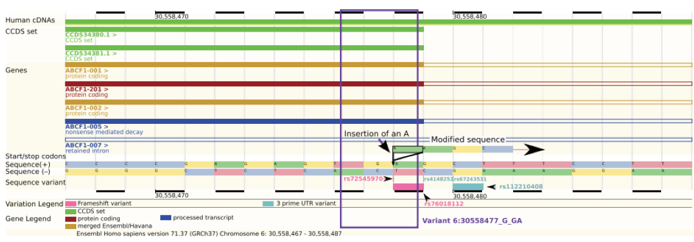{#fig-99}


In this example, an A is inserted within a stop codon (TGA) at the penultimate base of the exon in all transcripts but one. ANNOVAR reported a frameshift insertion and VEP a stop-loss, but the codon remains TGA, so the variant is actually synonymous (the current Sequence Ontology term is `stop_retained_variant`). The distinction matters because VEP rates this consequence as LOW impact, whereas stop-loss and frameshift variants are rated HIGH.

The choice of transcript set had an even bigger effect: ANNOVAR's LoF annotations agreed only 44% of the time between Ensembl and RefSeq transcripts (McCarthy et al 2014). RefSeq was the smaller set, with 105,258 human transcripts in release 57, and includes only transcripts with strong supporting evidence. Ensembl was more comprehensive, with 208,677 transcripts in version 69, drawing on resources including CCDS, HAVANA, Vega (since archived), ENCODE and GENCODE. Many Ensembl transcripts had no similar RefSeq transcript, which partly explains the difference: because ANNOVAR reports the most severe consequence across all transcripts, more transcripts give more opportunities for a severe annotation. These figures reflect the 2012–13 software and transcript releases used in the study, so current values may differ.

Clinical reporting needs a consistent transcript. The [MANE](https://www.ncbi.nlm.nih.gov/refseq/MANE/) project, a collaboration between NCBI and EMBL-EBI, defines MANE Select transcripts that are identical in RefSeq and Ensembl/GENCODE for each protein-coding gene, with MANE Plus Clinical transcripts where these are not enough to report all known clinical variants. MANE is available for GRCh38, the build used in this workshop.

## VEP (Variant Effect Predictor)

[VEP](https://www.ensembl.org/vep) is Ensembl's tool for predicting the effects of variants on genes, transcripts and proteins, and for reporting known variants at the same positions. Here we provide a VCF as input and receive a VCF in which the annotations for each transcript are stored in the `CSQ` INFO field.

[VEP Website](https://www.ensembl.org/vep)

[Paper](https://doi.org/10.1186/s13059-016-0974-4)

[VEP Tutorial](http://www.ensembl.org/info/docs/tools/vep/script/vep_tutorial.html)

::: {.callout-note appearance="simple"}
1. In the Tool Panel select the `Predict variant effects with VEP` tool.
1. In the section `Select source of annotation data`, select `VEP cache with matching version number`.
1. Select `Dataset collection` as your data type, then select `bcftools view on dataset 51` as your data collection.
1. Select `Homo sapiens hg38 (V116)` as the cache file
1. In use FASTA file as reference sequence (optional) select `Locally cached` and then `Human Dec. 2013 (GRCh38/hg38)` as the reference genome.
:::


::: {.callout-note appearance="simple"}
4. On the section `Output options`, set the following options:
    - Output SIFT prediction - `Both`
    - Output PolyPhen prediction - `Both`
:::

{#fig-61}

::: {.callout-note appearance="simple"}
5. On the section `Identifiers`, enable the following `Identifier flags`:
    - Add HGVS nomenclature, both coding and protein sequence names, to the ouput (requires FASTA)
    - Add the gene symbol (e.g. HGNC) (where available) to the output
    - Add a flag indicating if the transcript is the canonical transcript for the gene
    - Add a flag indicating if the transcript is the MANE Select or MANE Plus Clinical transcript for the gene (only for hg38)
    - Output the biotype of the transcript or regulatory feature
:::

{#fig-62}

::: {.callout-note appearance="simple"}
6. On the section `Co-located variants`, enable the following `Co-located variants flags`:
    - Report all known clinical significance values at the given locus (instead of allele-specific)
    - Add the global allele frequency (AF) from 1000 Genomes Phase 3 data for any known co-located variant to the output (--af)
    - Report the highest allele frequency observed in any population from 1000 genomes, ESP or gnomAD
7. On the section `Filtering and QC options`, enable the following `Filtering and QC flags`:
    - Only return consequences that fall in the coding regions of transcripts
7. Click on the `Run Tool` button to execute the analysis.
:::

{#fig-63}

### Variant Effect Prediction algorithms
::: {.callout-tip}
If you are running out of time, you can read this section later and skip to the next section on [filtering and prioritisation of variants](#filtering-and-prioritisation-of-variants).
:::

[Reference](https://www.ensembl.org/info/docs/tools/vep/online/input.html#prediction)

The prediction algorithms and scores used by variant annotation software are outlined below.

**SIFT** predicts whether an amino acid substitution affects protein function, based on sequence homology and the physical properties of amino acids. It is only available for commonly studied species. For both SIFT and PolyPhen, VEP can report a score between 0 and 1, a prediction in words, or both.

**PolyPhen-2** predicts the impact of an amino acid substitution on the structure and function of a protein. Its predictions use features of the substitution, which a probabilistic classifier then assesses:

- Sequence: whether the substitution falls within an annotated site in the protein (e.g. an active or binding site) or a non-globular region (e.g. a transmembrane region)
- Phylogenetics: how often the substitution occurs in a family of related proteins
- Structure: whether the substitution could affect the protein's 3D structure (e.g. the hydrophobic core, electrostatic interactions or interactions with ligands)

Two versions of PolyPhen-2 are available, HDIV and HVAR, which use different datasets to train and test the prediction models.

**PolyPhen-2 HDIV** should be used to evaluate rare alleles involved in complex phenotypes, where both disease-causing and mildly deleterious alleles are treated as damaging. Its dataset compares all damaging alleles in UniProtKB that affect molecular function and cause human Mendelian diseases with differences between human proteins and their closely related mammalian homologues, which are assumed to be non-damaging.

**PolyPhen-2 HVAR** should be used to diagnose Mendelian diseases, which requires distinguishing mutations with diagnostic effects from all other human variation, including many mildly deleterious alleles. Its dataset consists of all human disease-causing mutations from UniProtKB, together with common human non-synonymous SNPs (MAF\>1%) with no known involvement in disease, which are treated as non-damaging.

**LRT** (likelihood ratio test) predicts significantly conserved amino acid positions within the human proteome. Mutations that disrupt highly conserved amino acid residues are classed as 'deleterious', and other mutations as 'neutral' or 'unknown'.

**MutationTaster** uses a Bayes classifier to predict the disease potential of an alteration. It is trained on the frequencies of individual features in a large set of \>390,000 known disease mutations from HGMD Professional and \>6,800,000 harmless SNPs and indels from the 1000 Genomes Project.

**Mutation Assessor** estimates functional impact based on the evolutionary conservation of the affected amino acids in protein homologues. The method has been validated on a large set (60,000) of disease-associated (OMIM) and polymorphic variants.

**FATHMM** (Functional Analysis through Hidden Markov Models) predicts the functional effects of protein missense mutations. It combines sequence conservation within hidden Markov models (HMMs), which represent the alignment of homologous sequences and conserved protein domains, with "pathogenicity weights", which represent the overall tolerance of the protein or domain to mutations.

**MetaSVM** (formerly RadialSVM) is a support vector machine (SVM) ensemble prediction score. It incorporates 10 scores (SIFT, PolyPhen-2 HDIV, PolyPhen-2 HVAR, GERP++, MutationTaster, Mutation Assessor, FATHMM, LRT, SiPhy and PhyloP) and the maximum frequency observed in the 1000 Genomes populations. A larger value means the SNV is more likely to be damaging. Scores range from -2 to 3 in dbNSFP.

**LR score** evaluates the deleteriousness of missense mutations, using logistic regression to integrate information from:

1. function prediction scores (PolyPhen-2, SIFT, MutationTaster, Mutation Assessor, FATHMM, LRT, PANTHER, PhD-SNP, SNAP, SNPs&GO, and MutPred)
1. conservation scores (GERP++, SiPhy and PhyloP)
1. ensemble scores (CADD, PON-P, KGGSeq and CONDEL)
1. maximum minor allele frequency

**VEST3** (Variant Effect Scoring Tool) is a supervised machine learning classifier that prioritises rare missense variants likely to be involved in human disease. It was trained on \~45,000 disease mutations from the Human Gene Mutation Database and \~45,000 common (allele frequency \>1%), putatively neutral missense variants from the Exome Sequencing Project. VEST estimates p-values for variant scores against a null distribution of scores for neutral variants that were not in the training set. These p-values can be aggregated at the gene level across multiple disease exomes to rank genes by their likely involvement in disease.

**CADD raw**: Combined Annotation Dependent Depletion (CADD) integrates multiple annotations into one metric by contrasting variants that survived natural selection (differences between 1000 Genomes and the human-chimpanzee ancestral genome inferred by Ensembl Compara) with simulated mutations. Raw CADD scores come directly from the model. They have no absolute meaning and cannot be compared across different annotation combinations, training sets or model parameters. However, they do have relative meaning: a larger score indicates that a variant is more likely to have a damaging effect.

**CADD phred** scores are Phred-like scaled ranks based on the raw CADD scores across the whole genome. For example, variants in the top 10% of raw scores are assigned a score of 10, the top 1% a score of 20, and the top 0.1% a score of 30.

**GERP RS** (Genomic Evolutionary Rate Profiling Rejected Substitutions) identifies constrained elements in multiple alignments by quantifying substitution deficits. Scores range from -12.3 to 6.17, with 6.17 being the most conserved. Scores greater than 2 give high sensitivity while still being strongly enriched for truly constrained sites.

**PhyloP46way placental** is a phylogenetic conservation score based on the placental mammal subset (33 species) of a multiple alignment of 46 vertebrate genomes.

**PhyloP100way vertebrate** is a phylogenetic conservation score based on a multiple alignment of 100 vertebrate genomes.

**SiPhy 29way logOdds** is a conservation score based on the genomes of 29 mammals. A larger score means the site is more conserved.

## Filtering and Prioritisation of variants

There are many ways to filter the variants. One of the most common strategies is to select coding variants that are either rare or absent from databases of known variation such as [1000 Genomes](https://www.internationalgenome.org/) and [gnomAD](https://gnomad.broadinstitute.org) and predicted to be damaging by in-silico tools.

::: {.callout-note appearance="simple"}
1. In the Tool Panel select the `bcftools split-vep` tool.
1. Select `Dataset collection` as your data type, then select `Predict variant effects on collection 52` as your data collection.
1. On the section `Select INFO annotation to parse`, insert `CSQ`.
1. On the section `Enter fields to be extracted, listed either as indexes or names`, insert `-` (a single dash). This tells `bcftools` to split all `VEP`-generated fields existent in the `vcf` file.
1. On the section `Enter prefix of INFO annotations to be created after splitting the CSQ string (optional)`, insert `VEP_`.
1. On the section `Select transcripts to extract by type and/or consequence (optional)`, insert `worst`. This automatically picks the single most severe consequence for each variant (e.g., prioritizes Missense over Intronic), which is essential for prioritising variants.
1. Set the `output_type` to `uncompressed VCF`.
1. Click on the `Run Tool` button to execute the analysis.
:::

{#fig-64}

Now let's convert the vcf file into a tabular format, so it is easier to read.

::: {.callout-note appearance="simple"}
1. In the Tool Panel select the `bcftools query` tool.
1. Select `Dataset collection` as your data type, then select `bcftools split-vep on collection 65` as your data collection.
1. On the section `Query options`, insert the query below on `Format for Output`.

    <pre style="white-space:pre-wrap; word-break:break-word; overflow-wrap:anywhere;">
    %CHROM\t%POS\t%VEP_SYMBOL\t%VEP_Feature\t%VEP_HGVSc\t%VEP_HGVSp\t%VEP_Consequence\t%VEP_IMPACT\t%VEP_CLIN_SIG\t%VEP_Existing_variation\t%VEP_AF\t%VEP_MAX_AF\t%VEP_PolyPhen\t%VEP_SIFT\t%VEP_CANONICAL\t%VEP_MANE_SELECT\n
    </pre>

1. Enable `Output is tab-delimited`.
1. Click on the `Run Tool` button to execute the analysis.
:::

{#fig-66}

Here is a breakdown of what each column represents in your output file.

| Col | Field | Description |
|-----:|:------|:------------|
| 1 | CHROM | Chromosome name (e.g., `chr1`, `X`). |
| 2 | POS | Genomic coordinate (1‑based position). |
| 3 | VEP_SYMBOL | Official gene symbol (HGNC), e.g., `BRCA1`, `TP53`. |
| 4 | VEP_Feature | Transcript ID (usually Ensembl `ENST…`); `-s worst` shows the most severe transcript. |
| 5 | VEP_HGVSc | Coding DNA change (e.g., `c.152A>G`). |
| 6 | VEP_HGVSp | Protein change (e.g., `p.Lys51Arg` or `p.L51R`); empty if non-coding. |
| 7 | VEP_Consequence | Consequence type (e.g., `missense_variant`, `stop_gained`). |
| 8 | VEP_IMPACT | VEP severity: `HIGH`, `MODERATE`, `LOW`, `MODIFIER`. |
| 9 | VEP_CLIN_SIG | ClinVar significance (`pathogenic`, `likely_pathogenic`, `benign`, etc.). |
| 10 | VEP_Existing_variation | dbSNP rsID (e.g., `rs12345`). |
| 11 | VEP_AF | Global allele frequency (from 1000 Genomes). |
| 12 | VEP_MAX_AF | Max allele frequency across subpopulations (important to validate rarity). |
| 13 | VEP_PolyPhen | PolyPhen prediction (`probably_damaging`, `possibly_damaging`, `benign`). |
| 14 | VEP_SIFT | SIFT prediction (`deleterious` or `tolerated`). |
| 15 | VEP_CANONICAL | `YES` if the transcript is Ensembl canonical. |
| 16 | VEP_MANE_SELECT | MANE Select transcript (e.g., `NM_` number) if available. |

#### Questions
::: {.callout-important}
Use the options that we selected for `VEP` and `bcftools split-vep`, and the table of columns above, to answer the following questions.
:::

For questions 1 and 2, type your answer in the box and press `Check`. For the multiple choice questions (3--10), click on an option to check your answer.

1.  Which `VEP_IMPACT` category does `VEP` assign to a `stop_gained` variant? You can check the [severity scale](https://www.ensembl.org/info/genome/variation/prediction/predicted_data.html) in the `VEP` documentation.

    ::: {.saq answer="HIGH"}
    `VEP` rates `stop_gained` variants as `HIGH` impact, as they are expected to truncate the protein. Missense variants are `MODERATE`, synonymous variants are `LOW`, and variants outside of coding sequences, such as intronic variants, are mostly `MODIFIER`.
    :::

2.  A variant has a `VEP_MAX_AF` of 0.03. What is this frequency as a percentage?

    ::: {.saq answer="3|3%|3.0|3.0%"}
    0.03 × 100 = 3%. In the population where this variant is most common, 3% of the alleles carry it. A frequency this high is difficult to reconcile with a rare, highly penetrant disease.
    :::

3.  A variant is synonymous in one transcript, missense in two transcripts and `stop_gained` in another transcript. Which consequence is reported after running `bcftools split-vep` with `worst`?

    :::: {.mcq}
    - The synonymous consequence, as it is listed first
    - The missense consequence, as it affects the most transcripts
    - [The `stop_gained` consequence, as it is the most severe]{.correct}
    - All of the consequences, with one row for each transcript

    ::: {.mcq-explain}
    `worst` keeps the single most severe consequence for each variant, regardless of how many transcripts have it. This gives us one row per variant, which is easier to review, but the less severe consequences in other transcripts are no longer shown.
    :::
    ::::

4.  A variant has a `VEP_AF` of 0.002 and a `VEP_MAX_AF` of 0.09. What does this suggest about a patient with a rare, highly penetrant disease?

    :::: {.mcq}
    - [The variant is common in at least one population, so it is unlikely to be the cause]{.correct}
    - The variant is rare globally, so it is a strong candidate in every patient
    - The two values disagree, so one of them must be an error
    - The variant must be homozygous, as its frequency is above 1%

    ::: {.mcq-explain}
    A variant can be rare globally and common in one population, as the global frequency averages over populations of different sizes and ancestries. The highest frequency in any population is therefore more informative: it reached 9% here, which is too common for a rare, highly penetrant disease.
    :::
    ::::

5.  A variant has `.` in the `VEP_AF` column. What does this mean?

    :::: {.mcq}
    - The variant has an allele frequency of exactly 0 in all humans
    - The variant is definitely a sequencing artefact
    - [No 1000 Genomes frequency was reported for this variant, although it may still exist in people or other databases]{.correct}
    - The variant is present in every individual in 1000 Genomes

    ::: {.mcq-explain}
    A missing value is not the same as a frequency of 0. The 1000 Genomes Phase 3 data comes from about 2,500 individuals, so many rare variants are not represented, and some populations are under-represented. This is why much larger databases such as gnomAD should also be checked.
    :::
    ::::

6.  Why might a `stop_gained` variant have no value in the `VEP_PolyPhen` and `VEP_SIFT` columns?

    :::: {.mcq}
    - Both tools have predicted that the variant is harmless
    - [Both tools assess amino acid substitutions, which is not what a `stop_gained` variant causes]{.correct}
    - The variant failed the `freebayes` filter
    - `VEP` only runs these tools on the MANE Select transcript

    ::: {.mcq-explain}
    `SIFT` and `PolyPhen-2` predict the effect of replacing one amino acid with another, so they only score missense variants. An empty value here does not mean that a variant is benign, so variants should not be filtered on these columns alone, or truncating variants could be removed.
    :::
    ::::

7.  We asked `VEP` to report all known clinical significance values at the given locus, instead of allele-specific values. What does this mean for a variant with `pathogenic` in the `VEP_CLIN_SIG` column?

    :::: {.mcq}
    - The variant has been confirmed as the cause of disease in this patient
    - The patient's allele has been reviewed by ClinVar for this phenotype
    - All of the variants at this position are harmful
    - [The `pathogenic` label may refer to a different allele at this position, so the exact change should be checked in ClinVar]{.correct}

    ::: {.mcq-explain}
    Different alleles at the same position can have very different effects, such as a synonymous change and a stop gain.

    Reporting every value at the locus avoids missing relevant information, but it means that the label needs to be checked against the patient's allele.

    ClinVar classifications also describe the variant in general, rather than the diagnosis in this patient.
    :::
    ::::

8.  We told `VEP` to only return consequences that fall in the coding regions of transcripts. What is the main limitation of this choice?

    :::: {.mcq}
    - Missense variants will be reported as synonymous
    - [Disease-causing variants outside of coding regions will not be prioritised]{.correct}
    - Allele frequencies can no longer be reported
    - Only variants in the MANE Select transcript will be annotated

    ::: {.mcq-explain}
    This focuses the output on the variants that are easiest to interpret, but it also excludes other classes of potentially relevant variants. If no causative variant is found, this is one of the assumptions to revisit, along with the limits of the exome itself, as these regions were mostly not targeted by the capture kit.
    :::
    ::::

9.  A variant is rare, has `HIGH` impact and is in a protein-coding gene. Why is this not enough to conclude that it causes the patient's disease?

    :::: {.mcq}
    - `HIGH` impact variants are usually sequencing artefacts
    - Rare variants cannot cause disease
    - `VEP` predictions are only valid for common variants
    - [Healthy people also carry rare variants predicted to cause loss of function]{.correct}

    ::: {.mcq-explain}
    A typical person carries around 100 variants predicted to cause loss of function (MacArthur et al 2012), including some with two affected copies, and most have no obvious effect on health.

    Annotation and filtering narrow down the candidates, and the clinical information is needed to interpret them, as we will see in the case study.
    :::
    ::::

## Solving the Case Study

The sequence data that you will be analysing is from a 3-year-old male who presented with difficulty walking after the first year of life, followed by muscle wasting and weakness, muscle rigidity, developmental delay, progressive vision loss leading to blindness, seizures, impaired swallowing, paralysis, and cognitive decline.

A brain MRI scan showed a "tigroid" (leopard‑skin) pattern within the deep white matter. Further clinical testing suggested a diagnosis of [Metachromatic leukodystrophy](https://medlineplus.gov/genetics/condition/metachromatic-leukodystrophy/) (MLD, also called Arylsulfatase A deficiency), which is a lysosomal storage disease commonly listed in the family of leukodystrophies as well as among the sphingolipidoses as it affects the metabolism of sphingolipids.

## Find the candidate variant

#### Questions
::: {.callout-important}
Open your `bcftools query` output and use the patient's clinical diagnosis to find the candidate variant and answer the following questions.
:::

For questions 1--4, type your answer in the box and press `Check`.

1.  The patient's clinical diagnosis is Arylsulfatase A deficiency. Which gene symbol should you look for in column 3 (`VEP_SYMBOL`) of your `bcftools query` output? Think about which gene encodes the Arylsulfatase A enzyme.

    ::: {.saq answer="ARSA"}
    Arylsulfatase A is encoded by the `ARSA` gene. Starting from the clinical diagnosis focuses your search on a gene that is known to cause the patient's disease, rather than reviewing every variant in the file.
    :::

2.  Find the variant in this gene with `pathogenic` in column 9 (`VEP_CLIN_SIG`). What is its position on chromosome 22?

    ::: {.saq answer="50627285|chr22:50627285|22:50627285"}
    The variant is at `chr22:50627285`. Its row also reports `ENST00000216124.10:c.346C>T`, `ENSP00000216124.5:p.Arg116Ter`, `stop_gained` and `HIGH` impact. `YES` in column 15 and `NM_000487.6` in column 16 show that this consequence is on the canonical and MANE Select transcript, the one normally used for clinical reporting.
    :::

3.  At which codon does this variant introduce a stop codon?

    ::: {.saq answer="116|codon116|arg116|p.arg116"}
    `p.Arg116Ter` shows that the arginine at codon 116 is replaced by a stop codon. You can also work this out from `c.346C>T`, as each codon has 3 bases: 346 / 3 = 115.33, so base 346 is the first base of codon 116.
    :::

4.  What is the `VEP_MAX_AF` of this variant as a percentage? (Round to two decimal places.)

    ::: {.saq answer="0.02|0.02%|0.021|0.021%|0.0207|0.0207%|0.02071|0.02071%"}
    0.0002071 × 100 ≈ 0.02%. Even in the population where it is most common, the variant is very rare, which is compatible with a rare disease. `VEP_AF` is empty, so no global frequency from 1000 Genomes was reported for this variant, and `VEP_PolyPhen` and `VEP_SIFT` are empty as this is not a missense variant.
    :::


5.  Look at the protein change in column 6 (`VEP_HGVSp`) of the row for your candidate variant. What is its effect on the protein? The full-length protein has 507 amino acids.

    :::: {.mcq}
    - One arginine is replaced by threonine, and the rest of the protein is unchanged
    - [Translation stops early, so about three quarters of the protein would be missing]{.correct}
    - The normal stop codon is lost, so the protein is longer than usual
    - One arginine is deleted, and the rest of the protein is unchanged

    ::: {.mcq-explain}
    In `p.Arg116Ter`, `Ter` means termination (a stop codon), whereas threonine is `Thr`. At most, 115 of the 507 amino acids would be made, so about 77% of the protein is lost. The mRNA may also be degraded before it is translated, by a process called nonsense-mediated decay. Either way, this variant is expected to cause a loss of function.
    :::
    ::::

## View the candidate variant on IGV

::: {.callout-note appearance="simple"}
1. Download the bam file `Download dataset` and bam index `Download bam_index`
1. Download the filtered `bcftools view` vcf file
1. Upload them to IGV
:::

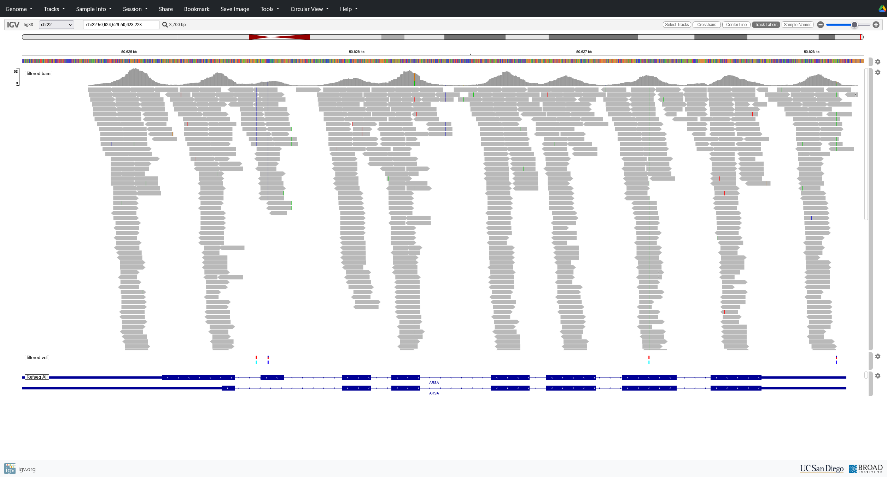{#fig-67}

::: {.callout-note appearance="simple"}
4. View the locus of your candidate variant on IGV
:::

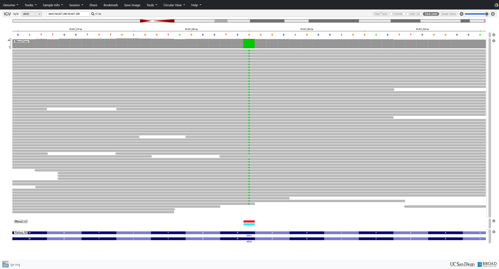{#fig-68}

#### Questions
::: {.callout-important}
Look at the candidate variant in IGV (@fig-68), and then compare your findings with the patient's clinical profile to answer the following questions.
:::

For the multiple choice questions (1--7), click on an option to check your answer.

1.  Look at the reads covering the position of your candidate variant in @fig-68. What is the most likely genotype of the patient at this position?

    :::: {.mcq}
    - Homozygous for the reference allele (`0/0`)
    - Heterozygous (`0/1`)
    - [Homozygous for the alternate allele (`1/1`)]{.correct}
    - The genotype cannot be assessed, as the depth is too low

    ::: {.mcq-explain}
    Virtually all of the reads covering this position carry the `A`, and the coverage track is green for the full height of the bar. Compare this with the heterozygous variant that we saw in `NF2`, where about half of the reads carried the alternate allele.

    You can also confirm this using the `GT` field of the variant in your filtered `vcf` file.
    :::
    ::::

2.  The base change shown in IGV is different from the change reported in column 5 (`VEP_HGVSc`) of your `bcftools query` output. Why are they different?

    :::: {.mcq}
    - IGV and `VEP` are using different reference genomes
    - One of the two tools has made an error
    - The patient has two different variants at this position
    - [The gene is on the reverse strand]{.correct}

    ::: {.mcq-explain}
    `VEP` describes the change relative to the coding sequence, which is complementary to the strand shown in IGV.

    `G` pairs with `C` and `A` pairs with `T`, so `G>A` on the forward strand is the same change as `C>T` on the reverse strand.

    IGV displays the forward strand, so the protein in the RefSeq track reads from right to left here. On the reverse strand, the arginine codon `CGA` becomes the stop codon `TGA`.
    :::
    ::::

3.  Metachromatic leukodystrophy is inherited in an autosomal recessive pattern. Why is the genotype that you found in question 1 important?

    :::: {.mcq}
    - [This variant appears to be homozygous]{.correct}
    - A single affected copy of the gene is enough to cause the disease
    - Autosomal recessive diseases are only caused by variants that are absent from gnomAD
    - The genotype is not important, as this variant is labelled `pathogenic`

    ::: {.mcq-explain}
    Carriers with one affected copy of `ARSA` generally do not develop the disease, so a heterozygous call on its own would not explain this patient's phenotype, and we would need to look for a second variant in `ARSA`.

    Autosomal recessive disease variants can be present in gnomAD, mostly in unaffected carriers.
    :::
    ::::

4.  Which form of metachromatic leukodystrophy best matches this genotype and the patient's clinical profile?

    :::: {.mcq}
    - Adult-onset, as symptoms start slowly and often begin with psychiatric or behavioural changes
    - Juvenile, as symptoms normally start later in childhood
    - [Late infantile, as symptoms started in early childhood and progressed rapidly]{.correct}
    - No form of the disease, as low-frequency variants do not cause severe phenotypes

    ::: {.mcq-explain}
    The patient had difficulty walking after the first year of life, followed by a rapid loss of motor and cognitive function, with vision loss and seizures by the age of 3. This is typical of the late infantile form, the most severe form of the disease.

    Two copies of a variant that truncates the protein are expected to leave little or no working enzyme, which fits with this severe, early-onset presentation. Sulfatides then accumulate and damage the myelin, which is consistent with the white matter changes seen on the MRI scan.
    :::
    ::::

5.  Besides true homozygosity, what could also explain all of the reads carrying the alternate allele?

    :::: {.mcq}
    - The patient has a heterozygous variant, and most heterozygous variants look like this in IGV
    - Duplicate reads were marked by `Picard`, which always removes the reference allele
    - [The other copy of the region is deleted or was not captured]{.correct}
    - The variant is in the MANE Select transcript

    ::: {.mcq-explain}
    Reads can only come from the DNA that was captured and sequenced. If the other copy of `ARSA` was deleted, or if the capture or amplification failed for that copy (allele dropout), then only the `A` allele would be seen.

    Testing the parents helps to tell these situations apart: if the patient is truly homozygous, then we expect both parents to carry the variant, unless it is explained by a rarer phenomenon, such as uniparental disomy.
    :::
    ::::

6.  Which statement best brings together the evidence for this variant?

    :::: {.mcq}
    - The `pathogenic` label alone proves the diagnosis, so no further evidence is needed
    - The variant should be rejected, as it was not reported in 1000 Genomes
    - The variant is likely to be an artefact, as only one allele is visible in IGV
    - [A rare, apparently homozygous truncating variant in the gene for this recessive disease is a very likely cause, but it should still be confirmed]{.correct}

    ::: {.mcq-explain}
    The evidence points the same way: the gene matches the diagnosis, the variant is rare and truncates the protein, the reads support a homozygous genotype, and the severe early-onset phenotype fits a complete loss of function.

    Confirmation would normally include an orthogonal method such as Sanger sequencing, testing the parents, and biochemical tests such as arylsulfatase A activity and urinary sulfatides.
    :::
    ::::

::: {.callout-tip appearance="simple"}
Now that you have identified the variant, explore it further:

- The 1000 Genomes database is relatively small. Use [gnomAD](https://gnomad.broadinstitute.org/) to check how rare the variant is.
- Can you find this variant on [ClinVar](https://www.ncbi.nlm.nih.gov/clinvar)? Does its classification apply to the same allele that the patient carries?
- Find the variant in the `freebayes` VCF file, and look at its `QUAL` score and the other fields used for filtering.
- If you didn't have detailed phenotype information and/or the diagnosis, would you have come to the same conclusion?
:::

---

# Reporting with MultiQC

`MultiQC` collates outputs from the QC and alignment tools used in this workflow (falco, fastp, Picard, samtools, mosdepth, etc.) into a single interactive HTML report. Use `MultiQC` to summarise key metrics, and produce a concise, shareable QC overview for reports and presentations.

::: {.callout-note appearance="simple"}
1. In the Tool Panel select the `MultiQC` tool.
2. For the option `Which tool was used generate logs?` select the relevant tools we used in this workflow. Some tools you also need to select the `Type of output`. Add as many Results sections as needed with the `Insert Results` button until you have added the following reports:
  - `FastQC`
    - Falco R1 Raw data
    - Falco R2 Raw data
  - `fastp`
    - JSON report
  - `samtools`
    - `flagstat`
      - stats on aligned bam file
      - stats on filtered bam file
    - `idxstats`
      - stats on filtered bam file
  - `Picard`
    - `Markdups`
      - tabular file
    - `Insert size`
      - CollectInsertSizeMetrics file
  - `bcftools`
    - `stats`
      - stats on Freebayes and filtered vcf file
3. Add the relevant metrics files to each section.
4. Click on the `Run Tool` button to execute the analysis.
:::

{#fig-69}

Explore the MultiQC report you just generated. Open the HTML report in a web browser and interact with the plots and tables. Hover plots for tooltips, click legend entries to hide/show series, and use the search/filter boxes to focus on metrics.


#### Questions
::: {.callout-important}
Use the `MultiQC` HTML report to answer the following questions. You can hover over the plots to see the exact values.
:::

For question 1, type your answer in the box and press `Check`. For the multiple choice questions (2--6), click on an option to check your answer.

1.  In the `General Statistics` table, what percentage of duplicate reads does `falco` report for the `forward` reads (the `Dups` column)?

    ::: {.saq answer="29|29%|29.0|29.0%"}
    `falco` reports 29.0% for the `forward` reads and 27.7% for the `reverse` reads. On the row for `WES01_chr22m`, the `Duplication` column shows the 5.8% reported by `Picard MarkDuplicates`.
    :::

2.  `falco` reports ~29% duplicate reads, but `Picard MarkDuplicates` reports only 5.8%. Why is there such a large difference?

    :::: {.mcq}
    - `fastp` removed most of the duplicates before `MarkDuplicates` was run
    - [`falco` compares the sequence of each read on its own, while `MarkDuplicates` compares the alignment positions of both reads of a pair]{.correct}
    - `falco` also counts the reads that failed its quality checks as duplicates
    - `MarkDuplicates` only looks for optical duplicates

    ::: {.mcq-explain}
    `falco` has no information about the mate of a read, or about where it aligns, so it counts identical read sequences within each file. Exome capture concentrates the reads on a small part of the genome, so different DNA fragments can often start at the same position and give identical reads in one file.

    `MarkDuplicates` only flags a pair as a duplicate if both of its reads align to the same positions as another pair. Two fragments that share one end but differ at the other are therefore not duplicates, which makes this the better estimate for paired-end data. `falco`'s value is also only an estimate, as the *Sequence Counts* plot notes.
    :::
    ::::

3.  Look at the `Status Checks` heatmap in the `Falco` section. Which module has a different status in the `forward` and `reverse` reads?

    :::: {.mcq}
    - Per Base Sequence Content
    - [Per Tile Sequence Quality]{.correct}
    - Per Sequence GC Content
    - Adapter Content

    ::: {.mcq-explain}
    All of the other modules have the same status in both files. A flow cell is divided into tiles, and the tile number of each read is recorded in its identifier, so `falco` can compare the quality of the tiles. A warning means that at least one tile has lower quality than the others at some positions in the reads, which can be caused by a problem on that part of the flow cell, such as a bubble.

    A heatmap like this one makes differences easy to spot, especially when a project has many samples. An unusual status should then be checked in the full `falco` report.
    :::
    ::::

4.  In the `Variant Substitution Types` plot, the bar for `input0` adds up to about 6,400 substitutions, but the `General Statistics` table reports only 1,171 SNPs for `input0`. Why?

    :::: {.mcq}
    - The plot counts each substitution once for each read that carries it
    - The plot counts each substitution once on each strand of the DNA
    - The plot also includes the indels
    - [The plot also includes the variants that were removed]{.correct}

    ::: {.mcq-explain}
    The plot matches the transitions and transversions that we saw in the `TSTV` section of the `bcftools stats` output, for both the variants removed by filtering (ID `0`) and those kept (ID `2`): 2,563 + 2,663 + 852 + 316 = 6,394. The values in the table, such as the 1,272 variants and the Ts/Tv of 2.70, are those of ID `2`.

    A report like this is only useful if you know where its numbers come from. Here, the `input0` label is used for two different sets of variants, so a plot and a table with the same label do not have to agree.
    :::
    ::::

5.  In the same plot, the largest sections are `C>A` and `G>T`, with about 1,000 substitutions each, even though they are transversions and true human variants are biased towards transitions. What is the most likely explanation?

    :::: {.mcq}
    - `C>A` and `G>T` are transitions, so this is the expected pattern
    - The high GC content of the exons makes transversions more common than transitions in true variants
    - [Many of these calls are artefacts that were removed by filtering]{.correct}
    - The patient has a disease that specifically causes these changes

    ::: {.mcq-explain}
    `C>A` and `G>T` are the same change, seen on opposite strands of the DNA. A well-known cause of this pattern is the oxidation of guanine during library preparation: the damaged base (8-oxoguanine) can pair with `A`, so a `G` can be read as a `T`.

    Filtering removed most of the transversions, as only 316 of the 2,979 were kept. This plot alone does not prove the cause, but you can see how many of each substitution were removed in the `ST` section of the `bcftools stats` output. High GC content would make `C>T` and `G>A` transitions more common too, so it cannot explain this pattern.
    :::
    ::::

6.  The `Variant depths` plot shows that about 35% of the sites have a depth of 2. Could a site with a depth of 2 pass the filter that we used on the `vcf` file?

    :::: {.mcq}
    - Yes, as long as both reads support the alternate allele
    - Yes, as long as `QUAL/INFO/AO` is above 10
    - No, because a site with a depth of 2 cannot have a `QUAL` above 1
    - [No, because `RPR > 1 && RPL > 1` requires at least four reads to support the alternate allele]{.correct}

    ::: {.mcq-explain}
    The filter requires at least two reads balanced to each side of the site, so a site with only two reads cannot pass, whatever its `QUAL`. The peak at a depth of 2 therefore shows the weakly supported records that `freebayes` outputs in the expectation that they will be filtered, and it does not describe the depth of the variants that we kept.

    This is another reason to check which set of variants a plot describes before drawing conclusions from it.
    :::
    ::::

---

# Sharing and publishing your work
::: {.callout-important}
This section is important because it is how this workshop will be assessed. Please read and follow the steps below carefully to share your Galaxy history and workflow so that your work can be reviewed.
:::

We will now learn how to share your current history and workflows.

## Create and apply a workflow from your Galaxy history

Please work through and read the Galaxy Guide on how to create a workflow: [Creating Workflows and Advanced Workflow Options](https://galaxyproject.org/learn/advanced-workflow/)

Reproducing an experiment on the same data or different datasets and comparing the results is a key feature of research that requires keeping a meticulous set of instructions. In many cases, multiple replicates are required and the best approach is an automated analysis that is consistent and less error prone. In Galaxy, the history acts as a detailed list of experimental instructions that can be reproduced and automated by creating a 'Workflow' or bioinformatic pipeline.

::: {.callout-important}
Before making your workflow delete any unwanted steps from the history so that it only includes the steps needed to make the final result.
:::

::: {.callout-note appearance="simple"}
1.  Go to the History panel, click the `History Options ≡`  and select `Extract workflow`.
:::

{#fig-70}

::: {.callout-note appearance="simple"}
Name your workflow : `Alignment_Variant_Calling_and_Filtering-v0.1` (or something similar, maybe add your initials).
:::

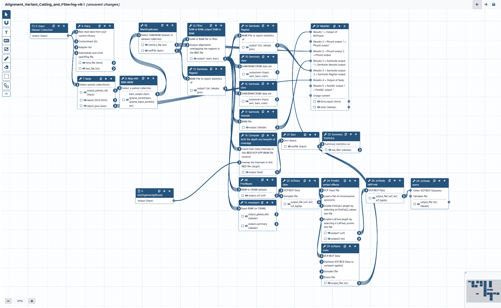{#fig-71}

## Running workflows

Now that you have made a workflow/bioinformatic pipeline you can apply the whole process to a new dataset with just a few clicks. Try your workflow on the original fastq files.

::: {.callout-note appearance="simple"}
1.  In the history panel click the cog icon and select 'Create New' to make a new history.

2.  Before running the workflows, we need to put the raw data files into the new history. You can do this by uploading or copying the data from an existing dataset. We will copy the input files by clicking the cog icon and selecting 'Copy Datasets'

3.  Select 'WES01 NGS Workshop' as the source history and the new 'Unnamed history' as the destination.

4.  Check the boxes for the 3 inputs that we need:
    1. `WES01 fastq` file collection
    2. `chr22.genes.hg38.bed` target `bed` file
    3. `hg38.fa.gz` reference genome

5.  Click on `Copy History Items`.

6.  Click the workflow tab then click your `‘Alignment_Variant_Calling_and_Filtering’` workflow and select run from the drop down menu.

7.  Now choose the relevant input files and click 'Run workflow' to analyse the data.
:::

For additional help please see the Galaxy guide [Extract Workflow from a History](https://wiki.galaxyproject.org/Learn/AdvancedWorkflow/Extract).

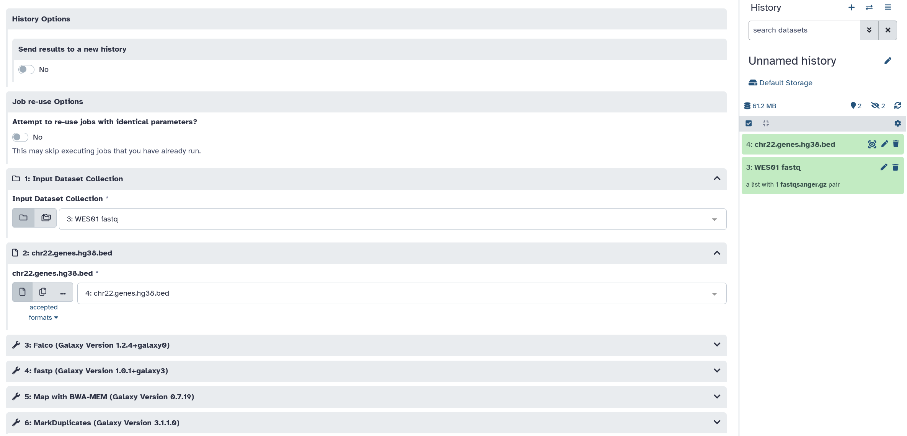{#fig-72}

::: {.callout-note appearance="simple"}
8. When the workflow has finished view the output and check that the result matches your original analysis.
:::

## Sharing Galaxy Histories and Workflows

::: {.callout-important}
1. To share your history, click the `History Options` and select `Share & Manage Access`.
:::

{#fig-70}

::: {.callout-important}
2. Enable `Make History Accessible`. This will generate a link that you can share with others so they can import your history into their Galaxy account.
:::

{#fig-73}

::: {.callout-important}
3. To share your workflow, click the workflow tab, then click your workflow and select 'Share or Download' from the drop down menu.
:::

{#fig-74}


::: {.callout-important}
4. Click 'Make workflow Accessible via Link' to generate a web link that can be used by others to import your workflow and apply it to their own data.
:::

{#fig-75}

------------------------------------------------------------------------
# Acknowledgments

Based on a workshop produced by Will Tapper, University of Southampton, and Stephen Newhouse, King's College London (2016)
