**Contacts:**<br>
  - <alfredo.iacoangeli@kcl.ac.uk><br>
  - <renato.santos@kcl.ac.uk>

::: {.callout-note}
This document is best viewed in a web browser.
:::

# Overview

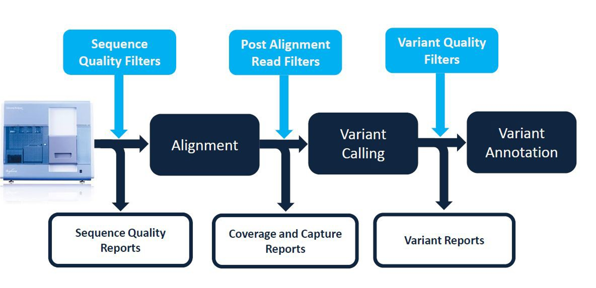{#fig-1}

**The basic analysis of NGS data for clinical genetics involves the following steps:**

- quality control
- alignment (read mapping)
- variant calling
- variant annotation
- variant prioritisation
- reporting

It is essential to assess data quality and performance at each step.

**At the end of this workshop you will be able to:**

1. Use the Galaxy suite of bioinformatic tools
2. Assess the quality of raw NGS data in FASTQ format prior to alignment
3. Align NGS data to the reference human genome using BWA-MEM
4. Describe the contents of FASTQ, SAM and BAM files
5. Make an assessment of the alignment process
6. Conduct quality control filtering of reads
7. Visualise aligned data
8. Call variants and conduct quality control filtering and annotation of variants
9. Prioritise variants for follow-up/clinical reporting

At the beginning of relevant sections the main software used and its basic input and output formats will be listed.

::: {.callout-tip}
Work through this workshop at your own pace. Read all sections carefully and if you're unsure about anything, don't be afraid to ask questions. Have fun!
:::

::: {.callout-warning}
Galaxy is an ongoing project, and bioinformatics tools and software are frequently updated. As a result, some screenshots in this document may not exactly match what you see on the live Galaxy site. Software versions may also differ. Don't panic. Keep calm. The workflows, pipelines, and tools we use remain the same; there may only be minor differences. Use Galaxy's search bar to find the tools you need, ask questions, search on Google, and report any bugs or typos.
:::

## Software used in this workshop

- [Galaxy Europe](https://usegalaxy.eu/)
- [falco](https://github.com/smithlabcode/falco)
- [fastp](https://github.com/OpenGene/fastp)
- [BWA-MEM](https://bio-bwa.sourceforge.net/)
- [samtools](https://www.htslib.org/doc/samtools.html)
- [picard](https://broadinstitute.github.io/picard/)
- [bedtools](https://bedtools.readthedocs.io/en/latest/)
- [mosdepth](https://github.com/brentp/mosdepth)
- [freebayes](https://github.com/freebayes/freebayes)
- [IGV](https://igv.org/)
- [bcftools](https://www.htslib.org/doc/bcftools.html)
- [Ensembl Variant Effect Predictor](https://www.ensembl.org/vep)

## Illumina Sequencing Technology
A short overview of how the Illumina sequencing-by-synthesis (SBS) technology works.

- [Screencast](https://vimeo.com/121178846)
- [Slides](https://depot.galaxyproject.org/hub/attachments/documents/presentations/NGS101-Illumina.pdf)

### Publications

- [Bentley, D. et al., 2008 Accurate whole human genome sequencing using reversible terminator chemistry.](https://doi.org/10.1038/nature07517)
  - The seminal paper describing the Illumina sequencing technology (originally developed by Solexa).
- [Kircher, M. et al., 2011. Addressing challenges in the production and analysis of illumina sequencing data.](https://doi.org/10.1186/1471-2164-12-382)
  - A practical guide for identifying and mitigating systematic errors and artifacts in Illumina sequencing.
- [Nakamura, K. et al., 2011. Sequence-specific error profile of Illumina sequencers.](https://doi.org/10.1093/nar/gkr344)
  - This paper shows that specific motifs, particularly inverted repeats and GGC triplets, can alter polymerase activity or cause single-stranded DNA to fold, resulting in reproducible false SNV calls and coverage bias.
- [Stoler, N. and Nekrutenko, A., 2021. Sequencing error profiles of Illumina sequencing instruments](https://doi.org/10.1093/nargab/lqab019)
  - This paper shows the differences between the newer 2-color sequencing systems (MiniSeq, NextSeq, and NovaSeq) and the older 4-color systems (MiSeq and HiSeq), leading to different error patterns.

---

# The Workshop Case Study

The sequence data that you will be analysing is from a 3-year-old male who presented with difficulty walking after the first year of life, followed by muscle wasting and weakness, muscle rigidity, developmental delay, progressive vision loss leading to blindness, seizures, impaired swallowing, paralysis, and cognitive decline.

A brain MRI scan showed a "tigroid" (leopard‑skin) pattern within the deep white matter. Further clinical testing suggested a diagnosis of [Metachromatic leukodystrophy](https://medlineplus.gov/genetics/condition/metachromatic-leukodystrophy/) (MLD, also called Arylsulfatase A deficiency), which is a lysosomal storage disease commonly listed in the family of leukodystrophies as well as among the sphingolipidoses as it affects the metabolism of sphingolipids.

The patient's exome was sequenced using the paired-end method on an [Illumina HiSeq 2500](https://support.illumina.com/sequencing/sequencing_instruments/hiseq_2500.html) following target enrichment using the [Nextera Rapid Capture Exome and Expanded Exome Enrichment Kits](https://support.illumina.com/sequencing/sequencing_kits/nextera-rapid-capture-exome-kit/documentation.html).

*This dataset is simulated but represents a realistic clinical scenario.*

## Getting the Data
Download the test data from the links provided below.

| File | Description |
|------|-------------|
| [WES01_chr22m_R1.fastq.gz](https://github.com/renatosantos98/ngs_galaxy_workshop/blob/main/WES01_chr22m_R1.fastq.gz) | Illumina FASTQ read 1 |
| [WES01_chr22m_R2.fastq.gz](https://github.com/renatosantos98/ngs_galaxy_workshop/blob/main/WES01_chr22m_R2.fastq.gz) | Illumina FASTQ read 2 |
| [chr22.genes.hg38.bed](https://github.com/renatosantos98/ngs_galaxy_workshop/blob/main/chr22.genes.hg38.bed) | Annotation BED file |

<br>
You should now have the files downloaded into a folder that looks something like @fig-2.

{#fig-2}

---

# Introduction to Galaxy

You will be using Galaxy to build and run your NGS pipeline. Galaxy is an open source, web-based platform and public servers hosted around the world, allowing scientists to analyse large datasets in a reproducible and collaborative way.

::: {.callout-tip}
If you are new to Galaxy start here and consult the help resources.
:::

**Learning Resources**

- [Galaxy NGS 101](https://galaxyproject.org/learn/galaxy-ngs101/)
  This page is designed to serve as a comprehensive resource describing
  manipulation and analysis of NGS data. While it is designed to
  highlight the utility of Galaxy it will also provide information that
  is broadly applicable and can be used for teaching of big data
  biology. It is accompanied by a collection of screencasts.
- [Galaxy Training](https://training.galaxyproject.org/)

**Getting more help on Galaxy**

- [FAQs and Guides](https://galaxyproject.org/support/)
- [GalaxyHelp Community Forum](https://help.galaxyproject.org/)

## Sign in to Galaxy

::: {.callout-important}
If you don't have a Galaxy account, please register at <https://usegalaxy.eu/register/start>.
:::

::: {.callout-note appearance="simple"}
Go to <https://usegalaxy.eu/login> and sign in.
:::

### The Galaxy Interface

- The available software can be found in the **Tools** menu in the left panel.
- The central panel is your working area where you can visualise your data, select tool options and execute jobs.
- Your **History** is shown in the right hand panel. Here you will see your data, results, and a history of all the software that you have used.

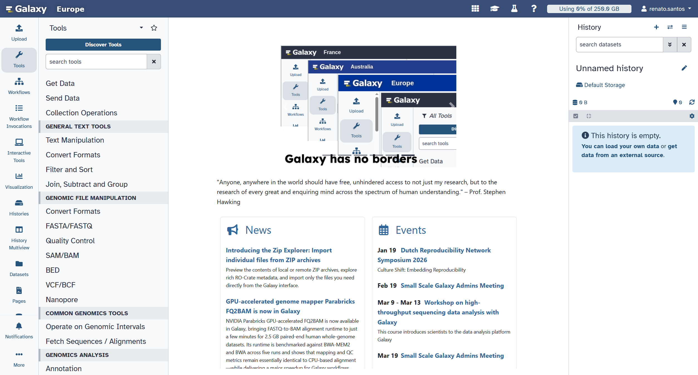{#fig-3}

### The Galaxy Tools Interface

When a tool is selected, the central panel shows important information related to that tool.

An example is shown in @fig-4. This is for the software Freebayes: a Bayesian genetic variant detector designed to find small polymorphisms,
specifically SNPs (single-nucleotide polymorphisms), indels (insertions and deletions), MNPs (multi-nucleotide polymorphisms), and complex
events (composite insertion and substitution events) smaller than the length of a short-read sequencing alignment.

In this page, if you scroll down you will be able to find the following:

- **Tool name, Galaxy Version, and tool version selector and other Galaxy options**
- **Tool parameters** e.g. set input files, reference genome version, tool specific parameters.
- **What it does**
- **Description**
- **Galaxy-specific options**
- **Command-line parameters**
- **Acknowledgments**
- **References**

::: {.callout-tip}
Don't worry about memorising everything on this interface right now, you will become familiar with it as you work through the workshop.
:::

::: figure
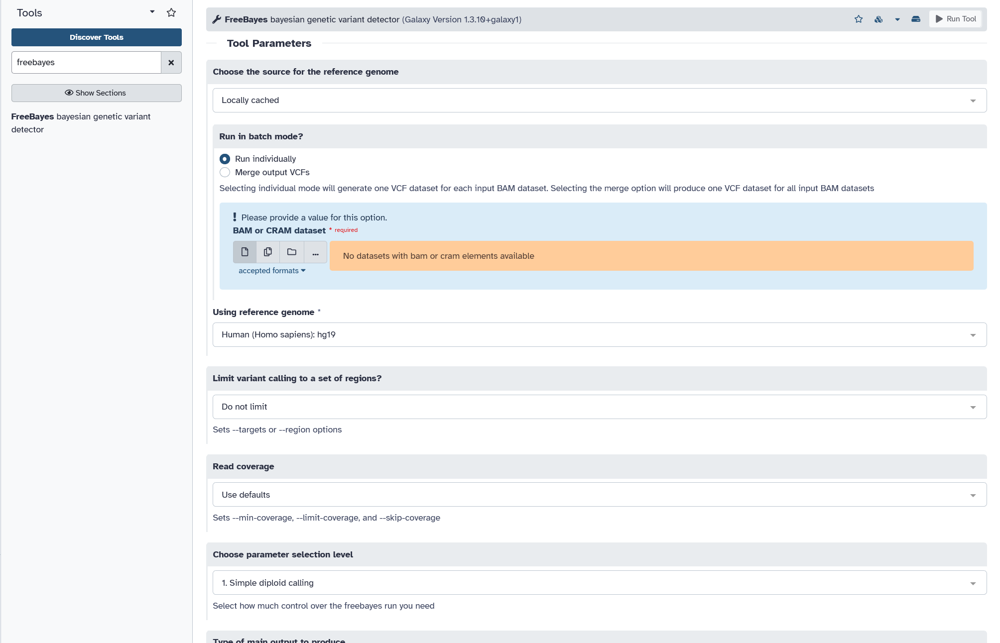{#fig-4}
:::

## Start a new Galaxy History

::: {.callout-note appearance="simple"}
1. Ensure you are starting with a new empty history.
1. If your history is not empty, click the `+` button to create a new history.
:::

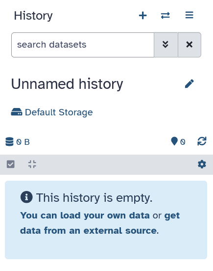{#fig-5}

::: {.callout-note appearance="simple"}
3. Click on the `Edit ✎` button to rename this history.
3. Change the name to **WES01 NGS Workshop**.
3. Click the `Save` button.
:::

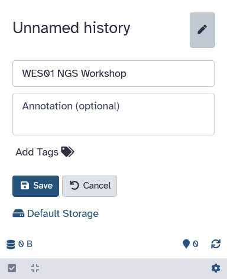{#fig-6}

---

# Data Upload

::: {.callout-note appearance="simple"}
1. Click on `Upload`.
:::

{#fig-7}

::: {.callout-note appearance="simple"}
2. On the top bar, above the box to drop files, click on `Collection`.
2. Change the **Collection:** type setting to `List of Pairs`.
2. Change the **Type (set all)** to `fastqsanger.gz`.
2. Click `Choose local file`.
:::

{#fig-8}

::: {.callout-note appearance="simple"}
6. Navigate to the `Downloads` folder on your local computer and select the two `.fastq.gz` files and click `Open`.
:::

{#fig-9}

The files will appear in the **Upload from Disk or Web** window.

::: {.callout-note appearance="simple"}
7. Click `Start` to begin the upload of the files.
7. Wait until the files are successfully uploaded and the `Build` button becomes enabled (it will turn blue). This may take some time, depending on server load.
7. Click on the `Build` button to create a list of paired `fastq` files.
:::

{#fig-10}

::: {.callout-note appearance="simple"}
10. Name the collection **WES01 fastq**.
10. Click on `Create collection`.
:::

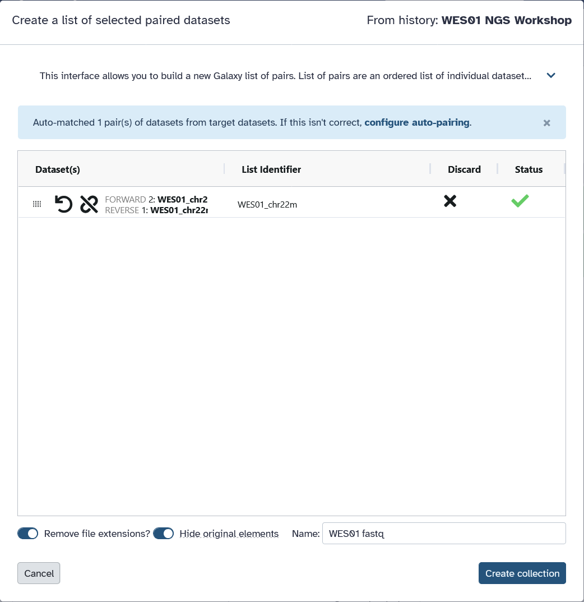{#fig-11}

A confirmation window will appear if the files were successfully paired.

::: {.callout-note appearance="simple"}
12. Click `Exit` on the confirmation window.
:::

{#fig-12}


::: {.callout-note appearance="simple"}
13. Open the `Upload from Disk or Web` window again.
13. On the top bar, above the box to drop files, click on `Regular`.
13. Click `Choose local file` again and upload the `chr22.genes.hg38.bed` file.
13. Change the file type to `bed`.
13. Change the genome reference to `Human Dec. 2013 (GRCh38/hg38)`.
13. Click `Start` to begin the upload of the `bed` file.
13. When the file has finished uploading, click `Close`.
:::

{#fig-13}

The uploaded data will appear in the History panel on the right.

{#fig-14}

::: {.callout-tip}
You can inspect and view the contents of the data uploaded by clicking on the `View 👁` button next to the name of each file.
:::

## NGS Data Files and Formats

### FASTQ Files
#### Data Format

One lane of paired end sequencing was performed so you have two files of raw sequence data (`WES01_chr22m_R1.fastq.gz` and `WES01_chr22m_R2.fastq.gz`) which contain all the sequence data for read 1 (R1) and read 2 (R2) respectively (@fig-15). To save on computing time and disk space, the NGS data for WES01 has been filtered to contain reads mapping to chromosome 22 only and the files have been compressed with `gzip` (hence the `.gz` extension).

{#fig-15}


The raw NGS data is held in [FASTQ format](https://en.wikipedia.org/wiki/FASTQ_format).
`fastq` files are the simplest and most generic way of storing biological sequences and their corresponding quality scores.

A `fastq` file has four line-separated fields per sequence:

  - Line 1 begins with an `@` character and is followed by a sequence identifier and an optional description (like a FASTA title line).
  - Line 2 is the raw sequence letters.
  - Line 3 begins with a `+` character and is optionally followed by the same sequence identifier (and any description) again.
  - Line 4 encodes the quality values for the sequence in Line 2, and must contain the same number of symbols as letters in the sequence.

A `fastq` file containing a single sequence might look like this:

```
@HWI-D00119:50:H7AP8ADXX:1:1212:10369:36657/1
GCACGTGGGTTCCCAGTAGCAAGAAACTAAAGGGTCGCAGGCCGGTTTCTGCTAATTTCTTTAATTCCAAGACAGTCTCAAATATTTTCTTATTAACTTCC
+
CCCFFFFFHHHHHJJJHIJJJJJJJJJJJJJJJJHFGIIIGJJJJIIHHHHHHFFFFFFFEEEEEEEEEDDDDDDDDDDEDDDDFFEEEDDDDEEEDDEDD
```

#### Illumina sequence identifiers

Sequences from the [Illumina instruments](https://help.basespace.illumina.com/files-used-by-basespace/fastq-files#format) use systematic identifiers.

```
@EAS139:136:FC706VJ:2:2104:15343:197393 1:Y:18:ATCACG
```

  Value         Description
  ------------- ------------------------------------------------------------------------
  **EAS139**    the unique instrument name
  **136**       the run id
  **FC706VJ**   the flowcell id
  **2**         flowcell lane
  **2104**      tile number within the flowcell lane
  **15343**     'x'-coordinate of the cluster within the tile
  **197393**    'y'-coordinate of the cluster within the tile
  **1**         the member of a pair, 1 or 2 (paired-end or mate-pair reads only)
  **Y**         Y if the read is filtered, N otherwise
  **18**        0 when none of the control bits are on, otherwise it is an even number
  **ATCACG**    index sequence

::: {.callout-note}
More recent versions of Illumina software output a sample number (as taken from the sample sheet) in place of an index sequence.

For example, the following header might appear in the `fastq` belonging to the first sample of a batch of samples:
`@EAS139:136:FC706VJ:2:2104:15343:197393 1:N:18:1`
:::

#### Phred Quality Scores

A [Phred quality score](https://en.wikipedia.org/wiki/Phred_quality_score) is a measure of the quality of the identification of the sequence of bases generated
by automated DNA sequencing.

A phred score or quality value Q is an integer mapping of p (i.e., the probability that the corresponding base call is incorrect).

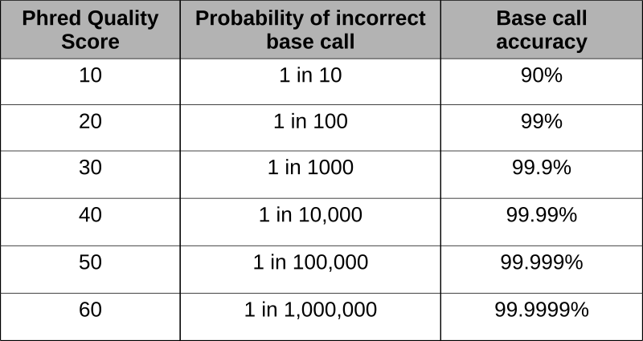{#fig-16}

- <https://en.Wikipedia.org/wiki/FASTQ_format#Quality>
- <https://en.Wikipedia.org/wiki/FASTQ_format#Encoding>

It is more efficient to store the sequence quality scores as characters because they require less disk space than numbers (i.e. 1 character
versus multiple digits). Characters are also more reliable and portable than numbers. Sequence quality scores on the phred scale are determined
by mapping the ASCII character to its associated number.

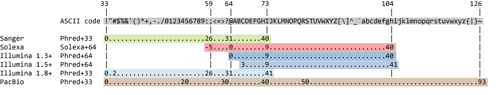{#fig-17}

### BED Files

The uploaded file `chr22.genes.hg38.bed` describes the exome sequences and genes that have been targeted in your trial data, stored in `.bed`
format. A **BED** file is a tab-delimited text file that defines genomic features.

Briefly, the [BED format](https://en.wikipedia.org/wiki/BED_(file_format)) consists of one line per feature, each containing 3-12 columns of data, plus optional feature definition lines.
A minimal `.bed` file uses 3-4 tab delimited columns of data to describe the target:

The first three fields in each feature line are required:

1.  **chrom** - Chromosome (e.g. chr3, chrY, chr2_random) or [scaffold](https://en.wikipedia.org/wiki/Scaffolding_(bioinformatics)) (e.g. scaffold10671) name
2.  **chromStart** - Start coordinate on the chromosome for the sequence considered (this position is zero-based, i.e. the first base on a chromosome is 0).
3.  **chromEnd** - End coordinate on the chromosome for the sequence considered; this position is non-inclusive, unlike chromStart (this position is one-based, i.e. the first base on a chromosome is 1)
4.  **name** - Name of the feature in that line.

Let's have a quick look at `chr22.genes.hg38.bed`

```
chr22	15721285	15721631	POTEH-chr22-16256332-16256677
chr22	15719659	15719778	POTEH-chr22-16258185-16258303
chr22	15710867	15711034	POTEH-chr22-16266929-16267095
chr22	15708019	15708090	POTEH-chr22-16269873-16269943
chr22	15702685	15702756	POTEH-chr22-16275207-16275277
chr22	15700077	15700215	POTEH-chr22-16277748-16277885
chr22	15698661	15698768	POTEH-chr22-16279195-16279301
chr22	15690025	15690709	POTEH-chr22-16287254-16287937
chr22	15528158	15529137	OR11H1-chr22-16448826-16449804
chr22	16590757	16592810	CCT8L2-chr22-17071648-17073700
```
---

# Pre-alignment QC

::: {.callout-note}
- **Software**
  - falco
  - fastp

- **Input/Output**
  - falco input (collection of raw fastq files):
    - `WES01_chr22m_R1.fastq.gz`
    - `WES01_chr22m_R2.fastq.gz`
  - falco output:
      - `html` report
        - forward
        - reverse
      - stats text file
        - forward
        - reverse
  - fastp input (collection of raw fastq files):
    - `WES01_chr22m_R1.fastq.gz`
    - `WES01_chr22m_R2.fastq.gz`
  - fastp output (collection of quality filtered fastq files):
    - `WES01_chr22m_R1.fastp.fastq.gz`
    - `WES01_chr22m_R2.fastp.fastq.gz`
    - `html` report
    - stats `JSON` file

:::

## Extract Read Group Information

::: {.callout-note appearance="simple"}
1. View the `fastq` files and note the following information:
    - The unique instrument name
    - The run id
    - The flowcell id
    - The flowcell lane
:::

This information can be obtained from the sequence identifier i.e. line 1 of the first fastq entry.


    Header: @HWI-D00119:50:H7AP8ADXX:1:1212:10369:36657/1
                |       |     |      |
    mapping:    1       2     3      4

1.  The unique instrument name:**HWI-D00119**
2.  The run id: **50**
3.  The flowcell id: **H7AP8ADXX**
4.  The flowcell lane: **1**

::: {.callout-tip}
For more information on `fastq` headers please see the [Illumina sequence identifiers](#illumina-sequence-identifiers) section.
:::

::: {.callout-important}
We will use this information later, during the alignment process, to add metadata, such as read group and run information, to the sample we are analysing.
:::

## Quality assessment of raw sequence data

To assess the quality of the raw sequence data and to guide quality control we will use a program called `falco`, short for *FastQC Alternative Code*. The program outputs
summary plots and text files that show if there are any problems with the data, which could influence alignment or variant calling if not addressed.

You can learn more about `falco` [here](https://github.com/smithlabcode/falco), and the older (and slower) program on which it is based, `FastQC` [here](https://www.bioinformatics.babraham.ac.uk/projects/fastqc/).

::: {.callout-note appearance="simple"}
1. In the Tool Panel select the `Falco` tool.
1. For the `Raw read data from your current history` choose `Dataset collection` (the third button) and then ensure the `WES01 fastq` collection is selected.
1. Click on the `Run Tool` button to execute the analysis.
:::

{#fig-18}

The FastQC reports will be shown in the History Pane. Queued jobs are shown in grey with a clock symbol, running jobs in yellow with a buffering symbol, and finished jobs in green, failed jobs in red with a cross.

Depending on server load, it may take a little while for the jobs to start running.

{#fig-19}


::: {.callout-note appearance="simple"}
4. Click on `Falco on collection 5: Webpage`, then on `WES01_chr22`, and then the view button for the `forward` and `reverse` files to view the respective QC reports.
:::

#### Questions
::: {.callout-important}
Use the html `falco` reports from the `forward` and `reverse` sequencing data to answer the following questions.
:::

For questions 1 and 2, type your answer in the box and press `Check`. For the multiple choice questions (3--6), click on an option to check your answer.

1.  How many reads does each file contain?

    ::: {.saq answer="505987"}
    Both files contain 505,987 reads. The forward and reverse files of a paired-end run should contain the same number of reads, as each read in one file is paired with a read in the other.
    :::

2.  How long are the reads (bp)?

    ::: {.saq answer="101"}
    All reads are 101 bp long, in both files.
    :::

3.  Which of the following quality checks has **failed** in **both** the `forward` and `reverse` files?

    :::: {.mcq}
    - Per base sequence quality and Adapter Content
    - Overrepresented sequences and Sequence Length Distribution
    - [Per base sequence content and Per sequence GC content]{.correct}
    - None of the above

    ::: {.mcq-explain}
    Both files fail *Per base sequence content* and *Per sequence GC content*, and give a warning for *Adapter Content*. A failed module does not necessarily mean the data is unusable: `falco` (like `FastQC`) assumes a random, whole-genome library, and some modules routinely fail for targeted sequencing data such as exomes.
    :::
    ::::

4.  Look at the *Per base sequence content* plots of the `forward` and `reverse` reads. What do they show, and what is the most likely reason this check has failed?

    :::: {.mcq}
    - The four lines overlap at 25% each along the whole read, so the check has failed in error
    - The four lines drift apart towards the end of the reads, because base quality falls there
    - The four lines are far apart along the whole length of the reads, because the sample is contaminated
    - [The four lines are uneven over the first ~15 bases and then flat and parallel, because library preparation introduces a sequence bias at the start]{.correct}

    ::: {.mcq-explain}
    In a random library, the proportions of A and T, and of G and C, should be nearly equal at every position, giving flat, parallel lines. `falco` fails this module if A and T, or G and C, differ by more than 20% at any position. Here G and C differ by almost 30% at base 4, but from about base 16 onwards the lines settle at G ≈ C ≈ 28% and A ≈ T ≈ 22%, consistent with the high GC content of this sample.

    The bias appears at the same positions in both files, so it was introduced when the library was made, not by the sequencer. The Nextera transposase enzymes used to fragment and tag the DNA prefer certain sequences, so the first bases of each read are not random.
    :::
    ::::

5.  Compare the *Per base sequence quality* plots of the `forward` and `reverse` reads. Which statement best describes them?

    :::: {.mcq}
    - [Quality declines towards the end of the reads]{.correct}
    - Quality is constant along the full length of the reads
    - Quality is lowest at the start of the reads and improves towards the end
    - The `forward` reads have lower quality than the `reverse` reads at every position

    ::: {.mcq-explain}
    Median quality peaks mid-read (~Q40) and falls towards the 3' end in both files, reaching ~Q31 in the `forward` reads and ~Q34 in the `reverse` reads. The reverse read is sequenced last, after the clusters have gone through many more chemistry cycles, so it is usually of lower quality.
    :::
    ::::

6.  The *Per sequence GC content* module fails, with a mean GC content of ~56% (the human genome average is ~41%). What is the most likely explanation?

    :::: {.mcq}
    - The sample is contaminated with bacterial DNA
    - [The reads come from captured exons]{.correct}
    - The reads are too short for GC content to be measured reliably
    - The library is dominated by adapter dimers

    ::: {.mcq-explain}
    Coding exons are GC-rich, and chromosome 22 is one of the most GC-rich human chromosomes. Exome capture also enriches some regions more than others, so the GC distribution departs from the smooth normal curve `falco` models for a random genomic library. *Overrepresented sequences* passes, which argues against contamination or adapter dimers.
    :::
    ::::


### Per base sequence quality
{#fig-20}

Looking at the per base sequence quality for the forward reads you will notice that the average base quality drops towards the end of the reads (@fig-20).

This drop in quality is typical for ensemble-based sequencing by synthesis (SBS) methods, such as Illumina, which add complementary bases one at a time in a cluster of identical sequences to determine a consensus sequence from the 'average' sequence signal over all copies in the cluster.

As nucleotides are added some of the sequences in a cluster grow at a different rate and become desynchronized which reduces the accuracy of the 'average' sequence signal (@fig-21).

{#fig-21}

Another particularly important plot is that of 'Overrepresented sequences', which lists sequences that account for more than 0.1% of the total. The presence of an overrepresented sequence suggests that the sequence is biologically significant, or that the library is contaminated or has low diversity.

To check for contamination, each overrepresented sequence is compared to a database of common contaminants such as sequencing adapters, which can then be removed from
the raw `fastq` data.

## Read filtering

In a typical analysis you may want to raise technical issues identified by `falco`, such as low read count, poor quality, and overrepresented sequences with the data provider. To ensure that only data of a certain quality is used for further analysis we will exclude low quality reads.

In paired-end data there are two `fastq` files per lane of sequencing which are synchronised so that matching pairs are stored in the same line of each file (e.g. the read in line 1, file 1 is paired with the read in line 1, file 2 and so on).

The fastq files need to be joined and the reads have to be analysed and trimmed or removed as a pair. To maintain this order when filtering, we will filter the `fastq` files using [`fastp`](https://github.com/OpenGene/fastp).


::: {.callout-note appearance="simple"}
1. In the Tool Panel select the `fastp` tool.
1. For the `Single-end or paired reads` section choose `Paired collection` and then ensure the `WES01 fastq` collection is selected.
1. Open the `Adapter Trimming Options` section and enable `Adapter sequence auto-detection for paired-end`.
:::

{#fig-22}

::: {.callout-note appearance="simple"}
4. Open the `Quality filtering options`. Note that, by default, `fastp` will discard reads where more than 40% of bases have Phred quality of 15 or lower, and reads with more than 5 unknown nucleotides (*N*). Leave the defaults as is, do not add any values to the boxes.
:::

{#fig-23}

::: {.callout-note appearance="simple"}
5. Open the `Length filtering options`. Note that, by default, `fastp` will discard reads shorter than 15 base pairs. Set the `Length required` parameter to `40`. This will discard reads shorter than 40 base pairs.
5. Open the `Read modification options`, and then `Per read cutting by quality options`. Set the lower `Cut by quality in tail (3') (Move a sliding window from front to tail)` to `Yes` and ensure the `Cutting window size for cut right` is set to `4` and `Cutting mean quality for cut right` is set to `20`.
5. Click on the `Run Tool` button to execute quality filtering.
:::

{#fig-24}

{#fig-25}

You should now have set up 3 `fastp` operations:

1.  Enabled `Adapter sequence auto-detection for paired-end`
1.  Discard reads below a specified length (40bp)
1.  Per read cutting by quality: trim the 3' end of each read using a sliding window (`Cut by quality in tail (3')`), moving from front to tail with a window size of 4 and cutting when the mean quality in the window drops below Q20

We are also using the default `fastp` quality filtering options, which include discarding reads with more than 40% of bases with less than Q15, and reads with more than 5 *N* nucleotides.

For paired-end data a particular strength of `fastp` is that it retains the pairing of reads (from R1 and R2) in the filtered output files.

The two `fastq` files (R1-paired and R2-paired) contain one read from each pair where both have survived filtering. Additionally, `fastp` can also output two `fastq` files (R1-unpaired and R2-unpaired) which contain reads where one of the pair failed the filtering steps, although this is currently not supported by the `fastp` version on Galaxy.

## Quality assessment of read filtering

::: {.callout-note appearance="simple"}
1. When the `fastp on collection 5: HTML report` has finished, click on the collection to open it, and then click on the `View 👁` button to view the report.
:::

{#fig-26}

::: {.callout-note appearance="simple"}
2. Check whether `fastp` detected the adapter sequences automatically, and whether they correspond to the sequences below, which were used in the [Nextera Rapid Capture Exome and Expanded Exome Enrichment Kits](https://support.illumina.com/sequencing/sequencing_kits/nextera-rapid-capture-exome-kit/documentation.html).
:::

The Nextera adapters used are:
```
Read1  I7_Nextera_Transposase_1  CTGTCTCTTATACACATCTCCGAGCCCACGAGAC
Read2  I5_Nextera_Transposase_1  CTGTCTCTTATACACATCTGACGCTGCCGACGA
```

[Further Reading](https://knowledge.illumina.com/library-preparation/general/library-preparation-general-reference_material-list/000001314): what sequences do we use for adapter trimming?

::: {.callout-tip}
If the adapter sequences were not correctly detected by `fastp`, it means that it could not correctly attempt to overlap the forward and reverse reads. Check that you correctly uploaded both the `R1` and `R2` `fastq.gz` files.
:::

::: {.callout-note}
`fastp` includes many adapter sequences in its database, but it is not exhaustive. If `fastp` does not detect your adapters in a future experiment, you would need to provide the adapter sequencers to the tool so it can trim them correctly.

However, please note that many modern sequencers and basecalling pipelines now perform adapter trimming automatically, so adapters may not always be detected at this stage and may not need to be trimmed.
:::

::: {.callout-note appearance="simple"}
3. Check the quality control results, before and after filtering.
:::

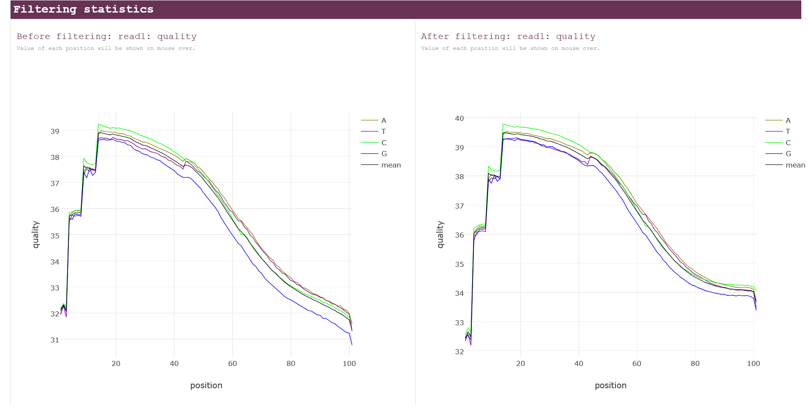{#fig-27}

There are other ways to clean up reads more agressively, such as applying stricter filtering criteria, which may be appropriate depending on data quality and analysis requirements. However, these approaches can reduce usable data and should be used with caution.

#### Questions
::: {.callout-important}
Use the `fastp` report to answer the following questions.
:::

For questions 1 and 2, type your answer in the box and press `Check`. For the multiple choice questions (3--9), click on an option to check your answer.

1.  How many reads does **each** file contain after quality filtering? (Hint: `fastp` reports the total for the `forward` and `reverse` files combined.)

    ::: {.saq answer="452030"}
    Each file contains 452,030 reads. The `fastp` summary reports 904,060 reads after filtering, which is the total for both files, just as the 1,011,974 reads before filtering are 2 × 505,987, the number `falco` reported for each file. Because `fastp` removes reads as pairs, both files keep the same number of reads.
    :::

2.  What is the mean length (bp) of the `forward` reads after quality filtering?

    ::: {.saq answer="96"}
    The mean length is 96 bp for the `forward` reads and 94 bp for the `reverse` reads, down from 101 bp. Trimming adapters and low-quality 3' ends shortens some of the reads, so they are no longer all the same length. The `reverse` reads are shorter on average because their quality is lower, so more of their 3' ends are trimmed.
    :::

3.  Have the correct adapter sequences been detected?

    :::: {.mcq}
    - Yes, they are TruSeq adapters
    - [Yes, they are Nextera adapters]{.correct}
    - No, no adapters were detected
    - Only the read 1 adapter was detected

    ::: {.mcq-explain}
    Both detected sequences match the Nextera adapters listed above, which were used to prepare this library. They share the same first 19 bases (`CTGTCTCTTATACACATCT`), which is the reverse complement of the mosaic end (ME) sequence that the Nextera transposase binds to.
    :::
    ::::

4.  The *Insert size peak* is 101 bp, and the reads are 101 bp long. Which reads will contain adapter sequence?

    :::: {.mcq}
    - All reads, because adapters are always sequenced at the start of each read
    - Reads from DNA fragments (inserts) longer than 101 bp
    - [Reads from fragments shorter than 101 bp]{.correct}
    - None, because the insert size peak is not longer than the reads

    ::: {.mcq-explain}
    The sequencer reads from the start of the insert. If the insert is shorter than the read length, the sequencer reads through the end of the insert and into the adapter on the other side.

    Fragments longer than 101 bp give reads with no adapter, but fragments shorter than 101 bp do, so with a peak at 101 bp a substantial proportion of the reads will contain adapter. With paired-end data, `fastp` finds these reads by overlapping the `forward` and `reverse` reads, which is why both files are needed for adapter auto-detection.

    Note that 48% of the read pairs could not be overlapped, so their insert size is unknown: it is either shorter than 30 bp or longer than 172 bp (or the reads contain too many sequencing errors).
    :::
    ::::

5.  Compare the read 1 quality plots before and after filtering (@fig-27). Has the read quality improved?

    :::: {.mcq}
    - [Yes, mean quality is higher, but it still declines towards the 3' end of the reads]{.correct}
    - Yes, but only improved at the start of the reads
    - Yes, quality is now constant along the whole read
    - No, the plots are identical

    ::: {.mcq-explain}
    The mean quality is higher at every position after filtering, and the proportion of bases with Q30 or higher is now 96.2%. Filtering removes the worst reads and trims their poor-quality ends, but it cannot change how the sequencer works, so quality still falls along the read and the dip in the first few bases remains.
    :::
    ::::

6.  Which filter removed the most reads?

    :::: {.mcq}
    - Low quality (more than 40% of bases below Q15)
    - Too many *N* bases
    - [Too short (below 40 bp)]{.correct}
    - Adapter dimers

    ::: {.mcq-explain}
    The *Filtering result* section shows that 107,506 reads (10.6%) were removed for being too short, compared with only 18 for low quality, 0 for too many *N* bases and 390 (0.04%) for being adapter dimers. Trimming adapters and low-quality 3' ends shortens reads, and any read left shorter than 40 bp is discarded. Overall, 89.3% of reads passed the filters.
    :::
    ::::

7.  The *GC content* is ~56% before filtering and ~55.7% after filtering. Why has it barely changed?

    :::: {.mcq}
    - `fastp` does not measure GC content after filtering
    - [The high GC content comes from the captured exons, not from low-quality reads or adapters, so filtering does not change it]{.correct}
    - Filtering should have lowered it to the genome average of ~41%, so filtering has failed
    - The adapter sequences have the same GC content as the reads

    ::: {.mcq-explain}
    As we saw in the `falco` reports, the high GC content is a property of the sample: coding exons and chromosome 22 are GC-rich. Filtering removes poor-quality reads and adapter sequence, which make up a small fraction of the data, so it does not change the GC content of the library.
    :::
    ::::

8.  For Illumina HiSeq systems, the typical minimum specification for data quality is that >85% to 90% of bases are expected to have a Q30 score or higher. Does this sample pass QC after quality filtering?

    :::: {.mcq}
    - [Yes, 96.2% of bases are Q30 or higher after filtering]{.correct}
    - It passed before filtering, but fails after filtering because bases were removed
    - No, it failed before filtering and still fails after filtering
    - No, only 29.8% of bases are Q40 or higher

    ::: {.mcq-explain}
    Before filtering, ~90% of bases were Q30 or higher, which already met the 85% specification. After filtering, 96.2% of bases are Q30 or higher, comfortably passing. The specification refers to Q30, not Q40: a Q30 base has a 1 in 1,000 chance of being incorrectly called.
    :::
    ::::

9.  The number of bases fell from 102.2 M to 86.6 M (~15%), and 10.7% of the reads were discarded. Considering this, which statement is most reasonable?

    :::: {.mcq}
    - Trimming was essential, because without it most reads would have failed the Q30 specification
    - Trimming should never be used for Illumina data
    - Trimming removed all of the reads with low-quality bases
    - [Trimming improved the data quality, but at a noticeable cost in reads and bases]{.correct}

    ::: {.mcq-explain}
    The proportion of bases with Q30 or higher rose to 96.2% after filtering, and the reads are cleaner, but about 15% of the bases were lost, mostly because 107,506 reads were left shorter than 40 bp.

    The data was already close to specification before filtering (~90% of bases at Q30 or higher), so trimming was not essential for it to pass QC.

    Modern aligners such as BWA-MEM can soft-clip poor-quality read ends, and variant callers generally take base quality into account, so stricter trimming is rarely needed for data of this quality. In your own experiments, weigh the loss of data against the gain in quality.
    :::
    ::::

---

# Alignment

::: {.callout-note}
- **Software**
  - `BWA-MEM`

- **Input/Output**
  - `BWA-MEM` input: Reference Genome and indexes for use with bwa
    - hg38 reference genome (`fasta` file)
    - `BWA-MEM` indexes (provided by Galaxy):
      - `.amb` is text file, to record appearance of N (or other non-ATGC)
        in the ref `fasta`.
      - `.ann` is text file, to record ref sequences, name, length, etc.
      - `.bwt` is binary, the Burrows-Wheeler transformed sequence.
      - `.pac` is binary, packaged sequence (four base pairs encode one
        byte).
      - `.sa` is binary, suffix array index.
    - `BWA-MEM` input (paired `fastq` files):
      - `WES01_chr22m_R1.fastp.fastq.gz`
      - `WES01_chr22m_R2.fastp.fastq.gz`
  - `BWA-MEM` output (aligned sequences file):
    - `.bam` file
    - `.bai` (`bam` index: automatically produced by Galaxy)
:::

## Align sequence data to the reference human genome

We will use a program called `BWA-MEM` (Burrows-Wheeler Aligner) to align the sequence data to the human genome. You can learn more about the `BWA` program [here](http://bio-bwa.sourceforge.net/).

::: {.callout-note appearance="simple"}
1. In the Tool Panel select the `Map with BWA-MEM` tool.
1. For the `Will you select a reference genome from your history or use a built-in index?`, ensure `Use a built-in genome index is selected`, then choose `Human Dec. 2013 (GRch38/hg38)` as the reference genome.
1. In the section `Single or Paired-end reads`, select `Paired Collection` as your data type, then select `fastp on collection 5: Paired-end output` as your data collection.
:::

{#fig-28}

## Set read groups per the SAM/BAM specification

::: {.callout-warning}
This next step is very important! Please do not skip it.
:::

::: {.callout-tip}
Please see the [Extract Read Group Information](#extract-read-group-information) section to remember how this information was obtained.
:::


::: {.callout-note appearance="simple"}
4. In the section `Set read groups information?`, select the option `Set read groups (SAM/BAM specification)`.
4. Enter the following for the options:
    - Read group identifier (ID): `HWI-D00119.50.H7AP8ADXX.1.WES01`
    - Read group sample name (SM): `WES01`
    - Platform/technology used to produce the reads (PL): `ILLUMINA`
    - Library name (LB): `nextera-wes01-blood`
:::

{#fig-29}

::: {.callout-note appearance="simple"}
6. Continue entering the following options
    - Date that run was produced (DT): `2017-02-23`
    - Platform unit (PU): `H7AP8ADXX.1`
6. Click on the `Run Tool` button to execute the analysis.
:::
{#fig-30}

[Additional Reference](https://gatk.broadinstitute.org/hc/en-us/articles/360035890671-Read-groups): what are read groups?

## A new NGS Data Format
### The Binary Alignment/Map file (BAM)

The alignment process maps the read data to the reference human genome creating a **Binary Alignment/Map file (BAM)**. The `bam` file is not in text format, so it is not directly viewable. Clicking the view button will open the alignment on IGV (Integrative Genomics Viewer).

[Additional Reference](https://galaxyproject.org/learn/galaxy-ngs101/#understanding-and-manipulating-sambam-datasets): understanding and manipulating SAM/BAM datasets

---

# Post Alignment QC and Filtering

::: {.callout-note}
- **Software**
  - `Picard MarkDuplicates`
  - `samtools`
  - `bedtools`
  - `mosdepth`

- **Input/Output**
  - `Picard MarkDuplicates` input: `BWA-MEM` aligned BAM file
  - `Picard MarkDuplicates` output: BAM file with duplicate reads flagged
  - `samtools view` input: duplicate read marked BAM file
  - `samtools `view` output: Filtered duplicate read marked BAM file and related bai index
  - `samtools flagstat` input: Filtered duplicate read marked BAM file
  - `samtools flagstat` output: text file
  - `samtools idxStats` input: Filtered duplicate read marked BAM file
  - `samtools idxStats` output: text file
  - `bedtools coverageBed` input:
    - Filtered duplicate read marked BAM file
    - Target intervals file `.bed` file
      - chr22.genes.hg19.bed
  - `bedtools coverageBed` output: text file
  - `mosdepth` input: Filtered duplicate read marked BAM file
  - `mosdepth` output: text file
:::

For variant calling, reads with low mapping quality (phred <20), unmapped reads, secondary alignments, reads failing platform/vendor quality checks, and duplicate reads that have the same start and stop position are typically removed or ignored because they can influence genotyping accuracy.

Duplicates originate mostly from DNA library preparation methods that rely on PCR amplification, which can create multiple sequencing reads from the same original DNA molecule (PCR duplicates) and thus artificially inflate read depth and bias allele fractions. Other sources include optical duplicates (sequencing clusters imaged more than once) and platform-specific artefacts.

For example, at heterozygous sites the two alleles should be evenly distributed (50% of reads have the A allele and 50% have the B allele) but if reads with the A allele are duplicated the A allele will become overrepresented and the site might be misinterpreted as homozygous for the A allele.

We will use `Picard MarkDuplicates` and then `samtools view` to make a new BAM file which flags duplicate molecules and excludes poor quality reads.

[Additional Reference](https://www.cureffi.org/2012/12/11/how-pcr-duplicates-arise-in-next-generation-sequencing/): How PCR duplicates arise in next-generation sequencing

## MarkDuplicates

::: {.callout-note appearance="simple"}
1. In the Tool Panel select the `MarkDuplicates` tool.
1. Select `Dataset collection` (the third button) as your data type, then select `Map with BWA-MEM on collection 13 (mapped reads in BAM format)` as your data collection.
1. Leave all other settings on their default options.
1. Click on the `Run Tool` button to execute the analysis.
:::

{#fig-31}


This tool examines aligned records in the supplied SAM or BAM dataset to locate duplicate molecules. All records are then written to the output file with the duplicate records flagged. Two files are produced, 1) the new BAM file with duplicate reads marked and 2) a metrics file summarising the number of duplicate reads found.

## Filter BAM based on mapping quality and bitwise flags

::: {.callout-note appearance="simple"}
1. In the Tool Panel select the `Filter SAM or BAM, output SAM or BAM files on FLAG MAPQ RG LN or by region` tool.
1. Select `Dataset collection` as your data type, then select `MarkDuplicates on collection 20: BAM` as your data collection.
1. For `Minimum MAPQ quality score` type `30`.
1. On the section `Filter on bitwise flag` select `yes`.
1. Select the following options on `Skip alignments with any of these flag bits set`:
    - `The read is unmapped`
    - `The alignment or this read is not primary`
    - `The read fails platform/vendor quality checks`
    - `The read is a PCR or optical duplicate`
1. Leave all other settings on their default options.
1. Click on the `Run Tool` button to execute the analysis.
:::

{#fig-32}

This tool uses the `samtools view` command in the `samtools` toolkit to filter a `sam` or `bam` file on the MAPQ (mapping quality), FLAG bits, Read Group, Library, or region.

The input is a `bam` file, and the output file will also be `bam`.

## Generating Alignment Statistics

When aligning reads to the reference genome anywhere between 0 to 20% of reads are not aligned due to sequencing errors, sample contamination (e.g. bacterial or viral DNA), gaps in the reference genome and genome variation. Use `samtools flagstat` to determine how many reads have been aligned. We will compare the duplicate-marked `bam` file with the final filtered `bam` file.

::: {.callout-note appearance="simple"}
1. In the Tool Panel select the `Samtools flagstat tabulate descriptive stats for BAM datset` tool.
1. Select `Dataset collection` as your data type, then select `MarkDuplicates on collection 20: BAM` as your data collection.
1. Click on the `Run Tool` button to execute the analysis.
1. Run the `Samtools flagstat` tool again for the `Filter SAM or BAM, output SAM or BAM on collection 23: bam` dataset.
:::

{#fig-33}

{#fig-34}

::: {.callout-important}
Click the view data icon for both and use the Flagstat output to determine the percentage of mapped reads, and calculate the number of reads that were filtered out (difference in total read count between the raw and filtered BAM files).
:::

**Before Filtering**

{#fig-35}

**After Filtering**

{#fig-36}

## Viewing the BAM File

As mentioned above, the `bam` file is held in binary format and so it can not be viewed directly.

However, the `bam` file can be converted to a viewable text format known as a SequenceAlignment/Map file or `sam` file. The `sam` file format is described in
detail [here](https://samtools.github.io/hts-specs/SAMv1.pdf).

Let's use `samtools view` to convert the filtered `bam` file to a `sam` file so we can view its contents.

::: {.callout-note appearance="simple"}
1. In the Tool Panel select the `Samtools view` tool.
1. Select `Dataset collection` as your data type, then select `Filter SAM or BAM, output SAM or BAM on collection 23: bam` as your data collection.
1. In the `Output format` select the option`SAM`.
1. Click on the `Run Tool` button to execute the conversion.
1. Click view data to view the SAM file.
:::

{#fig-37}

::: {.callout-note appearance="simple"}
8. Spend some time inspecting this file and its contents and format.
8. **Optional.** Repeat the conversion step but exclude the SAM header by disabling `Include SAM header in the output?`. This will make it easier to view the aligned reads.
:::

### The SAM/BAM Format

In the SAM file, lines starting with "@" are headers, and those without "@" are read sequences aligned to the reference.

  **SAM_Column**   Description
  ---------------- ------------------------------------------------
  **QNAME**        Query name of the read or the read pair
  **FLAG**         Bitwise flag (pairing)
  **RNAME**        Reference sequence name
  **POS**          1-Based leftmost position of clipped alignment
  **MAPQ**         Mapping quality (Phred-scaled)
  **CIGAR**        Extended CIGAR string (operations MIDNSHP)
  **MRNM**         Mate reference name ('=' if same as RNAME)
  **MPOS**         1-based leftmost mate position
  **ISIZE**        Inferred insert size
  **SEQQuery**     Sequence on the same strand as the reference
  **QUAL**         Query quality (ASCII-33=Phred base quality)

<br>

Please see the following two reads. Note that they both have the same read id. `HWI-D00119:50:H7AP8ADXX:1:2202:7515:35573`
```
HWI-D00119:50:H7AP8ADXX:1:2202:7515:35573   99  chr22   16123342    60  101M    =   16123407    166 CTACCTCCAGAGCATCAGGCCTTGCCTGGCCCTGGGCAGAGAGCTGGTCTACAACCGGCGGCCTGGGGACGAGGGCACTGTCATGTCTCTAGCTGGGAAAT   CCCFFFFFHHHHHIJIJJJIJJJIJIIJIIJJIJIIJJIJJJJIIIJHJJJJJIGGHIGFDDDDDDDDDDDD@BBDDDDDDDDDDCDEDDEDDDDDDDCDD   XA:Z:chr14,-19719869,101M,2;chr14,+19855438,101M,2; MD:Z:101    PG:Z:MarkDuplicates RG:Z:HWI-D0011.50.H7AP8ADXX.1.WES01 NM:i:0  AS:i:101    XS:i:91

HWI-D00119:50:H7AP8ADXX:1:2202:7515:35573   147 chr22   16123407    60  101M    =   16123342    -166    GGGACGAGGGCACTGTCATGTCTCTAGCTGGGAAATACACATTGAACAACTGGTTGGCAACGTTAACGTTGAGCCAGGCGGGCATGCACGCAACATACTAC   B@DDDDDDDDDDDDDDDDDDDDDDEEDEEFFEFFFEEHHHHFHGJJJJJJIIIIJJIIJJIJJJIGGJHEHEGHHFIIJJIJJIJIJJHHHHHFFFFF@B@   XA:Z:chr14,+19719804,101M,2;chr14,-19855503,101M,3;chr2,+132481028,101M,3;  MD:Z:101    PG:Z:MarkDuplicates RG:Z:HWI-D0011.50.H7AP8ADXX.1.WES01 NM:i:0  AS:i:101    XS:i:91
```

**SAM/BAM Format mapping:**

**QNAME**: HWI-D00119:50:H7AP8ADXX:1:2202:7515:35573\
**FLAG**: 147\
**RNAME**: chr22\
**POS**: 16123407\
**MAPQ**: 60\
**CIGAR**: 101M\
**MRNM**: =\
**MPOS**: 16123342\
**ISIZE**: 166\
**SEQQuery**: GGGACGAGGGCACTGTCATGTCTCTAGCTG...\
**QUAL**: B@DDDDDDDDDDDDDDDDDDDDDDEEDEEF...

::: {.callout-important}
Use [this website](https://broadinstitute.github.io/picard/explain-flags.html) to decode the flags (99 and 147) of the reads and determine which strand of the
reference genome they are aligned with.
:::

## Compressing the BAM File
While `bam` files are already compressed, further compression is possible using the `cram` format. `cram` (Compressed Read Alignment Map) is a more efficient file format that compresses alignment data by storing only the differences between the reads and the reference genome, rather than storing the full sequence data.

CRAM files typically achieve 4-10x better compression than BAM files, making them ideal for long-term storage and data transfer. However, CRAM files require the reference genome to be accessible for reading, so the reference sequence must be provided.

::: {.callout-note appearance="simple"}
1. In the Tool Panel select the `samtools view` tool.
1. Select `Dataset collection` as your data type, then select `Filter SAM or BAM, output SAM or BAM on collection 23: bam` as your data collection.
1. In the `Output format` select the option `CRAM (-C)`.
1. In the section `Use a reference sequence?`, select `Use a built-in genome` and then for the reference genome, select `Human (Homo sapiens): hg38`.
1. Click on the `Run Tool` button to execute the conversion.
:::

{#fig-38}


::: {.callout-important}
Once the CRAM file has been generated, compare the file sizes of the `bam` and `cram` files.

  1. In your History panel, click on the `bam` file dataset and note the file size displayed.
  2. Click on the `cram` file dataset and note the file size displayed.
  3. Calculate the compression ratio: (`bam` size - `cram` size) / `bam` size × 100%

How much space has been saved by converting to CRAM format?
:::

::: {.callout-note}
`cram` files are particularly useful for large-scale sequencing projects where storage and transfer costs can become significant.
:::

## Generate alignment statistics per chromosome

When viewing the SAM file you may have noticed that not all the reads are mapped to chromosome 22 which is surprising as the sequence was initially filtered for reads mapping to chromosome 22 only. Use the IdxStats to generate a breakdown of the number of reads that map to each chromosome or contig.

::: {.callout-note appearance="simple"}
1. In the Tool Panel select the `Samtools idxstats` tool.
1. Select `Dataset collection` as your data type, then select `Filter SAM or BAM, output SAM or BAM on collection 23: bam`, or the `cram` file we just generated in `Samtools view on collection 26: filtered alignments`, as your data collection.
1. Click on the `Run Tool` button to execute the analysis.
1. Click on `View` when the job has finished running.
:::

{#fig-39}

This will produce a file with 4 columns:

  1. Reference sequence identifier
  2. Reference sequence length
  3. Number of mapped reads.
  4. Number of placed but unmapped reads (typically unmapped partners of mapped reads)

::: {.callout-important}
Use the `idxStats` output to calculate the percentage of reads mapping to chromosome 22.
:::

{#fig-40}

## Determine the distribution of insert sizes

Insert sizes, the region between the 5' ends of the paired reads (see @fig-41), are important for correct alignment and variant calling. For variant calling, reads are assumed to be independent.

However, if an insert is smaller than the sum of the read pairs the reads will overlap and not be independent in the overlapping region (shown in yellow).

If a PCR error occurs in this overlapping region it will be present in both reads which may result in there being enough evidence to call a variant at this site that is not real.

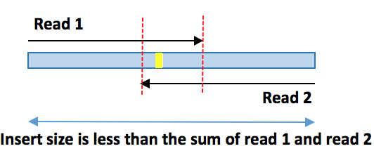{#fig-41}

Picard  `CollectInsertSizeMetrics` provides data on the Insert Size, including the parts covered by the reads and the unsequenced gap in the middle.

::: {.callout-note appearance="simple"}
1. In the Tool Panel select the `CollectInsertSizeMetrics` tool.
1. Select `Dataset collection` as your data type, then select `Filter SAM or BAM, output SAM or BAM on collection 23: bam` as your data collection.
1. On the section `Use a reference sequence` set it to `Use a built-in genome` and the genome reference to `Human Dec. 2013 (GRch38/hg38)`.
1. Click on the `Run Tool` button to execute the analysis.
:::

{#fig-42}

This tool will produce two output files. The first is a tabular output with some metrics and a list of insert sizes and counts. The second output is a .pdf with a insert size histogram, that should look like @fig-43.

{#fig-43}

The aspects to look out for here depend on the experiment.

In **WGS**, the goal is uniform coverage, so the ideal insert target range is usually **350bp - 500bp**. With 2x100bp reads, a 350bp insert leaves a ~150bp gap between reads, which provides good physical coverage for spanning repetitive regions or detecting deletions.

What to watch out for:

  - You want a sharp bell curve, as a tight distribution allows structural variant callers (which rely on deviations from the expected insert size) to work accurately.
  - If the histogram is very wide, the library size selection was poor.
  - Bimodality (two distinct peaks in the histogram) usually means two different library preps were mixed, or there was a problem with fragment selection during library preparation.

In **WES** the goal is capturing coding regions efficiently, so the ideal insert target range is lower at around **150bp - 250bp**. This is because exome capture probes work best on specific fragment sizes. If fragments are too large, they may overlap into intronic regions, and if they are too small, the probes may not bind well.

What to watch out for:

  - If your median is very low (e.g., 130bp), your reads overlap significantly. While you will get high-confidence variant calling in the overlap, the data may generate false positive variants, as seen above (@fig-41), and there was a waste in sequencing capacity, since there was less than 200bp of data per read pair.
  - Look at the very left of the histogram. A sharp spike near ~0-30bp often indicates adapter dimers, i.e., empty molecules composed of two adapters joined together without a fragment between them. This wastes sequencing reads with bad data.

::: {.callout-important}
1. View the tabular output and record the mean insert size and standard deviation.
2. Compare the histogram generated on the aligned data by `CollectInsertSizeMetrics`, with the histogram generated on the raw sequencing data by `fastp`. Why are there differences between the two plots?
:::

## Depth of Coverage

Identification and accuracy of variant calling relies on the depth and breadth of sequence coverage. To calculate coverage, a file in bed format describing the target region is required. Bed files use tab delimited columns of data to describe the target: chromosome, left location (bp), right location (bp).

### Calculate depth per base
We will use the uploaded bed file which describes the exome sequence that has been targeted in your trial data `chr22.genes.hg38.bed`.

The options we selected will report the per-base of coverage for each feature in the `bed` file.

::: {.callout-note appearance="simple"}
1. In the Tool Panel select the `bedtools Compute both the depth and breadth of coverage` tool.
1. Switch the tool software version to `2.22.1`.
1. For the `Count how many intervals in this BED/VCF/GFF/BAM file (source)` section select `Dataset collection` as your data type, then select `Filter SAM or BAM, output SAM or BAM on collection 23: bam` as your data collection.
1. For the `overlap the intervals in this BED file (target)` select the `chr22.genes.hg38.bed` file.
1. Enable the option `Report the depth at each position in each B feature`.
1. Click on the `Run Tool` button to execute the analysis.
:::

{#fig-44}

The output will consist of a line for each one-based position in each
feature, followed by the coverage detected at that position.

The 6th (last) column is the **Depth** at position X (Column 5) for the genomic feature (exon) A (columns 1-4).

Note that the order in column 5 is not numerical or in order. This is a quirk of `bed` files' sorting.

```
chr22	15528158	15529137	OR11H1-chr22-16448826-16449804	1	23
chr22	15528158	15529137	OR11H1-chr22-16448826-16449804	10	33
chr22	15528158	15529137	OR11H1-chr22-16448826-16449804	100	65
```
For line 1: the depth at the first base (indicated by col 5) of the feature/exon OR11H1-chr22-16448826-16449804 is 23.
For line 2: the depth at the 10th base (indicated by col 5) of the feature/exon OR11H1-chr22-16448826-16449804 is 33.
For line 3: the depth at the 100th base (indicated by col 5) of the feature/exon OR11H1-chr22-16448826-16449804 is 65.

### Correct the sort order

::: {.callout-note appearance="simple"}
7. In the Tool Panel select the `Sort data in ascending or descending order` tool.
7. For the `Sort Query` section select `Dataset collection` as your data type, then select `Compute both the depth and breadth of coverage across collection 26` as your data collection.
7. In `Column selections`, Click `+ Insert Column Selections` twice.
7. Add `Sort on Column 2` Leave all the other options as they are.
7. Add `Sort on Column 5` Leave all the other options as they are.
7. Click on the `Run Tool` button to execute the analysis.
:::

{#fig-45}

::: {.callout-note appearance="simple"}
13. View the new sorted data. It should look like @fig-46.
:::

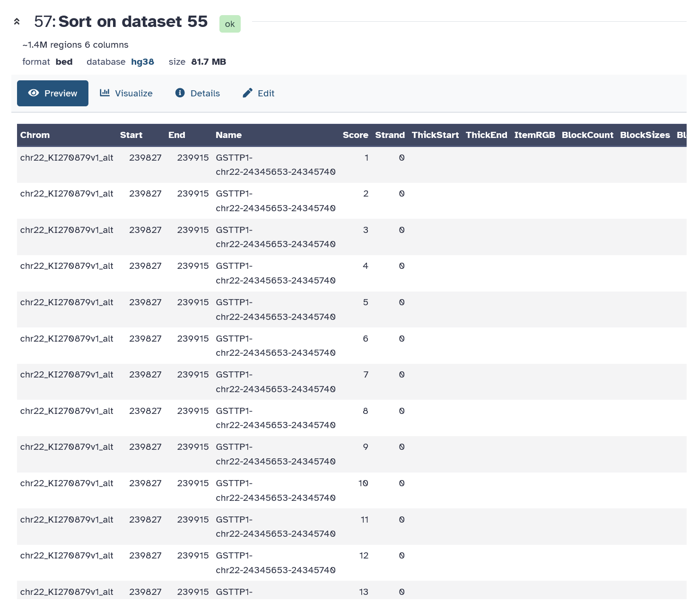{#fig-46}

### Targeted Regions Mean Coverage

We can calculate the mean coverage of the targeted regions by averaging over the values in column 6.

::: {.callout-note appearance="simple"}
14. In the Tool Panel select the `Summary Statistics` tool.
14. For the `Summary statistics on` section select `Dataset collection` as your data type, then select `Sort on collection 54` as your data collection.
14. Set `Column or expression` to `c6`.
14. Click on the `Run Tool` button to execute the analysis.
:::

{#fig-47}

::: {.callout-note appearance="simple"}
18. View the data. It should look like @fig-48.
:::

{#fig-48}

### Depth of coverage by chromosome

What is the average depth of coverage across the entirety of chromosome 22?

To quickly and efficiently calculate this value, we will be using the [mosdepth](https://github.com/brentp/mosdepth) tool.

::: {.callout-note appearance="simple"}
19. In the Tool Panel select the `mosdepth` tool.
19. Select `Dataset collection` as your data type, then select `Filter SAM or BAM, output SAM or BAM on collection 23: bam` as your data collection.
19. Click on the `Run Tool` button to execute the analysis.
:::

{#fig-49}

::: {.callout-note appearance="simple"}
18. View the `mosdepth summary` file to see the coverage of depth calculated by chromosome. It should look like @fig-50.
:::

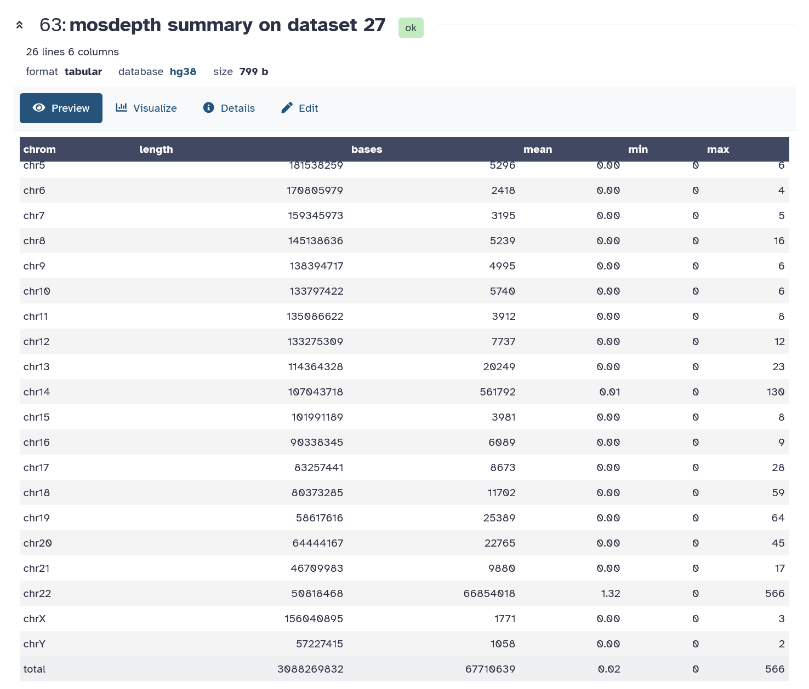{#fig-50}

::: {.callout-important}
Use the mosdepth report to answer the following questions:

1. What is the mean depth of coverage across the entire chromosome 22?
2. What is the mean depth of coverage across the entire genome?
:::

---

# Visualising Alignments

::: {.callout-note}
- **Software**
  - `IGV`

- **Input/Output**
  - `IGV` input:
    - `bam` and `bai` file
    - reference genome (IGV provided)
    - optional additional files
      - vcf from variant calling
      - bed files (gene annotations)
  - `IGV` output:
    - Interactive visual display of data
:::

## Integrative Genomics Viewer (IGV)
It is useful to look at the aligned data as this is one way to identify variants, assess their quality, and determine their genomic context with respect to other annotated features of the human genome such as genes, repeat sequences, transcription factor binding sites etc. We therefore recommend alignment visualisation before validation of in-silico variants by independent sequencing methods.

The Integrative Genome Viewer (IGV) is a popular tool for interrogating aligned NGS data (look here for more details on IGV: www.ncbi.nlm.nih.gov/pubmed/22517427).

You can run IGV on its [Web App](https://igv.org/app/). Don't worry if you accidentally close Galaxy. Your files will remain saved as long as you don't delete them.

[About IGV](hhttps://igv.org/doc/)

## Viewing the BAM File

::: {.callout-note appearance="simple"}
1. Navigate to your filtered `bam` data set `Filter SAM or BAM, output SAM or BAM on collection 23: bam` and open the panel.
1. Download the `Dataset` and the `bam_index`.
1. Rename the `bam` file to `filtered.bam`, and the `bai` index to `filtered.bam.bai`.
:::

::: {.callout-warning}
The `bam` and `bai` file names should not have special characters for the files to be read successfully by IGV.
:::

{#fig-51}

::: {.callout-note appearance="simple"}
4. Open the [IGV Web App](https://igv.org/app/), and ensure the reference genome is set to `hg38`, on the top left corner. You can change it in the `Genome` drop-down menu if you are currently on a different build.
4. Click on the `Tracks` drop-down menu, and click on `Local File...`.
4. Select the `filtered.bam` and `filtered.bam.bai` files to import the alignment track to IGV.
:::

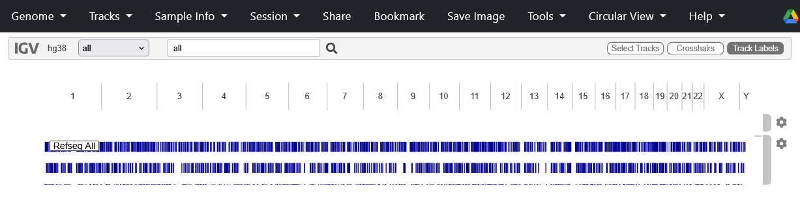{#fig-52}

## Viewing the Gene NF2

::: {.callout-note appearance="simple"}
7. Enter `NF2` in the search box and click enter to go to this gene. We can now see data for the whole gene as a coverage profile in the upper track and individual reads below.
:::

`NF2` is a tumour suppressor gene that regulates cell cycle, growth and differentiation. An inactivating germline mutation in exon 1 of SMARCB1 has been reported in patients with [NF2-related Schwannomatosis](https://doi.org/10.1016/j.spen.2024.101171). Schwannomas are mostly benign tumours involving schwann cells that myelinate the axons of nerve cells but can cause problems if the tumour compresses a nerve. There are several cases where people with schwannomatosis have developed hearing loss due to an acoustic neuroma, which is a schwannoma on the vestibular nerve in the brain that is involved in hearing.

{#fig-53}

::: {.callout-important}
What does the coverage look like? Are all exons equally captured?

Zoom in on an exon and get familiar with IGV and viewing the BAM file.
:::

## A Variant in NF2

::: {.callout-note appearance="simple"}
8. Enter the location `chr22:29,642,163` in the search box to focus on the data for a particular variant. You can now see the coloured bar consists of two colours representing the two alleles and their height corresponds with the allele frequency.
8. Right click and select sort alignments by base.
8. Mouse over the coverage track for the SNV at `chr22:29,642,163` and look at the information IGV displays.
:::

{#fig-54}

---

# Variant Calling

::: {.callout-note}
- **Software**
  - `freebayes`
  - `bcftools`

- **Input/Output**
  - `freebayes` input:
    - Filtered duplicate read marked BAM file
    - Reference Genome hg19 (fasta file, provided by galaxy)
  - `freebayes` output:
    - vcf file
  - `bcftools view` input: vcf file
  - `bcftools view` output: filtered vcf file
:::

Accurate and consistent variant calling requires statistical modelling and is essential for the clinical implementation of NGS. However, many programs are available for calling variants and their concordance varies. Furthermore, variants have different levels of confidence due to differences in data quality.

For variants with intermediate confidence levels, it is difficult to separate true variation from artefacts that arise from many factors such as sequencing error, misalignment and inaccurate base quality scores. As a result, the evidence for variant calls requires scrutiny and caution should be used when interpreting positive and negative findings especially for indels which are more error prone.

At the end of this exercise you will be able to:

1.  Use a state of the art software (`freebayes`) to call small variants
    (SNVs and indels)
2.  Describe the contents of variant call files
3.  Generate and interpret basic variant quality control parameters
4.  Use quality control filters to exclude or flag variants with low
    confidence

[Additional Reference](https://galaxyproject.org/learn/galaxy-ngs101/#finding-variants): Finding variants

## Freebayes

[Freebayes](https://github.com/freebayes/freebayes) is a Bayesian genetic variant detector designed to find small polymorphisms, specifically SNPs (single-nucleotide polymorphisms), indels (insertions and deletions), MNPs (multi-nucleotide polymorphisms), and complex events (composite insertion and substitution events) smaller than the length of a short-read sequencing alignment.

::: {.callout-note appearance="simple"}
1. In the Tool Panel select the `freebayes` tool.
1. Select `Dataset collection` as your data type, then select `Filter SAM or BAM, output SAM or BAM on collection 23: bam` as your data collection.
1. On the section `Using reference genome`, select `Human Dec. 2013 (GRch38/hg38)`.
1. Click on the `Run Tool` button to execute the analysis.
:::

{#fig-55}

`Freebayes` uses short-read alignments ([BAM](http://samtools.sourceforge.net/SAMv1.pdf) files with [Phred+33](http://en.wikipedia.org/wiki/Phred_quality_score) encoded quality scores, now standard) for any number of individuals from a population and a [reference genome](http://en.wikipedia.org/wiki/Reference_genome) (in [FASTA](http://en.wikipedia.org/wiki/FASTA_format) format) to determine the most-likely combination of genotypes for the population at each position in the reference. It reports positions which it finds putatively polymorphic in variant call file ([VCF](http://www.1000genomes.org/node/101)) format. It can also use an input set of variants (VCF) as a source of prior information, and a copy number variant map (BED) to define non-uniform ploidy variation across the samples under analysis.


## Viewing the VCF
::: {.callout-important}
View the VCF file created by freebayes and familiarise yourself with the variables by reading the comments in the header section.

This history panel shows: 7,044 variants and 516 comments (@fig-56).

The comments appear at the top of the VCF file (lines begin with a '#' character) and explain the format of the info and sample columns.
:::

{#fig-56}

`Freebayes` emits a standard VCFv4.2 output stream. This format is designed for the probabilistic description of allelic variants within a population of samples, but it is equally suited to describing the probability of variation in a single sample.

Of primary interest to most users is the `QUAL` field, which estimates the probability that the site is polymorphic (i.e. carries an alternate allele). In `freebayes`, this value can be understood as 1 - P(locus is homozygous reference, given the data). It is recommended that users use this value to filter their results, rather than accepting anything output by freebayes as ground truth.

{#fig-57}

## Filtering the VCF

By default, VCF records are output even if they have very low probability of variation, in expectation that the VCF will be filtered.

::: {.callout-note appearance="simple"}
1. In the Tool Panel select the `bcftools view VCF/BCF conversion` tool.
1. Select `Dataset collection` as your data type, then select `FreeBayes on collection 26 (variants)` as your data collection.
1. On the section `Restrict to`, add the following filtering expression to `Include`:
    `QUAL > 1 && QUAL/INFO/AO > 10 && SAF > 0 && SAR > 0 && RPR > 1 && RPL > 1`
1. Set the `output_type` to `uncompressed VCF`.
1. Click on the `Run Tool` button to execute the analysis.
:::

{#fig-58}

**The Freebayes Information Fields we used for filtering**

- `QUAL`    probability that there is a polymorphism at the loci described by the record: 1 - P(locus is homozygous given the data).
- `AO`      Alternate allele observations, with partial observations recorded fractionally.
- `SAF`     Number of alternate observations on the forward strand.
- `SAR`     Number of alternate observations on the reverse strand.
- `RPL`     Reads Placed Left: number of reads supporting the alternate balanced to the left (5') of the alternate allele.
- `RPR`     Reads Placed Right: number of reads supporting the alternate balanced to the right (3') of the alternate allele.

**What calls do we "know" are poor (w.r.t. freebayes VCFannotations)?**
1. Low-quality calls (QUAL < N)
  - Variants with low overall quality scores
  - Additionally, cases where QUAL is high but QUAL/AO (quality per observation) is low
2. Low read depth (DP < N)
  - Loci with insufficient sequencing coverage
3. Strand bias issues
  - AF > 0 & SAR > 0: Ensures alternate alleles are seen on BOTH forward and reverse strands
  - Removes variants only observed on one DNA strand (likely artifacts)
4. Read placement bias
  - RPL > 0 & RPR > 0: Ensures reads supporting the variant are balanced on both sides

**Suggested freebayes hard filters for diploid Humans**

`QUAL > 1 && QUAL/INFO/AO > 10 && SAF > 0 && SAR > 0 && RPR > 1 && RPL > 1`

- QUAL \> 1: removes horrible sites\
- QUAL / AO \> 10 : additional contribution of each obs should be 10 log
  units (\~ Q10 per read)\
- SAF \> 0 & SAR \> 0 : reads on both strands\
- RPR \> 1 & RPL \> 1 : at least two reads "balanced" to each side of
  the site

[Additional Reference](https://www.scribd.com/document/415209482/Erik-Garrison-Iowa-Talk-2): freebayes in depth: model, filtering, and walkthrough

::: {.callout-important}
Look at the filtered `vcf` file. How many variants are there after filtering?
:::

  Before                                                                After
  --------------------------------------------------------------------- ----------------------------------------------------------------
  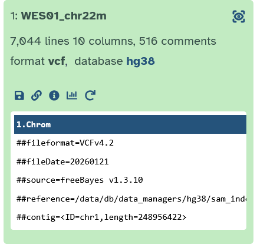{#fig-56}     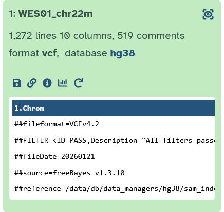{#fig-59}

---

# Variant Annotation and Prioritisation

::: {.callout-note}
- **Software**
  - `VEP` (Variant Effect Predictor)

- **Input/Output**
  - `VEP` input:
    - vcf file
    - annotation databases
  - `VEP` output:
    - annotated vcf file
    - text file with annotations
:::

At this point in the analysis of whole exome data from patient WES01, we have assessed the quality of raw sequence data, removed low quality reads, aligned sequence data to the reference genome, removed poorly mapped reads and duplicate reads, assessed the alignment process, called variants and evaluated variant calling. The aim of this practical is to complete the analysis of WES01 by annotating the variants and using a filtering strategy to generate a short-list of potentially pathogenic variants. At the end of this exercise you will be able to:

  1.  Use `VEP` to annotate variants with respect to genes, databases of normal variation, and predictors of pathogenicity
  2.  Apply basic variant filters to generate a list of candidate genes and likely causative variants
  3.  Use phenotype information to improve annotation, filtering and prioritisation of likely causative variants

## Annotating variants

The result of variant calling is a variant call file (VCF) which describes the location and data quality of each variant. However, the initial VCF file does not provide any information about the functional relevance of variants and their potential contribution to disease. To gain these insights we will use VEP (McLaren et al 2016)  to annotate each variant in the VCF file with respect to their location in relation to genes and coding sequences (exon, intron or intergenic), whether they change the coding sequence and if so how (missense, stop gain, synonymous, frameshift, amino acid consequence etc). In addition, we will cross reference the variants with databases of known variation (1000 genomes, dbSNP, Exome Sequencing Project and COSMIC) and predictions of functional significance (avsift and conservation scores).

At this stage, it is important to be aware that the annotation result will vary according to the choice of annotation software (alternative software: SnpEff Cingolani et al 2012; and ANNOVAR Wang et al 2010) and definition of transcripts (Ensemble Flicek et al 2012, RefSeq Pruitt et al 2012, Gencode Harrow et al 2012).

This variability occurs because a single variant may have different effects in different transcripts (isoforms of the gene) and in some cases may effect different genes (genes can overlap, one on forward strand the other on the reverse strand) each with multiple transcripts. It is also possible to interpret a single variant as having multiple effects on a single transcript.

The annotation software must therefore apply a set of rules to determine which variant takes precedence (see [here](http://annovar.openbioinformatics.org/en/latest/user-guide/gene/#output-file-2-refseq-gene-annotation) for the ANNOVAR precedence rules) but these rules vary between programs so that they generate different results.

For example, the overall agreement for Loss of Function (LoF) variants annotated by ANNOVAR and VEP is just 64% (McCarthy et al 2014: [Choice of transcripts and software has a large effect on variant annotation](https://doi.org/10.1186/gm543)).

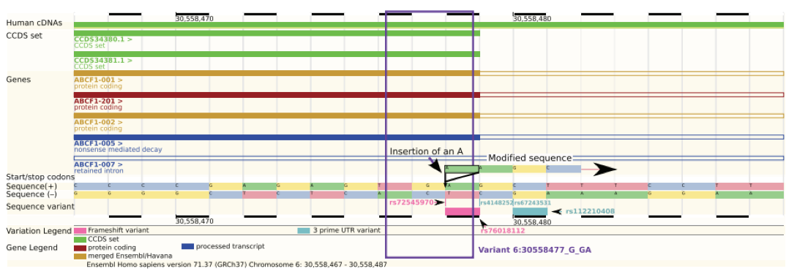{#fig-99}


The variant is an insertion of an A in a stop codon (TGA) in the penultimate base of the exon in all transcripts except one. It is possible to interpret this variant as a frameshift insertion or a stop-loss but it is actually a synonymous variant because the stop codon remains in the same place.

The choice of which transcript set to use for annotation has an even bigger effect on the annotation results. For example, the overlap between LoF variants is only 44% when the same software is used to annotate against transcripts from Ensembl or RefSeq (McCarthy et al 2014). This is because RefSeq transcripts are based on a collection of non-redundant mRNA models that have strong support and are manually curated.

As a result, the RefSeq database is highly accurate but does not contain all possible transcripts or gene models (n=41,501 transcripts from RefSeq release 57 that were used by ANNOVAR). In comparison, Ensembl provides a less curated but more comprehensive list of transcripts (n=115,901 transcripts from Ensembl version 69 that were
used by ANNOVAR) based on information from the Consensus Coding Sequence (CCDS, Pruitt et al 2009), Human and Vertebrate Analysis and Annotation (HAVANA), Vertebrate Genome Annotation (Vega, Ashurst et al 2005), ENCODE (The ENCODE Project Consortium 2012) and GENCODE (Searle et al 2010).

## VEP (Variant Effect Predictor)

[VEP](https://www.ensembl.org/vep) is a rapid, efficient tool to annotate functional consequences of genetic variation from high-throughput sequencing data. VEP also provides easy and intuitive web-based access to the most popular functionalities of the software.

`VEP` will annotate variants using specified gene annotations, regions, and filtering databases. Input is a VCF dataset, and output is a table of annotations for each variant in the VCF dataset or a VCF dataset with the annotations in INFO fields.

[VEP Website](https://www.ensembl.org/vep)

[Paper](https://doi.org/10.1186/s13059-016-0974-4)

[VEP Tutorial](http://www.ensembl.org/info/docs/tools/vep/script/vep_tutorial.html)

::: {.callout-note appearance="simple"}
1. In the Tool Panel select the `Predict variant effects with VEP` tool.
1. In the section `Select source of annotation data`, select `Any VEP cache file`.
1. Select `Dataset collection` as your data type, then select `bcftools view on dataset 51` as your data collection.
1. Select `Homo sapiens hg38 (V106)` as the cache file and `Human Dec. 2013 (GRch38/hg38)` as the reference genome.
:::


::: {.callout-note appearance="simple"}
4. On the section `Output options`, set the following options:
    - Output SIFT prediction - `Both`
    - Output PolyPhen prediction - `Both`
:::

{#fig-61}

::: {.callout-note appearance="simple"}
5. On the section `Identifiers`, enable the following `Identifier flags`:
    - Add HGVS nomenclature, both coding and protein sequence names, to the ouput (requires FASTA)
    - Add the gene symbol (e.g. HGNC) (where available) to the output
    - Add a flag indicating if the transcript is the canonical transcript for the gene
    - Add a flag indicating if the transcript is the MANE Select or MANE Plus Clinical transcript for the gene (only for hg38)
    - Output the biotype of the transcript or regulatory feature
6. On the section `Co-located variants`, enable the following `Co-located variants flags`:
    - Report all known clinical significance values at the given locus (instead of allele-specific)
    - Add the global allele frequency (AF) from 1000 Genomes Phase 3 data for any known co-located variant to the output (--af)
    - Report the highest allele frequency observed in any population from 1000 genomes, ESP or gnomAD
7. On the section `Filtering and QC options`, enable the following `Filtering and QC flags`:
    - Only return consequences that fall in the coding regions of transcripts
7. Click on the `Run Tool` button to execute the analysis.
:::

{#fig-62}

::: {.callout-note appearance="simple"}
6. On the section `Co-located variants`, enable the following `Co-located variants flags`:
    - Report all known clinical significance values at the given locus (instead of allele-specific)
    - Add the global allele frequency (AF) from 1000 Genomes Phase 3 data for any known co-located variant to the output (--af)
    - Report the highest allele frequency observed in any population from 1000 genomes, ESP or gnomAD
7. On the section `Filtering and QC options`, enable the following `Filtering and QC flags`:
    - Only return consequences that fall in the coding regions of transcripts
7. Click on the `Run Tool` button to execute the analysis.
:::

{#fig-63}

### Variant Effect Prediction algorithms
::: {.callout-tip}
If you're running out of time to finish the workshop you can read the section below in your own time and skip to the last section on [how to create a workflow](#sharing-and-publishing-your-work).
:::

[Reference](https://www.ensembl.org/info/docs/tools/vep/online/input.html#prediction)

Below you can see outlined different prediction algorithms used by variant prediction software.

**SIFT predictions** SIFT predicts whether an amino acid substitution affects protein function based on sequence homology and the physical properties of amino acids. Only available in popular species. For both SIFT and PolyPhen Ensembl VEP can report either a score between 0 and 1, a prediction in words, or both.

**Polyphen-2** Polyphen-2 predicts the impact of an amino acid substitution on the structure and function of a protein. Predictions are based on features that characterise the substitution including the sequence (does the substitution occur within an annotated site in the protein e.g. active or binding site, non-globular region such as trans-membrane etc), phylogenetics (how often does the substitution occur in a family of related proteins) and structural information (could the substitution affect the proteins 3D structure e.g. hydrophobic core, electrostatic interactions, interactions with ligands or other important features). These features are assessed by a probabilistic classifier. Two versions of Polyphen are available, HDIV and HVAR, that used different datasets to train and test the prediction models. HDIV should be used for evaluating rare alleles involved in complex phenotypes where both disease causing and mildly deleterious alleles are treated as damaging. The HDIV dataset consists of all damaging alleles in the UniProtKb database that effect molecular function and cause human Mendelian diseases versus differences between human proteins and their closely related mammalian homologues which are assumed to be non-damaging.

**HVAR** should be used for diagnostics of Mendelian diseases which requires distinction between mutations with diagnostic effects from all remaining human variation, including a wealth of mildly deleterious alleles. The HVAR dataset used to train and test Polyphen consisted of all human disease causing mutations from UniProtKb together with common human non-synonymous SNPs (MAF\>1%) without annotated involvement in disease which were treated as non-damaging.

**LRT score** Likelihood ratio test (LRT) for prediction of significantly conserved amino acid positions within the human proteome. Mutations are estimated as 'deleterious' that disrupt highly conserved aminoacid residues, 'neutral' or 'unknown'.

**Mutation Taster** MutationTaster uses a Bayes classifier to predict the disease potential of an alteration. For this prediction, the frequencies of all single features for known disease mutations/polymorphisms were studied in a large training set composed of \>390,000 known disease mutations from HGMD Professional and \>6,800,000 harmless SNPs and Indel polymorphisms from the 1000 Genomes Project.

**Mutation Assessor** Mutation assessor scores estimate functional impact based on evolutionary conservation of the affected amino acids in protein homologs. The method has been validated on a large set (60k) of disease associated (OMIM) and polymorphic variants.

**FATHMM score** Functional Analysis through Hidden Markov Models. Predicts the functional effects of protein missense mutations by combining sequence conservation within hidden Markov models (HMMs), representing the alignment of homologous sequences and conserved protein domains, with "pathogenicity weights", representing the overall tolerance of the protein/domain to mutations.

**RadialSVM** Support vector machine (SVM) based ensemble prediction score, which incorporates 10 scores (SIFT, PolyPhen-2 HDIV, PolyPhen-2 HVAR, GERP++, MutationTaster, Mutation Assessor, FATHMM, LRT, SiPhy, PhyloP) and the maximum frequency observed in the 1000 genomes populations. Larger value means the SNV is more likely to be damaging. Scores range from -2 to 3 in dbNSFP.

**LR score** LR scores evaluate the deleteriousness of missense mutations by using logistic regression to integrate information from:

1. function prediction scores (PolyPhen-2, SIFT, MutationTaster, Mutation Assessor, FATHMM, LRT, PANTHER, PhD-SNP, SNAP, SNPs&GO, and MutPred)
1. conservation scores (GERP++, SiPhy and PhyloP)
1. ensemble scores (CADD, PON-P, KGGSeq and CONDEL)
1. maximum minor allele frequency

**VEST3 score** Variant Effect Scoring Tool (VEST) is a supervised machine learning-based classifier for prioritisation of rare missense variants with likely involvement in human disease. The VEST classifier training set comprised \~ 45,000 disease mutations from the latest Human Gene Mutation Database release and another \~45,000 high frequency (allele frequency \>1%) putatively neutral missense variants from the Exome Sequencing Project. VEST estimates variant score p-values against a null distribution of VEST scores for neutral variants not included in the VEST training set. These p-values can be aggregated at the gene level across multiple disease exomes to rank genes for probable disease involvement.

**CADD raw** Combined Annotation Dependent Depletion (CADD) is a framework that integrates multiple annotations into one metric by contrasting variants that survived natural selection (differences between 1000 Genomes and the Ensembl Compara inferred human-chimpanzee ancestral genome) with simulated mutations. Raw CADD scores come straight from the model and have no absolute unit of meaning and are incomparable across distinct annotation combinations, training sets, or model parameters. However, raw values have relative meaning with larger scores indicating that a variant is more likely to have a damaging effect.

**CADD phred**
Phred CADD scores are ranked scores based on the whole genome CADD raw scores. For example, variants at the 10th-% of raw CADD scores are assigned to CADD-10, top 1% to CADD-20, top 0.1% to CADD-30, etc. The results of this transformation are Phred-like scaled CADD scores.

**Genomic Evolutionary Rate** Profiling Rejected Substitution scores (GERP RS). GERP identifies constrained elements in multiple alignments by quantifying substitution deficits for SNPs. Scores range from -12.3 to 6.17, with 6.17 being the most conserved. Scores greater than 2 provide a high sensitivity while still strongly enriched for truly constrained sites.

**PhyloP46way placental** Phylogenetic conservation score based on a multiple alignment of 46 vertebrate genomes (10 primates, 33 placental mammals).

**PhyloP100way vertebrate** Phylogenetic conservation score based on a multiple alignment of 100 vertebrate genomes.

**SiPhy 29way logOdds** The estimated stationary distribution of A, C, G and T at the site, using SiPhy algorithm based on 29 mammals genomes.

## Filtering and Prioritisation of variants

There are many ways to filter the variants. One of the most common strategies is to select coding variants that are either rare or absent from databases of known variation such as [1000 Genomes](https://www.internationalgenome.org/) and [gnomAD](https://gnomad.broadinstitute.org) and predicted to be damaging by in-silico tools.

::: {.callout-note appearance="simple"}
1. In the Tool Panel select the `bcftools split-vep` tool.
1. Select `Dataset collection` as your data type, then select `Predict variant effects on collection 52` as your data collection.
1. On the section `Select INFO annotation to parse`, insert `CSQ`.
1. On the section `Enter fields to be extracted, listed either as indexes or names`, insert `-` (a single dash). This tells `bcftools` to split all `VEP`-generated fields existent in the `vcf` file.
1. On the section `Enter prefix of INFO annotations to be created after splitting the CSQ string (optional)`, insert `VEP_`.
1. On the section `Select transcripts to extract by type and/or consequence (optional)`, insert `worst`. This automatically picks the single most severe consequence for each variant (e.g., prioritizes Missense over Intronic), which is essential for prioritising variants.
1. Set the `output_type` to `uncompressed VCF`.
1. Click on the `Run Tool` button to execute the analysis.
:::

{#fig-64}

Now let's convert the vcf file into a tabular format, so it is easier to read.

::: {.callout-note appearance="simple"}
1. In the Tool Panel select the `bcftools query` tool.
1. Select `Dataset collection` as your data type, then select `bcftools split-vep on collection 65` as your data collection.
1. On the section `Query options`, insert the query below on `Format for Output`.

    <pre style="white-space:pre-wrap; word-break:break-word; overflow-wrap:anywhere;">
    %CHROM\t%POS\t%VEP_SYMBOL\t%VEP_Feature\t%VEP_HGVSc\t%VEP_HGVSp\t%VEP_Consequence\t%VEP_IMPACT\t%VEP_CLIN_SIG\t%VEP_Existing_variation\t%VEP_AF\t%VEP_MAX_AF\t%VEP_PolyPhen\t%VEP_SIFT\t%VEP_CANONICAL\t%VEP_MANE_SELECT\n
    </pre>

1. Enable `Output is tab-delimited`.
1. Click on the `Run Tool` button to execute the analysis.
:::

{#fig-66}

Here is a breakdown of what each column represents in your output file.

| Col | Field | Description |
|-----:|:------|:------------|
| 1 | CHROM | Chromosome name (e.g., `chr1`, `X`). |
| 2 | POS | Genomic coordinate (1‑based position). |
| 3 | VEP_SYMBOL | Official gene symbol (HGNC), e.g., `BRCA1`, `TP53`. |
| 4 | VEP_Feature | Transcript ID (usually Ensembl `ENST…`); `-s worst` shows the most severe transcript. |
| 5 | VEP_HGVSc | Coding DNA change (e.g., `c.152A>G`). |
| 6 | VEP_HGVSp | Protein change (e.g., `p.Lys51Arg` or `p.L51R`); empty if non-coding. |
| 7 | VEP_Consequence | Consequence type (e.g., `missense_variant`, `stop_gained`). |
| 8 | VEP_IMPACT | VEP severity: `HIGH`, `MODERATE`, `LOW`, `MODIFIER`. |
| 9 | VEP_CLIN_SIG | ClinVar significance (`pathogenic`, `likely_pathogenic`, `benign`, etc.). |
| 10 | VEP_Existing_variation | dbSNP rsID (e.g., `rs12345`). |
| 11 | VEP_AF | Global allele frequency (from 1000 Genomes). |
| 12 | VEP_MAX_AF | Max allele frequency across subpopulations (important to validate rarity). |
| 13 | VEP_PolyPhen | PolyPhen prediction (`probably_damaging`, `possibly_damaging`, `benign`). |
| 14 | VEP_SIFT | SIFT prediction (`deleterious` or `tolerated`). |
| 15 | VEP_CANONICAL | `YES` if the transcript is Ensembl canonical. |
| 16 | VEP_MANE_SELECT | MANE Select transcript (e.g., `NM_` number) if available. |

## Solving the Case Study

The sequence data that you will be analysing is from a 3-year-old male who presented with difficulty walking after the first year of life, followed by muscle wasting and weakness, muscle rigidity, developmental delay, progressive vision loss leading to blindness, seizures, impaired swallowing, paralysis, and cognitive decline.

A brain MRI scan showed a "tigroid" (leopard‑skin) pattern within the deep white matter. Further clinical testing suggested a diagnosis of [Metachromatic leukodystrophy](https://medlineplus.gov/genetics/condition/metachromatic-leukodystrophy/) (MLD, also called Arylsulfatase A deficiency), which is a lysosomal storage disease commonly listed in the family of leukodystrophies as well as among the sphingolipidoses as it affects the metabolism of sphingolipids.

::: {.callout-important}
Based on the patients phenotypes and clinical diagnosis, which of the variants in your report do you think is the causative mutation?

The 1000 Genomes database is relatively small. Enter the [gnomAD](https://gnomad.broadinstitute.org/) and validate how rare the variant you chose is on this database.

Can you find this variant on [ClinVar](https://www.ncbi.nlm.nih.gov/clinvar)? NM_000487.6(ARSA):c.346C>T (p.Arg116Ter)?

For the causal variant use the VCF file from Freebayes and look at the Quality score and other fields used for filtering.

If you didn't have detailed phenotype information and/or the diagnosis, would you have come to the same conclusion?
:::

## View the ARSA chr22:50627285 stop gain SNV on IGV

::: {.callout-note appearance="simple"}
1. Download the bam file `Download dataset` and bam index `Download bam_index`
1. Download the Freebayes vcf file
1. Upload them to IGV
:::

{#fig-67}

::: {.callout-note appearance="simple"}
1. View the chr22:50627285 variant on IGV
:::

{#fig-68}

---

# Reporting with MultiQC

`MultiQC` collates outputs from the QC and alignment tools used in this workflow (falco, fastp, Picard, samtools, mosdepth, etc.) into a single interactive HTML report. Use `MultiQC` to summarise key metrics, and produce a concise, shareable QC overview for reports and presentations.

::: {.callout-note appearance="simple"}
1. In the Tool Panel select the `MultiQC` tool.
1. For the option `Which tool was used generate logs?` select the relevant tools we used in this workflow. Some tools you also need to select the `Type of output`. Add as many Results sections as needed with the `Insert Results` button until you have added the following reports:
  - `FastQC`
    - Raw data
  - `fastp`
    - JSON report
  - `samtools`
    - `flagstat`
    - `idxstats`
  - `Picard`
    - `Markdups`
    - `Insert size`
1. Add the relevant metrics files to each section.
1. Click on the `Run Tool` button to execute the analysis.
:::

{#fig-69}

Explore the MultiQC report you just generated. Open the HTML report in a web browser and interact with the plots and tables:

- Hover plots for tooltips, click legend entries to hide/show series, and use the search/filter boxes to focus on metrics.
- Export tables as CSV (use the export button) and take screenshots of any plots or warnings you plan to discuss.

---

# Sharing and publishing your work
::: {.callout-important}
For part of the assessment, you will share your history and workflows with the examiner by submitting them as web links in your NGS report.
:::

We will now learn how to share your current history and workflows.

## Create and apply a workflow from your Galaxy history

Please work through and read the Galaxy Guide on how to create a workflow: [Creating Workflows and Advanced Workflow Options](https://galaxyproject.org/learn/advanced-workflow/)

Reproducing an experiment on the same data or different datasets and comparing the results is a key feature of research that requires keeping a meticulous set of instructions. In many cases, multiple replicates are required and the best approach is an automated analysis that is consistent and less error prone. In Galaxy, the history acts as a detailed list of experimental instructions that can be reproduced and automated by creating a 'Workflow' or bioinformatic pipeline.

::: {.callout-important}
Before making your workflow delete any unwanted steps from the history so that it only includes the steps needed to make the final result.
:::

::: {.callout-note appearance="simple"}
1.  Go to the History panel, click the `History Options ≡`  and select `Extract workflow`.
:::

{#fig-70}

See [Extract Workflow from a History](https://wiki.galaxyproject.org/Learn/AdvancedWorkflow/Extract) and follow the instructions there.

::: {.callout-note appearance="simple"}
Name your workflow : `Alignment_Variant_Calling_and_Filtering-v0.1` (or something similar, maybe add your initials).
:::

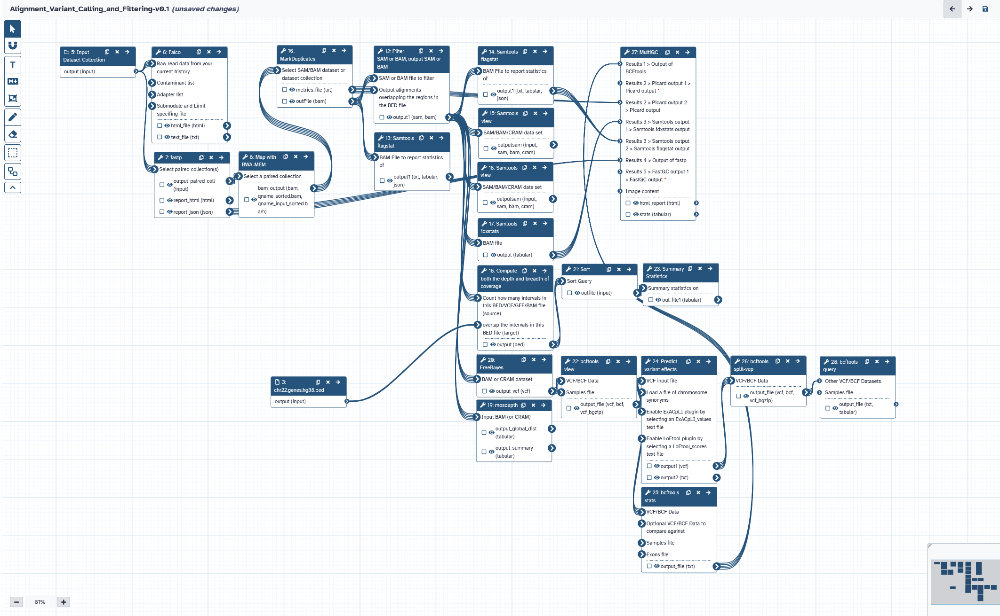{#fig-71}

## Running workflows

Now that you have made a workflow/bioinformatic pipeline you can apply the whole process to a new dataset with just a few clicks. Try your workflow on the original fastq files.

::: {.callout-note appearance="simple"}
1.  In the history panel click the cog icon and select 'Create New' to make a new history.

2.  Before running the workflows, we need to put the raw data files into the new history. You can do this by uploading or copying the data from an existing dataset. We will copy the input files by clicking the cog icon and selecting 'Copy Datasets'

3.  Select 'WES01 NGS Workshop' as the source history and the new 'Unnamed history' as the destination.

4.  Check the boxes for the 2 inputs that we need:
    1. `WES01 fastq` file collection
    2. `chr22.genes.hg38.bed` target `bed` file

5.  Click on `Copy History Items`.

6.  Click the workflow tab then click your `‘Alignment_Variant_Calling_and_Filtering’` workflow and select run from the drop down menu.

7.  Now choose the relevant input files and click 'Run workflow' to analyse the data.
:::

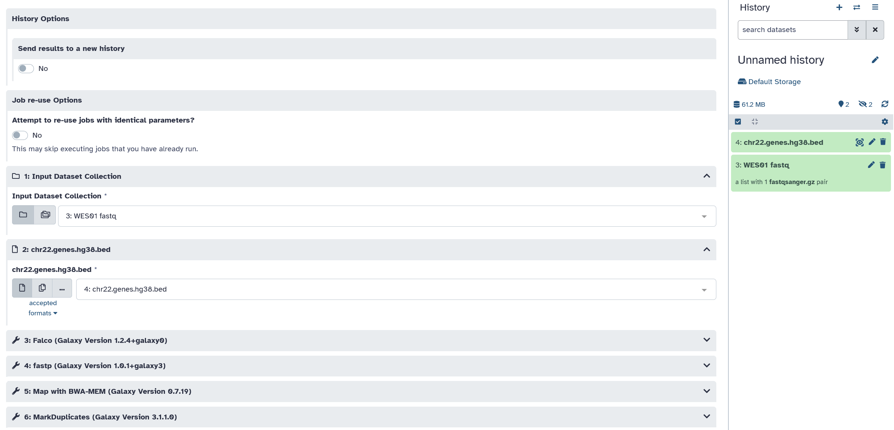{#fig-72}

::: {.callout-note appearance="simple"}
8. When the workflow has finished view the output and check that the result matches your original analysis.
:::

## Sharing Galaxy Histories and Workflows

::: {.callout-important}
1. To share your history, click the `History Options` and select `Share & Manage Access`.
:::

{#fig-70}

::: {.callout-important}
2. Enable `Make History Accessible`. This will generate a link that you can share with others so they can import your history into their Galaxy account.
:::

{#fig-73}

::: {.callout-important}
4. To share your workflow, click the workflow tab, then click your workflow and select 'Share or Download' from the drop down menu.
:::

{#fig-74}


::: {.callout-important}
5. Click 'Make workflow Accessible via Link' to generate a web link that can be used by others to import your workflow and apply it to their own data.
:::

{#fig-75}

------------------------------------------------------------------------
# Acknowledgments

Based on a workshop produced by Will Tapper, University of Southampton, and Stephen Newhouse, King's College London (2016)
